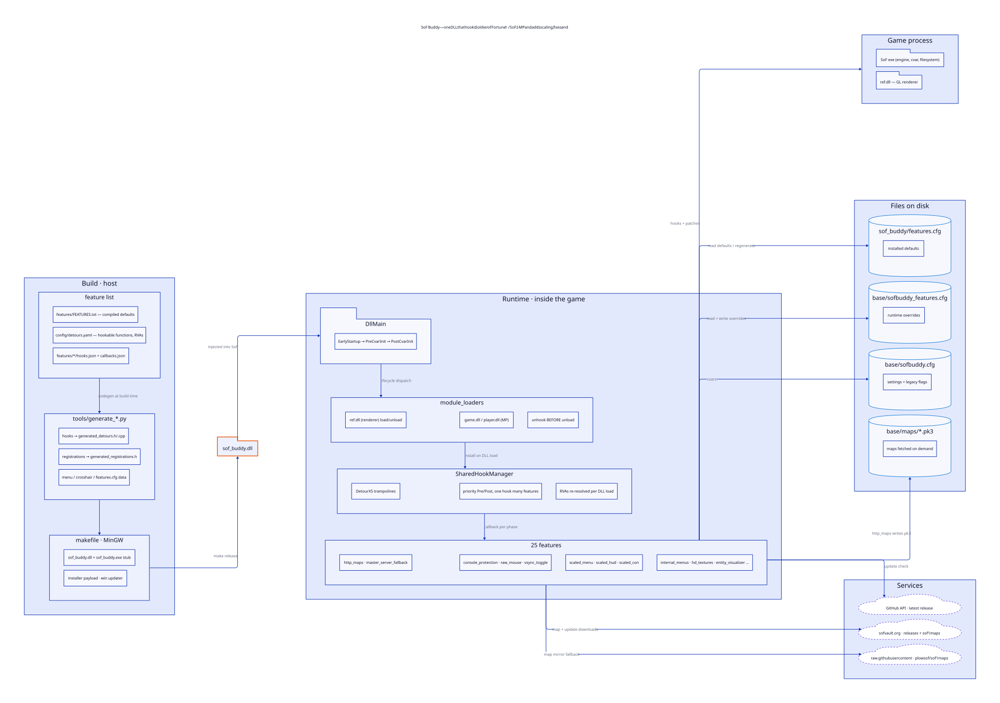

# SoF Buddy — for humans

> One DLL, injected into Soldier of Fortune 1, that hooks the engine and adds scaling, fixes and menus.

Read it left to right:

- **Build · host** — `FEATURES.txt` and `detours.yaml` are the spec; `tools/generate_*.py` turns them into `generated_detours.*` / `generated_registrations.*` at build time. Nothing hook-related is hand-written in the DLL.
- **Runtime · inside the game** — `DllMain` runs three lifecycle phases, `module_loaders` re-installs hooks whenever `ref.dll` / `game.dll` / `player.dll` load, and `SharedHookManager` lets many features share one detour. Hooks are removed *before* a DLL unloads.
- **Files on disk** — `sof_buddy/features.cfg` is the installed default set; `base/sofbuddy_features.cfg` is what the player toggled at runtime. Overrides never rewrite the defaults.
- **Services** — update checks hit GitHub and sofvault.org; `http_maps` fetches missing maps on demand.

Source: [`docs/system.d2`](docs/system.d2). Edit that, then run `scripts/render-diagram.sh`.
