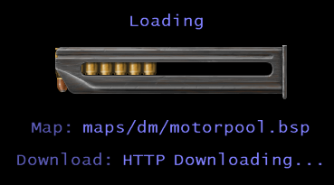
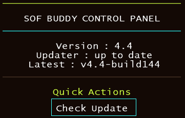

# SoF Buddy 🚀

<p align="center">
  <a href="LICENSE"></a>
  <a href="https://github.com/d3nd3/sof_buddy/releases"></a>
  <a href="https://discord.gg/zZjnsRKPEJ"></a>
  
  
</p>

> **Suggestions, criticisms, and issues are highly encouraged.** Please [open a GitHub issue](https://github.com/d3nd3/sof_buddy/issues), reply on a release, or reach out on [Discord](https://discord.gg/zZjnsRKPEJ) — feedback directly drives what gets fixed and built next.




> **A modern enhancement suite for Soldier of Fortune 1 — scaling, fixes, and quality-of-life improvements.**

---

## SoF 1 — Soldier of Fortune

### ⚠️ **#1 THING YOU NEED TO KNOW**

**Press `F12` in-game** (or bind a key to `sofbuddy_menu sof_buddy`). That opens the SoF Buddy menu — settings, updater, profiles, and everything else. **Do this first.** If you don’t, you’re missing the main way to use SoF Buddy. Press F12 again on a SoF Buddy page to close the whole menu.

---

## ✨ Features

<details open>
<summary><b>Click to expand</b></summary>

- 🎯 **One menu for everything** — Press **F12** for settings, profiles, updates, links, and diagnostics. No console required.
- ✨ **Crisp at any resolution** — Fonts, HUD, console, intros, cinematics, and the **entire menu system** scale cleanly from 640×480 to 4K and ultrawide, with per-element scale sliders and Integer/Smooth modes.
- 🧭 **Menu Scaling, rebuilt** — Stock and F12 menus stay sharp and readable at high resolutions. The redesigned F12 menu has adaptive tabs, a fixed nav bar, a comfortable widescreen reading column, themes, and readable font/tooltip presets.
- 🎯 **Crosshair studio** — Stock and community crosshair packs with live preview, tint, size control, and optional auto-scaling.
- ⚡ **Smoother framerate** — Fine-grained singleplayer FPS caps, including exact integer targets, with improved timing and CPU-friendly pacing.
- 🔇 **Clean Alt-Tab** — Sounds started while the game was in the background no longer stack up and play all at once when you return.
- 🔎 **Faster cvars & commands** — Hash-map lookups replace the engine's linked-list scans for cvars, commands, and aliases; especially noticeable with script-heavy SoF Plus setups.
- 🖱️ **Raw mouse input** — Direct hardware input without Windows acceleration; your existing sensitivity settings still work.
- 🏷️ **Widescreen fixes** — Team icons and player names stay correctly positioned and scale with your HUD, and the sniper scope keeps its 4:3 shape with the magnification readout scaled to match.
- 🖼️ **HD textures & extended skins** — High-resolution texture support plus extra multiplayer player models.
- 🌙 **Better lighting** — Q3/Daikatana-style overbright lightmaps that work with multitexture on or off, an 11-point lightmap tone curve (2x Linear, 4x Linear, Soft Glow, High Contrast, Deep Shadows, Film Slope, Cliff Edge, Bright Punch, and Midnight presets), separate **Overbright Pre-Curve** profiles (Popping mid+highlight (default), Late highlights, Popping highlights, Preserve Darks only, 2x everything, Custom), optional map lighting normalization, and optional smooth light-style interpolation. The Lighting tab opens the live side panel with every lighting control in one place, so changes can be judged while the world stays visible.
- 🌐 **Multiplayer quality of life** — HTTP map downloads, a GameSpy master selector with known-host fallback, and faster server setup.
- ⬆️ **In-game updater** — Check, download, and install releases without leaving the game; choose the stable master channel or unstable prerelease builds, get an optional startup prompt, and (in the graphical updater) merge new recommended feature defaults while keeping explicit overrides.
- 🎮 **One-click Windows installer** — Installs SoF Buddy and can optionally set up the official SoF Plus client, with automatic CD/GOG detection.
- 🛡️ **Rock-solid compatibility** — Console crash fixes, large-config handling, Windows XP builds, and Wine/Proton support.
- 📚 **Learn more** — Feature guides live under `src/features/`; start with `scaled_menu/`, `internal_menus/`, and `more_crosshairs/`.


</details>

---

## 🚀 Installation

<details>
<summary><b>Click to expand</b></summary>

### Recommended: Windows installer (easiest)

For Windows, the installer is the most effortless way to install SoF Buddy: it installs the
universal DLL, lets you choose features, and writes the runtime selection for you. No manual
extraction or feature-enable scripts are needed.

1. [Download the latest Windows installer](https://github.com/d3nd3/sof_buddy/releases) (`sof_buddy_setup_v<version>.exe`).
2. Run it and select the SoF folder containing `SoF.exe`.
3. Keep **Recommended feature set** or choose **Custom feature selection**, then finish setup. Setup reselects the Recommended feature set on upgrades instead of reusing an older custom/disabled selection.
4. Setup automatically enables SoF Buddy and saves the original as `SoF.exe.bak`.
5. Launch SoF.

> **Antivirus note:** The Windows installer is unsigned, and Microsoft Defender's
> machine-learning heuristic can occasionally flag it as
> `Trojan:Win32/Wacatac!ml`. This is a false positive: the installer only contains
> files from this repository (the SoF Buddy DLL, updater, scripts, and menu
> assets). If Defender blocks it, download `release_windows_universal.zip` instead
> and use the manual installation steps below. You can also report the file as a
> false positive at <https://www.microsoft.com/en-us/wdsi/filesubmission>.

### Manual installation (Windows/Linux/Wine)

#### 1. Get SoF Buddy

- **Option A:** [Download a pre-compiled release](https://github.com/d3nd3/sof_buddy/releases)
- **Option B:** Compile from source:
  ```sh
  make               # Release + universal DLLs and the Windows updater
  make xp            # Windows XP-targeted build
  make debug         # Debug build (with logging)
  make xp-debug      # XP-targeted debug build
  make debug-collect # Debug build with func_parents collection
  ```

### 2. Prepare Your Game Folder

- **Recommended:** Delete your `User/config.cfg` for optimal defaults.
- Extract the release `.zip` directly into your SoF root (where `SoF.exe` lives). It contains:
  - `sof_buddy.dll` (goes in the SoF root)
  - `sof_buddy/` folder (created under the SoF root)
    - `sof_buddy/funcmaps/` (contains JSON function maps)
    - `sof_buddy/*.pak` — `sndrstfindimage.pak` (silences `GL_FindImage` spam after `snd_restart`), `extended_skins.pak` (multiplayer skins; credit Acadie)
    - Windows: `sof_buddy/enable_*.cmd` scripts and `sof_buddy/patch_sof_binary.ps1`
    - Linux/Wine: `sof_buddy/enable_*.sh` scripts and `sof_buddy/patch_sof_binary.sh`
- Use the helper scripts to patch SoF.exe to load different DLLs:
  - **`enable_sofplus_and_buddy.cmd`** → Loads `sof_buddy.dll` (recommended: SoF Buddy + optional SoF Plus)
  - **`enable_sofplus.cmd`** → Loads `spcl.dll` (SoF Plus only, disables SoF Buddy)
  - **`enable_vanilla.cmd`** → Loads `WSOCK32.dll` (vanilla SoF, no mods)
  - **`sof_buddy_update.exe`** → Graphical Windows updater (universal channel / installer only): progress bar and release notes
  - **`update_from_zip.cmd`** → Standard Windows update path (all channels): extract downloaded zip (`sof_buddy/update/*.zip`) into SoF root
- SoF Buddy auto-loads `spcl.dll` if present, so it works *with* SoF Plus.

### Windows installer features

See [WINDOWS_INSTALLER.md](docs/WINDOWS_INSTALLER.md) for the complete packaging,
runtime-selection, and updater behavior.
See [FEATURES_FLOW.md](docs/FEATURES_FLOW.md) for feature-file ownership, startup
load order, reset behavior, and updater handling.

The Windows installer uses one universal DLL and writes the selected features to
`sof_buddy/features.cfg`; it does not compile a custom DLL for each installation.
GitHub publishes that universal channel separately as
`release_windows_universal.zip`; `release_windows.zip` remains the
compile-time/default channel, and the updater keeps those channels separate.
Its initial selections are generated from `features/FEATURES.txt`. The file can be
edited later (`feature` enables it, `// feature` disables it); restart SoF after changes.
If `features.cfg` is missing, the universal DLL falls back to those same defaults.
The F12 **Features** tab exposes the same choices at runtime as archived
`_sofbuddy_feature_<name>` cvars. Changing a setting whose feature is disabled
opens a **Feature Required** prompt with a shortcut to the Features tab instead
of silently doing nothing. Changes are written to `base/sofbuddy_features.cfg`,
shown as **Unavailable** when the installed non-universal DLL does not contain a
feature, and take effect after restarting SoF. On startup, those saved selections
override the installed `sof_buddy/features.cfg`; the installed file is treated as
the default set and is not overwritten by runtime toggles. Deleting
`base/sofbuddy_features.cfg` therefore falls back to the installed defaults (or
the compiled defaults when `features.cfg` is missing or was auto-generated).
The installer and updater offer **Reset feature toggles** separately from the
normal settings reset, for users expecting a newly added feature.
It also offers a **Select Additional Tasks** page with **Optional installation
options**. After you pick the game directory, Setup probes `SoF.exe` and
pre-checks the first two tasks when they still make sense for your retail build;
**Install SoF Plus client** is off by default, and is only pre-ticked when the
chosen folder already contains a SoF Plus client (`spcl.dll` or `SofPlus.dll`).

- **[OPTIONAL] Apply Windows 10+ Application Compatibility fix** — For a
  recognized `SoF.exe`, applies the same PE change GOG uses so the game behaves
  under Windows 10+ application compatibility. The original is saved as
  `SoF.exe.sofbuddy.bak`. Unrecognized executables are not modified. Skipped
  when the KB4571756 Raven-string fix is already present on the executable.

- **[OPTIONAL] Unlock full violence** — Recommended when you are not using
  SoFPlus's `spcl.dll`. Password, volume serial, and `-cs` key are optional.
  The installer sets SoF parental-control values for the volume that contains
  the chosen game folder, for the current Windows user only. Uninstalling SoF
  Buddy does not remove those per-user settings.

- **[OPTIONAL] Expecting a new feature? Reset feature toggles** — Shown only
  when an existing SoF Buddy install is detected. Clears saved feature toggles
  (`base/sofbuddy_features.cfg` and legacy feature lines) while keeping normal
  SoF Buddy settings, then uses the features selected in the installer.
  The graphical updater and update scripts offer the same reset separately from
  **fresh settings**.

- **[OPTIONAL] Install SoF Plus client (20140531)** — Bundles all four retail
  patch kits (`cd`, `gog`, `cd-kb4571756`, `gog-kb4571756`); Setup selects one
  from your `SoF.exe`, runs `sofplus-patch.exe`, and then enables
  `enable_sofplus_and_buddy` so `sof_buddy.dll` loads `spcl.dll` when present.
  Full detection rules: [WINDOWS_INSTALLER.md](docs/WINDOWS_INSTALLER.md#sof-plus-client-20140531).

</details>

---

## 🕹️ Usage

<details>
<summary><b>Click to expand</b></summary>

### Enable SoF Buddy (Recommended)

- **Windows:** Run `sof_buddy/enable_sofplus_and_buddy.cmd`
- **Linux/Wine:** Run `sof_buddy/enable_sofplus_and_buddy.sh`
- This enables SoF Buddy and optionally loads SoF Plus (if `spcl.dll` is present)
- To apply a downloaded update zip, run:
  - **Windows universal / installer:** `sof_buddy/sof_buddy_update.exe` (or `update_from_zip.cmd`)
  - **Windows compile-time channel:** `sof_buddy/update_from_zip.cmd` only
  - **Linux/Wine:** `sof_buddy/update_from_zip.sh`
  - Put `--reset-features` before the optional zip path to reset only saved
    feature toggles for a newly added feature; use `--fresh-settings` to remove
    `sofbuddy.cfg`. Scripts also accept
    `SOFBUDDY_UPDATER_RESET_FEATURES=1` / `SOFBUDDY_UPDATER_FRESH=1`.

### Enable SoF Plus Only

- **Windows:** Run `sof_buddy/enable_sofplus.cmd`
- **Linux/Wine:** Run `sof_buddy/enable_sofplus.sh`
- This disables SoF Buddy and uses only SoF Plus

### Restore Vanilla SoF

- **Windows:** Run `sof_buddy/enable_vanilla.cmd`
- **Linux/Wine:** Run `sof_buddy/enable_vanilla.sh`
- This removes all mods and restores the original game

### In-Game Commands

- **`F12`** (or `bind <key> sofbuddy_menu sof_buddy`) — **Open the SoF Buddy menu. Use this. It’s the main entry point for all settings, updater, and profiles.** Set an additional shortcut from **F12 → General → Bonus menu key**; F12 remains available. Under **UI Scale**: each scale has an integer percentage slider (**0%** = 1×, **100%** = the vertical resolution max; scale sliders commit on mouse release, and the menu-scale slider reparses the open page at the new scale) and a **Reset to default** button. **Restore Scaling Defaults** resets the font, HUD, and menu percentages and computed scales together, so switching between Smooth and Integer does not bring old values back. The percentage is saved and reapplied after startup and resolution/video changes. **Scaling Mode** selects **Smooth** (integer-prescaled cached textures for HUD/crosshair/scoreboard images; 0% = 1×, 100% = the vertical max, linear in between, with sub-2× results rounded to the nearest integer; if the vertical max is below 2×, Smooth stays at 1×) or **Integer** (integer slider; floors font/HUD/menu/crosshair scales to 1×, 2×, 3×…). **Cinematic Images Rounding** and **Scale Cinematic Images** are on the same page.
- `sofbuddy_close_menu` — Close every open SoF Buddy page and return to the game.
- `sofbuddy_list_features` — Print compiled features (and whether they are on/off).
- `sofbuddy_lighting_status` — Print the active lighting preset, blend factors, colour mode, normalization state, and custom curve values.
- `sofbuddy_lighting_rebuild` — Re-upload the current map's lightmaps with the active curve (also available as a button in F12 → Lighting).
- `sofbuddy_lighting_curve_template <alias>` — Write a built-in curve template into the 11 slider cvars, select Preserve brightness, and switch to Custom.
- `sofbuddy_lighting_curve_templates` — List the curve-template aliases.
- `sofbuddy_lighting_curve_reset` — Reset the custom 11-point curve to linear (`0,10,...,100`), also available as **Reset Curve** in the Tone Curve live editor (F12 → Lighting).
- `sofbuddy_lighting_reset` — Reset the SoF Buddy lighting defaults (curve, overbright, pre-curve, colour mode, normalization, cutoff, shiny, Ghoul minimum), also available as **Reset SoF Buddy Lighting** in F12 → Lighting.
- `sofbuddy_menu <name>` — Open an embedded internal menu page (examples: `loading`, `sof_buddy`).
- `sofbuddy_menu <menu>/<page>` — Open a specific embedded page (e.g. `sofbuddy_menu sof_buddy/cpu`).
- `sofbuddy_apply_vid_mode` — Apply the resolution staged in F12 → Graphics (runs `vid_restart` and reopens the Graphics page).
- `menu_wide <menu> [frame]` — Open a menu with the 4:3→wide frame correction forced. Plain `menu` leaves loose user menus under `User/menus`/`base/menus` at their authored frame geometry; stock pak menus keep the correction either way.
- `sofbuddy_apply_profile` — Apply the profile selected by `_sofbuddy_perf_profile` (`0` Competitive, `1` High Visual, `2` Low Visual, `3` Custom/Current).
- `sofbuddy_update` — Check the selected channel/tag from the configured update feed and compare with your current version.
- `sofbuddy_update stable` / `sofbuddy_update unstable` — Select the stable master channel or the unstable prerelease channel and open the install prompt.
- `sofbuddy_update releases` — Refresh the installable release-tag list.
- `sofbuddy_update download` — Download the selected release zip to `sof_buddy/update/` (apply after closing game; release zips are preferred over debug zips).
- `sofbuddy_update apply` — Download and install the selected release target.
- `sofbuddy_update_install` — On **universal** builds with the graphical updater enabled (default), queue `sof_buddy_update.exe`; otherwise use `update_from_zip.cmd` (Windows) or extract in-process on Wine/Proton, falling back to the script via `winstart`. SoF quits so the update can apply.
- `sofbuddy_openurl <https_url>` — Open trusted community links in your default browser (used by the Social Links menu page).

</details>

---

## 🧓 Windows XP

<details>
<summary><b>Click to expand</b></summary>

- Use the **XP package** from releases (`release_windows_xp.zip`) or compile with:
  ```sh
  make xp
  ```
- XP builds define `SOFBUDDY_XP_BUILD` and default updater endpoints to:
  - `_sofbuddy_update_api_url` = `http://sofvault.org/sof_buddy/releases/latest.json`
  - `_sofbuddy_update_releases_url` = `http://sofvault.org/sof_buddy/releases/latest`
- If you run your own mirror/proxy feed, override in console:
  ```cfg
  set _sofbuddy_update_api_url "http://your-endpoint/latest.json"
  set _sofbuddy_update_releases_url "http://your-endpoint/releases/latest"
  ```
- XP users may hit WinHTTP TLS failures on modern HTTPS endpoints (for example GitHub API). The mirror defaults above avoid that path.
- The startup check reads `latest.json` first and accepts it when its tag belongs to the requested channel; the full `list.json`/`by_tag/` feeds are only needed for the other channel and **Refresh Release List**. All of those paths must return `200` over plain HTTP on the mirror — a redirect to HTTPS still produces `win32 error 12175` on XP. The updater now names that redirected-TLS cause instead of blaming Windows settings.
- The sofvault host syncs the XP zip + `latest.json` from GitHub on a cron schedule (`rsrc/sofvault_mirror/sync_from_github.sh`); no SSH publish from CI is required. Run `rsrc/sofvault_mirror/check_http.sh` after nginx changes; see `rsrc/sofvault_mirror/README.md` for the HTTP exceptions.

</details>

---

## 🍷 Wine/Proton (Linux)

<details>
<summary><b>Click to expand</b></summary>

- **Recommendation:** Use Wine for best fullscreen experience and fewer visual glitches.
- **Launch Example:**
  ```sh
  wine SoF.exe +set console 1 +set cddir CDDIR #%command%
  ```
- **Proton Note:** Proton ≤ 4.11-13 recommended. Otherwise, adjust sound frequency each startup.
- **Raw Mouse Input (`_sofbuddy_rawmouse`):** For true raw mouse input (bypassing system acceleration), you need **Proton ≥ 9.0** or **GloriousEggroll's custom Proton builds**. Standard Wine/wine-staging may still apply system mouse acceleration.
- **Optimal FPS Tweaks:** Add to `base/autoexec.cfg`:
  ```
  cl_quads 0
  ghl_light_method 0
  ghl_shadows 0
  ```
  (Note: `cl_quads 0` disables many effects.)

</details>

---

## ⚙️ Cvars (Configuration Variables)

<details>
<summary><b>Click to expand</b></summary>

Most user-facing cvars appear in **F12 → Cvars**, which shows the live value, the default, and a
description. Friendly controls for many of them also live on the named tabs (**Cpu**, **UI Scale**,
**Graphics**, **Lighting**, **Gameplay**, **Network**, **Version**, **General**, …). A few are
startup-only (noted below); set those with `set <name> <value>` in the console or your config.

Internal bookkeeping cvars (layout math, migration guards, runtime status read-outs) use the
`_sb_internal_` prefix and are listed separately at the bottom. Do not edit those by hand.

### User-facing

<table style="width:100%;max-width:838px;table-layout:fixed;border-collapse:collapse">
<colgroup><col style="width:34%"><col style="width:66%"></colgroup>
<thead><tr>
<th style="text-align:left;vertical-align:top;padding:6px 8px;border-bottom:1px solid #30363d">Cvar</th><th style="text-align:left;vertical-align:top;padding:6px 8px;border-bottom:1px solid #30363d">Description</th>
</tr></thead><tbody>
<tr>
<td style="text-align:left;vertical-align:top;padding:6px 8px;border-bottom:1px solid #30363d;word-break:break-word;overflow-wrap:anywhere;width:34%"><code>_sofbuddy_high_priority</code></td>
<td style="text-align:left;vertical-align:top;padding:6px 8px;border-bottom:1px solid #30363d;width:66%"><strong>Default</strong> <code>1</code>. Set process priority to HIGH (<code>0</code> = NORMAL). F12 → CPU.</td>
</tr>
<tr>
<td style="text-align:left;vertical-align:top;padding:6px 8px;border-bottom:1px solid #30363d;word-break:break-word;overflow-wrap:anywhere;width:34%"><code>_sofbuddy_sleep</code></td>
<td style="text-align:left;vertical-align:top;padding:6px 8px;border-bottom:1px solid #30363d;width:66%"><strong>Default</strong> <code>1</code>. CPU-saving sleep between frames. F12 → CPU.</td>
</tr>
<tr>
<td style="text-align:left;vertical-align:top;padding:6px 8px;border-bottom:1px solid #30363d;word-break:break-word;overflow-wrap:anywhere;width:34%"><code>_sofbuddy_sleep_jitter</code></td>
<td style="text-align:left;vertical-align:top;padding:6px 8px;border-bottom:1px solid #30363d;width:66%"><strong>Default</strong> <code>0</code>. Frame time borrowing. Experimental; can worsen pacing, leave <code>0</code> unless needed. F12 → CPU.</td>
</tr>
<tr>
<td style="text-align:left;vertical-align:top;padding:6px 8px;border-bottom:1px solid #30363d;word-break:break-word;overflow-wrap:anywhere;width:34%"><code>_sofbuddy_sleep_busyticks</code></td>
<td style="text-align:left;vertical-align:top;padding:6px 8px;border-bottom:1px solid #30363d;width:66%"><strong>Default</strong> <code>2</code>. 1 ms busyloop ticks per frame. Lower saves CPU, <code>0</code> may stutter. F12 → CPU.</td>
</tr>
<tr>
<td style="text-align:left;vertical-align:top;padding:6px 8px;border-bottom:1px solid #30363d;word-break:break-word;overflow-wrap:anywhere;width:34%"><code>_sofbuddy_hashmap</code></td>
<td style="text-align:left;vertical-align:top;padding:6px 8px;border-bottom:1px solid #30363d;width:66%"><strong>Default</strong> <code>1</code>. Hash-map lookups for cvars, commands, and aliases. Read once at startup; restart SoF after changing it. <code>0</code> keeps the engine's original linked-list scans.</td>
</tr>
<tr>
<td style="text-align:left;vertical-align:top;padding:6px 8px;border-bottom:1px solid #30363d;word-break:break-word;overflow-wrap:anywhere;width:34%"><code>_sofbuddy_cl_maxfps_exact</code></td>
<td style="text-align:left;vertical-align:top;padding:6px 8px;border-bottom:1px solid #30363d;width:66%"><strong>Default</strong> <code>0</code>. <code>1</code> = <code>cl_maxfps</code> is literal integer FPS; <code>0</code> = legacy millisecond-budget list. Requires Singleplayer Max FPS. F12 → CPU.</td>
</tr>
<tr>
<td style="text-align:left;vertical-align:top;padding:6px 8px;border-bottom:1px solid #30363d;word-break:break-word;overflow-wrap:anywhere;width:34%"><code>_sofbuddy_perf_profile</code></td>
<td style="text-align:left;vertical-align:top;padding:6px 8px;border-bottom:1px solid #30363d;width:66%"><strong>Default</strong> <code>0</code>. Perf preset: <code>0</code> Competitive, <code>1</code> High Visual, <code>2</code> Low Visual, <code>3</code> Custom/Current. The **Cpu** tab selects Custom/Current when the adjusted cvars do not match a preset. F12 → Cpu.</td>
</tr>
<tr>
<td style="text-align:left;vertical-align:top;padding:6px 8px;border-bottom:1px solid #30363d;word-break:break-word;overflow-wrap:anywhere;width:34%"><code>_sofbuddy_font_scale</code></td>
<td style="text-align:left;vertical-align:top;padding:6px 8px;border-bottom:1px solid #30363d;width:66%"><strong>Default</strong> <code>1</code>. Computed font scale, driven by <code>_sofbuddy_font_scale_pct</code> (<code>0%</code> = 1×, <code>100%</code> = vertical max). F12 → UI Scale.</td>
</tr>
<tr>
<td style="text-align:left;vertical-align:top;padding:6px 8px;border-bottom:1px solid #30363d;word-break:break-word;overflow-wrap:anywhere;width:34%"><code>_sofbuddy_font_pack</code></td>
<td style="text-align:left;vertical-align:top;padding:6px 8px;border-bottom:1px solid #30363d;width:66%"><strong>Default</strong> <code>0</code>. Font mode: <code>0</code> Default, <code>1</code> Force SoFPlus, <code>2</code> Force Vanilla. Changing it reloads the renderer. F12 → UI Scale.</td>
</tr>
<tr>
<td style="text-align:left;vertical-align:top;padding:6px 8px;border-bottom:1px solid #30363d;word-break:break-word;overflow-wrap:anywhere;width:34%"><code>_sofbuddy_hud_scale</code></td>
<td style="text-align:left;vertical-align:top;padding:6px 8px;border-bottom:1px solid #30363d;width:66%"><strong>Default</strong> <code>1</code>. Computed HUD scale, driven by <code>_sofbuddy_hud_scale_pct</code> (<code>0%</code> = 1×, <code>100%</code> = vertical max). F12 → UI Scale.</td>
</tr>
<tr>
<td style="text-align:left;vertical-align:top;padding:6px 8px;border-bottom:1px solid #30363d;word-break:break-word;overflow-wrap:anywhere;width:34%"><code>_sofbuddy_scale_mode</code></td>
<td style="text-align:left;vertical-align:top;padding:6px 8px;border-bottom:1px solid #30363d;width:66%"><strong>Default</strong> <code>1</code> (Smooth). Scaling mode: <code>0</code> Integer, <code>1</code> Smooth. Integer floors font/HUD/menu/crosshair scales to whole numbers; Smooth maps the percentage sliders from 1× to the vertical max. F12 → UI Scale.</td>
</tr>
<tr>
<td style="text-align:left;vertical-align:top;padding:6px 8px;border-bottom:1px solid #30363d;word-break:break-word;overflow-wrap:anywhere;width:34%"><code>_sofbuddy_scale_round_auto</code></td>
<td style="text-align:left;vertical-align:top;padding:6px 8px;border-bottom:1px solid #30363d;width:66%"><strong>Default</strong> <code>0</code>. Snap the effective menu and cinematic image scale to the round step. <code>1</code> on, <code>0</code> off. F12 → UI Scale.</td>
</tr>
<tr>
<td style="text-align:left;vertical-align:top;padding:6px 8px;border-bottom:1px solid #30363d;word-break:break-word;overflow-wrap:anywhere;width:34%"><code>_sofbuddy_scale_round_ratio</code></td>
<td style="text-align:left;vertical-align:top;padding:6px 8px;border-bottom:1px solid #30363d;width:66%"><strong>Default</strong> <code>0.25</code>. Snap increment for direct console font/HUD/menu scale values (<code>0.05</code>, <code>0.1</code>, <code>0.125</code>, <code>0.25</code>, <code>0.5</code>, <code>1</code>). Also applies to cinematic image scaling when rounding is on. F12 → UI Scale.</td>
</tr>
<tr>
<td style="text-align:left;vertical-align:top;padding:6px 8px;border-bottom:1px solid #30363d;word-break:break-word;overflow-wrap:anywhere;width:34%"><code>_sofbuddy_scale_cinematic_pics</code></td>
<td style="text-align:left;vertical-align:top;padding:6px 8px;border-bottom:1px solid #30363d;width:66%"><strong>Default</strong> <code>1</code>. Scale cinematic credit/fade images (<code>SP_FLAG_CREDIT</code> / <code>SCR_DrawCinemaScope</code>) up from 640×480. <code>1</code> on, <code>0</code> off. F12 → UI Scale.</td>
</tr>
<tr>
<td style="text-align:left;vertical-align:top;padding:6px 8px;border-bottom:1px solid #30363d;word-break:break-word;overflow-wrap:anywhere;width:34%"><code>_sofbuddy_crossh_scale</code></td>
<td style="text-align:left;vertical-align:top;padding:6px 8px;border-bottom:1px solid #30363d;width:66%"><strong>Default</strong> <code>1</code>. Crosshair size multiplier. F12 → Gameplay → Crosshair.</td>
</tr>
<tr>
<td style="text-align:left;vertical-align:top;padding:6px 8px;border-bottom:1px solid #30363d;word-break:break-word;overflow-wrap:anywhere;width:34%"><code>_sofbuddy_crossh_scale_auto</code></td>
<td style="text-align:left;vertical-align:top;padding:6px 8px;border-bottom:1px solid #30363d;width:66%"><strong>Default</strong> <code>0</code> (Off). Auto-scale the crosshair from the vertical scale; hides the manual scale control when On. F12 → Gameplay.</td>
</tr>
<tr>
<td style="text-align:left;vertical-align:top;padding:6px 8px;border-bottom:1px solid #30363d;word-break:break-word;overflow-wrap:anywhere;width:34%"><code>_sofbuddy_crosshair_theme</code></td>
<td style="text-align:left;vertical-align:top;padding:6px 8px;border-bottom:1px solid #30363d;width:66%"><strong>Default</strong> <code>0</code>. Crosshair theme index used by the crosshair picker. F12 → Gameplay.</td>
</tr>
<tr>
<td style="text-align:left;vertical-align:top;padding:6px 8px;border-bottom:1px solid #30363d;word-break:break-word;overflow-wrap:anywhere;width:34%"><code>_sofbuddy_icons_autoscale</code></td>
<td style="text-align:left;vertical-align:top;padding:6px 8px;border-bottom:1px solid #30363d;width:66%"><strong>Default</strong> <code>1</code>. Scale team icons and playernames drawn above players with the HUD scale. <code>1</code> on, <code>0</code> off. F12 → UI Scale.</td>
</tr>
<tr>
<td style="text-align:left;vertical-align:top;padding:6px 8px;border-bottom:1px solid #30363d;word-break:break-word;overflow-wrap:anywhere;width:34%"><code>_sofbuddy_console_size</code></td>
<td style="text-align:left;vertical-align:top;padding:6px 8px;border-bottom:1px solid #30363d;width:66%"><strong>Default</strong> <code>0.5</code>. Console height as a fraction of screen height (<code>0</code>–<code>1</code>, <code>1</code> = fullscreen). F12 → UI Scale.</td>
</tr>
<tr>
<td style="text-align:left;vertical-align:top;padding:6px 8px;border-bottom:1px solid #30363d;word-break:break-word;overflow-wrap:anywhere;width:34%"><code>_sofbuddy_minfilter_unmipped</code></td>
<td style="text-align:left;vertical-align:top;padding:6px 8px;border-bottom:1px solid #30363d;width:66%"><strong>Default</strong> <code>GL_LINEAR</code>. Min filter for sky and other unmipped textures. <code>GL_NEAREST</code> or <code>GL_LINEAR</code> (mipmap modes make textures incomplete). F12 → Graphics.</td>
</tr>
<tr>
<td style="text-align:left;vertical-align:top;padding:6px 8px;border-bottom:1px solid #30363d;word-break:break-word;overflow-wrap:anywhere;width:34%"><code>_sofbuddy_magfilter_unmipped</code></td>
<td style="text-align:left;vertical-align:top;padding:6px 8px;border-bottom:1px solid #30363d;width:66%"><strong>Default</strong> <code>GL_LINEAR</code>. Mag filter for sky and other unmipped textures. F12 → Graphics.</td>
</tr>
<tr>
<td style="text-align:left;vertical-align:top;padding:6px 8px;border-bottom:1px solid #30363d;word-break:break-word;overflow-wrap:anywhere;width:34%"><code>_sofbuddy_minfilter_mipped</code></td>
<td style="text-align:left;vertical-align:top;padding:6px 8px;border-bottom:1px solid #30363d;width:66%"><strong>Default</strong> <code>GL_LINEAR_MIPMAP_LINEAR</code>. Min filter for mipmapped textures. F12 → Graphics.</td>
</tr>
<tr>
<td style="text-align:left;vertical-align:top;padding:6px 8px;border-bottom:1px solid #30363d;word-break:break-word;overflow-wrap:anywhere;width:34%"><code>_sofbuddy_magfilter_mipped</code></td>
<td style="text-align:left;vertical-align:top;padding:6px 8px;border-bottom:1px solid #30363d;width:66%"><strong>Default</strong> <code>GL_LINEAR</code>. Mag filter for mipmapped textures. F12 → Graphics.</td>
</tr>
<tr>
<td style="text-align:left;vertical-align:top;padding:6px 8px;border-bottom:1px solid #30363d;word-break:break-word;overflow-wrap:anywhere;width:34%"><code>_sofbuddy_minfilter_ui</code></td>
<td style="text-align:left;vertical-align:top;padding:6px 8px;border-bottom:1px solid #30363d;width:66%"><strong>Default</strong> <code>GL_NEAREST</code>. Min filter for UI textures. Keep <code>GL_NEAREST</code> — LINEAR makes fonts unreadable. F12 → Graphics.</td>
</tr>
<tr>
<td style="text-align:left;vertical-align:top;padding:6px 8px;border-bottom:1px solid #30363d;word-break:break-word;overflow-wrap:anywhere;width:34%"><code>_sofbuddy_magfilter_ui</code></td>
<td style="text-align:left;vertical-align:top;padding:6px 8px;border-bottom:1px solid #30363d;width:66%"><strong>Default</strong> <code>GL_NEAREST</code>. Mag filter for UI textures. Keep <code>GL_NEAREST</code> — LINEAR makes fonts unreadable. F12 → Graphics.</td>
</tr>
<tr>
<td style="text-align:left;vertical-align:top;padding:6px 8px;border-bottom:1px solid #30363d;word-break:break-word;overflow-wrap:anywhere;width:34%"><code>_sofbuddy_lighting_preset</code></td>
<td style="text-align:left;vertical-align:top;padding:6px 8px;border-bottom:1px solid #30363d;width:66%"><strong>Default</strong> <code>0</code>. <code>0</code> Vanilla, <code>1</code> 2x Linear, <code>2</code> 4x Linear, <code>3</code> Soft Glow, <code>4</code> Raven 2x (legacy; use the separate Overbright Lighting toggle), <code>5</code> Custom, <code>6</code> High Contrast, <code>7</code> Deep Shadows, <code>8</code> Film Slope, <code>9</code> Cliff Edge, <code>10</code> Bright Punch, <code>11</code> Midnight. Curve presets write the 11 slider values and use Preserve brightness; the Tone Curve editor stays available under a preset, and editing a slider there switches Lighting Style to Custom. F12 → Lighting → Style.</td>
</tr>
<tr>
<td style="text-align:left;vertical-align:top;padding:6px 8px;border-bottom:1px solid #30363d;word-break:break-word;overflow-wrap:anywhere;width:34%"><code>_sofbuddy_lighting_curve_0</code> … <code>_sofbuddy_lighting_curve_100</code></td>
<td style="text-align:left;vertical-align:top;padding:6px 8px;border-bottom:1px solid #30363d;width:66%"><strong>Default</strong> identity <code>0,10,20,...,100</code>. The 11-point curve mapping input lightmap brightness 0–100 to output 0–100. <code>100</code> = white; map lower inputs to 100 for overbright. Every built-in curve preset writes these values. The editor stays available under any curve preset; editing a slider there switches Lighting Style to Custom. <strong>Performance:</strong> baked into the lightmap LUT; no per-frame cost. F12 → Lighting → **Tone Curve...** (opens a live side panel).</td>
</tr>
<tr>
<td style="text-align:left;vertical-align:top;padding:6px 8px;border-bottom:1px solid #30363d;word-break:break-word;overflow-wrap:anywhere;width:34%"><code>_sofbuddy_lighting_preserve_color</code></td>
<td style="text-align:left;vertical-align:top;padding:6px 8px;border-bottom:1px solid #30363d;width:66%"><strong>Default</strong> <code>2</code>. <code>0</code> per-channel curve (classic overbright, more saturated). <code>1</code> preserve brightness: curve on luminance, RGB scaled together; may still clip bright saturated colours. <code>2</code> preserve colour: curve on the brightest channel, RGB scaled together; never clips, so hue and saturation stay exact, but colours already near white cannot brighten further. Built-in Lighting Style presets select <code>1</code>. F12 → Lighting → Colour.</td>
</tr>
<tr>
<td style="text-align:left;vertical-align:top;padding:6px 8px;border-bottom:1px solid #30363d;word-break:break-word;overflow-wrap:anywhere;width:34%"><code>_sofbuddy_lighting_normalize</code></td>
<td style="text-align:left;vertical-align:top;padding:6px 8px;border-bottom:1px solid #30363d;width:66%"><strong>Default</strong> <code>0</code> (off). <code>1</code> <strong>Up</strong>: uses the Up amount to move the brightest sample toward white; 100% maps it to 255. <code>2</code> <strong>Down</strong>: uses the Down amount to move the absolute minimum toward black while keeping the original maximum, so values above it (dynamic lights) keep their headroom; a no-op when the minimum is already 0. <code>3</code> <strong>Both</strong>: applies Down then Up; 100%/100% is the full min..max → 0..255 stretch. Amounts are map-relative percentages. Also applies to entity, particle, and Ghoul model light through the <code>R_LightPoint</code> post-hook. <strong>Performance:</strong> one-time scan/rebuild for world lightmaps; the entity hook adds a small LUT lookup only while normalization or a non-identity curve is active. F12 → Lighting → Normalize.</td>
</tr>
<tr>
<td style="text-align:left;vertical-align:top;padding:6px 8px;border-bottom:1px solid #30363d;word-break:break-word;overflow-wrap:anywhere;width:34%"><code>_sofbuddy_lighting_normalize_up</code></td>
<td style="text-align:left;vertical-align:top;padding:6px 8px;border-bottom:1px solid #30363d;width:66%"><strong>Default</strong> <code>100</code>. Up amount percentage used by Up and Both. <code>0</code> leaves the map maximum; <code>100</code> moves it to <code>255</code>. The target follows the current map: <code>max + amount × (255 - max)</code>. F12 → Lighting → Normalize.</td>
</tr>
<tr>
<td style="text-align:left;vertical-align:top;padding:6px 8px;border-bottom:1px solid #30363d;word-break:break-word;overflow-wrap:anywhere;width:34%"><code>_sofbuddy_lighting_normalize_down</code></td>
<td style="text-align:left;vertical-align:top;padding:6px 8px;border-bottom:1px solid #30363d;width:66%"><strong>Default</strong> <code>100</code>. Down amount percentage used by Down and Both. <code>0</code> leaves the map minimum; <code>100</code> moves it to <code>0</code>. The target follows the current map: <code>min - amount × min</code>. F12 → Lighting → Normalize.</td>
</tr>
<tr>
<td style="text-align:left;vertical-align:top;padding:6px 8px;border-bottom:1px solid #30363d;word-break:break-word;overflow-wrap:anywhere;width:34%"><code>_sofbuddy_lighting_ghoul_min_light</code></td>
<td style="text-align:left;vertical-align:top;padding:6px 8px;border-bottom:1px solid #30363d;width:66%"><strong>Default</strong> <code>0</code> (Vanilla). <code>1</code> Bypass removes the engine's <code>0.1</code> minimum-light floor for Ghoul models with <code>RF_MINLIGHT</code>, letting them follow the lighting curve and go fully dark. F12 → Lighting → Ghoul Min.</td>
</tr>
<tr>
<td style="text-align:left;vertical-align:top;padding:6px 8px;border-bottom:1px solid #30363d;word-break:break-word;overflow-wrap:anywhere;width:34%"><code>_sofbuddy_lighting_overbright</code></td>
<td style="text-align:left;vertical-align:top;padding:6px 8px;border-bottom:1px solid #30363d;width:66%"><strong>Default</strong> <code>0</code>. Independent <strong>Overbright Lighting</strong> toggle. <code>1</code> uses Raven's original 2 × L × T product and the Lighting tab shows the separate Overbright Pre-Curve row; <code>0</code> returns to the selected Lighting Style. Works with <code>gl_ext_multitexture</code> on or off. <strong>Performance:</strong> small per-surface cost while On; Off does no combiner/blend work. F12 → Lighting.</td>
</tr>
<tr>
<td style="text-align:left;vertical-align:top;padding:6px 8px;border-bottom:1px solid #30363d;word-break:break-word;overflow-wrap:anywhere;width:34%"><code>_sofbuddy_lighting_overbright_profile</code></td>
<td style="text-align:left;vertical-align:top;padding:6px 8px;border-bottom:1px solid #30363d;width:66%"><strong>Default</strong> <code>1</code>. Overbright-only pre-curve profile, separate from Lighting Style: <code>0</code> Popping highlights, <code>1</code> Popping mid+highlight (default), <code>2</code> Preserve Darks only, <code>3</code> 2x everything (linear identity / stock 2 × T × L), <code>4</code> Custom, <code>5</code> Late highlights. Selecting a profile writes its 11 values into the overbright curve cvars; editing a slider in the editor switches to Custom. F12 → Lighting → Pre-Curve.</td>
</tr>
<tr>
<td style="text-align:left;vertical-align:top;padding:6px 8px;border-bottom:1px solid #30363d;word-break:break-word;overflow-wrap:anywhere;width:34%"><code>_sofbuddy_lighting_overbright_curve_0</code> … <code>_sofbuddy_lighting_overbright_curve_100</code></td>
<td style="text-align:left;vertical-align:top;padding:6px 8px;border-bottom:1px solid #30363d;width:66%"><strong>Default</strong> Popping mid+highlight <code>0,5,10,15,20,25,40,55,70,85,100</code>. Separate 11-point pre-curve applied before the Overbright 2× product: <code>2 × T × C(L)</code>. The <strong>2x everything</strong> profile restores the identity <code>0,10,20,...,100</code> and the stock Overbright product. The live editor displays these as <strong>0-200%</strong> after the x2 product, so displayed 100% is stored 50%; the archived values stay 0-100. Archived separately from the Lighting Style curve; works with <code>gl_ext_multitexture</code> on or off. <strong>Performance:</strong> no per-frame cost; edits rebuild lightmaps once. F12 → Lighting → **OB Pre-Curve...** (opens a live side panel).</td>
</tr>
<tr>
<td style="text-align:left;vertical-align:top;padding:6px 8px;border-bottom:1px solid #30363d;word-break:break-word;overflow-wrap:anywhere;width:34%"><code>_sofbuddy_lighting_cutoff</code></td>
<td style="text-align:left;vertical-align:top;padding:6px 8px;border-bottom:1px solid #30363d;width:66%"><strong>Default</strong> <code>64</code>. D-Light Cut Off (DLIGHT_CUTOFF). F12 → Lighting → D-Light Cut Off.</td>
</tr>
<tr>
<td style="text-align:left;vertical-align:top;padding:6px 8px;border-bottom:1px solid #30363d;word-break:break-word;overflow-wrap:anywhere;width:34%"><code>_sofbuddy_water_size</code></td>
<td style="text-align:left;vertical-align:top;padding:6px 8px;border-bottom:1px solid #30363d;width:66%"><strong>Default</strong> <code>64</code>. Warp texture chunk size for water, lava, and sky turbulence. Smaller is finer (more work), minimum <code>16</code>. F12 → Graphics.</td>
</tr>
<tr>
<td style="text-align:left;vertical-align:top;padding:6px 8px;border-bottom:1px solid #30363d;word-break:break-word;overflow-wrap:anywhere;width:34%"><code>_sofbuddy_lightblend_src</code></td>
<td style="text-align:left;vertical-align:top;padding:6px 8px;border-bottom:1px solid #30363d;width:66%"><strong>Default</strong> <code>GL_ZERO</code>. Source blend factor for the Custom lighting style. Non-default values need <code>gl_ext_multitexture 0</code>. F12 → Lighting → Manual lightmap blend (Custom).</td>
</tr>
<tr>
<td style="text-align:left;vertical-align:top;padding:6px 8px;border-bottom:1px solid #30363d;word-break:break-word;overflow-wrap:anywhere;width:34%"><code>_sofbuddy_lightblend_dst</code></td>
<td style="text-align:left;vertical-align:top;padding:6px 8px;border-bottom:1px solid #30363d;width:66%"><strong>Default</strong> <code>GL_SRC_COLOR</code>. Destination blend factor for the Custom lighting style. F12 → Lighting → Manual lightmap blend (Custom).</td>
</tr>
<tr>
<td style="text-align:left;vertical-align:top;padding:6px 8px;border-bottom:1px solid #30363d;word-break:break-word;overflow-wrap:anywhere;width:34%"><code>_sofbuddy_shiny_spherical</code></td>
<td style="text-align:left;vertical-align:top;padding:6px 8px;border-bottom:1px solid #30363d;width:66%"><strong>Default</strong> <code>1</code>. Shiny/Glossy surfaces mode: <code>0</code> Disabled, <code>1</code> Engine Decides, <code>2</code> As Planar (camera position only), <code>3</code> As Sphere Map (camera position + view angle), <code>4</code> Planar And SphereMap - double (experimental). F12 → Lighting → Shiny/Glossy surfaces.</td>
</tr>
<tr>
<td style="text-align:left;vertical-align:top;padding:6px 8px;border-bottom:1px solid #30363d;word-break:break-word;overflow-wrap:anywhere;width:34%"><code>_sofbuddy_lightstyle_interpolation</code></td>
<td style="text-align:left;vertical-align:top;padding:6px 8px;border-bottom:1px solid #30363d;width:66%"><strong>Default</strong> <code>0</code>. Smoothly interpolates animated light styles between their 10 Hz frames. <code>1</code> on, <code>0</code> off (stock stepping). F12 → Lighting.</td>
</tr>
<tr>
<td style="text-align:left;vertical-align:top;padding:6px 8px;border-bottom:1px solid #30363d;word-break:break-word;overflow-wrap:anywhere;width:34%"><code>_sofbuddy_rawmouse</code></td>
<td style="text-align:left;vertical-align:top;padding:6px 8px;border-bottom:1px solid #30363d;width:66%"><strong>Default</strong> <code>0</code>. Raw mouse input via the Raw Input API, bypassing Windows pointer acceleration. <code>1</code> on, <code>0</code> off. F12 → Gameplay.</td>
</tr>
<tr>
<td style="text-align:left;vertical-align:top;padding:6px 8px;border-bottom:1px solid #30363d;word-break:break-word;overflow-wrap:anywhere;width:34%"><code>_sofbuddy_forcerun_singleplayer</code></td>
<td style="text-align:left;vertical-align:top;padding:6px 8px;border-bottom:1px solid #30363d;width:66%"><strong>Default</strong> <code>0</code>. Force run speed in singleplayer instead of walking; the walk key still slows you down. <code>1</code> on, <code>0</code> off. F12 → Gameplay.</td>
</tr>
<tr>
<td style="text-align:left;vertical-align:top;padding:6px 8px;border-bottom:1px solid #30363d;word-break:break-word;overflow-wrap:anywhere;width:34%"><code>_sofbuddy_local_mp_full_movescale</code></td>
<td style="text-align:left;vertical-align:top;padding:6px 8px;border-bottom:1px solid #30363d;width:66%"><strong>Default</strong> <code>1</code>. Locally hosted multiplayer games ignore the saved <code>g_movescale</code> server setting and run at full movement speed. <code>0</code> keeps the saved value (Half/Full). Dedicated servers and remote clients are unaffected. F12 → Gameplay.</td>
</tr>
<tr>
<td style="text-align:left;vertical-align:top;padding:6px 8px;border-bottom:1px solid #30363d;word-break:break-word;overflow-wrap:anywhere;width:34%"><code>_sp_cl_master_gamespy</code></td>
<td style="text-align:left;vertical-align:top;padding:6px 8px;border-bottom:1px solid #30363d;width:66%"><strong>Default</strong> <code>sof1master.sofvault.org</code>. Selected GameSpy master server; choose a known host from F12 → Network. SoFPlus saves this value across launches.</td>
</tr>
<tr>
<td style="text-align:left;vertical-align:top;padding:6px 8px;border-bottom:1px solid #30363d;word-break:break-word;overflow-wrap:anywhere;width:34%"><code>_sofbuddy_http_maps</code></td>
<td style="text-align:left;vertical-align:top;padding:6px 8px;border-bottom:1px solid #30363d;width:66%"><strong>Default</strong> <code>1</code>. HTTP map assist: <code>0</code> Off, <code>1</code> Primary, <code>2</code> Random provider, <code>3</code> Rotate providers. F12 → Network.</td>
</tr>
<tr>
<td style="text-align:left;vertical-align:top;padding:6px 8px;border-bottom:1px solid #30363d;word-break:break-word;overflow-wrap:anywhere;width:34%"><code>_sofbuddy_http_maps_dl_1</code></td>
<td style="text-align:left;vertical-align:top;padding:6px 8px;border-bottom:1px solid #30363d;width:66%"><strong>Default</strong> <code>https://sofvault.org/sof1maps</code>. Zip download base URL, provider slot 1. F12 → Network (provider block) or Cvars.</td>
</tr>
<tr>
<td style="text-align:left;vertical-align:top;padding:6px 8px;border-bottom:1px solid #30363d;word-break:break-word;overflow-wrap:anywhere;width:34%"><code>_sofbuddy_http_maps_dl_2</code></td>
<td style="text-align:left;vertical-align:top;padding:6px 8px;border-bottom:1px solid #30363d;width:66%"><strong>Default</strong> <code>https://raw.githubusercontent.com/plowsof/sof1maps/main</code>. Zip download base URL, provider slot 2. F12 → Network or Cvars.</td>
</tr>
<tr>
<td style="text-align:left;vertical-align:top;padding:6px 8px;border-bottom:1px solid #30363d;word-break:break-word;overflow-wrap:anywhere;width:34%"><code>_sofbuddy_http_maps_dl_3</code></td>
<td style="text-align:left;vertical-align:top;padding:6px 8px;border-bottom:1px solid #30363d;width:66%"><strong>Default</strong> <em>empty</em>. Zip download base URL, provider slot 3. F12 → Network or Cvars.</td>
</tr>
<tr>
<td style="text-align:left;vertical-align:top;padding:6px 8px;border-bottom:1px solid #30363d;word-break:break-word;overflow-wrap:anywhere;width:34%"><code>_sofbuddy_http_maps_crc_1</code></td>
<td style="text-align:left;vertical-align:top;padding:6px 8px;border-bottom:1px solid #30363d;width:66%"><strong>Default</strong> <code>https://sofvault.org/sof1maps</code>. CRC lookup base URL, slot 1 (HTTP Range fetch of the zip central directory). F12 → Network or Cvars.</td>
</tr>
<tr>
<td style="text-align:left;vertical-align:top;padding:6px 8px;border-bottom:1px solid #30363d;word-break:break-word;overflow-wrap:anywhere;width:34%"><code>_sofbuddy_http_maps_crc_2</code></td>
<td style="text-align:left;vertical-align:top;padding:6px 8px;border-bottom:1px solid #30363d;width:66%"><strong>Default</strong> <code>https://raw.githubusercontent.com/plowsof/sof1maps/main</code>. CRC lookup base URL, slot 2. F12 → Network or Cvars.</td>
</tr>
<tr>
<td style="text-align:left;vertical-align:top;padding:6px 8px;border-bottom:1px solid #30363d;word-break:break-word;overflow-wrap:anywhere;width:34%"><code>_sofbuddy_http_maps_crc_3</code></td>
<td style="text-align:left;vertical-align:top;padding:6px 8px;border-bottom:1px solid #30363d;width:66%"><strong>Default</strong> <em>empty</em>. CRC lookup base URL, slot 3. F12 → Network or Cvars.</td>
</tr>
<tr>
<td style="text-align:left;vertical-align:top;padding:6px 8px;border-bottom:1px solid #30363d;word-break:break-word;overflow-wrap:anywhere;width:34%"><code>_sofbuddy_http_show_providers</code></td>
<td style="text-align:left;vertical-align:top;padding:6px 8px;border-bottom:1px solid #30363d;width:66%"><strong>Default</strong> <code>0</code>. Show the provider + updater URL inputs on the Network tab. <code>1</code> show, <code>0</code> hide. F12 → Cvars (value); URLs on Network when shown.</td>
</tr>
<tr>
<td style="text-align:left;vertical-align:top;padding:6px 8px;border-bottom:1px solid #30363d;word-break:break-word;overflow-wrap:anywhere;width:34%"><code>_sofbuddy_update_check_startup</code></td>
<td style="text-align:left;vertical-align:top;padding:6px 8px;border-bottom:1px solid #30363d;width:66%"><strong>Default</strong> <code>1</code>. Run the updater check at startup and open the internal prompt when a newer release is found. F12 → General.</td>
</tr>
<tr>
<td style="text-align:left;vertical-align:top;padding:6px 8px;border-bottom:1px solid #30363d;word-break:break-word;overflow-wrap:anywhere;width:34%"><code>_sofbuddy_update_show_all_releases</code></td>
<td style="text-align:left;vertical-align:top;padding:6px 8px;border-bottom:1px solid #30363d;width:66%"><strong>Default</strong> <code>0</code>. Show up to 12 recent release tags in F12 after Refresh release list; off shows channels plus the latest stable/unstable tags. F12 → Version.</td>
</tr>
<tr>
<td style="text-align:left;vertical-align:top;padding:6px 8px;border-bottom:1px solid #30363d;word-break:break-word;overflow-wrap:anywhere;width:34%"><code>_sofbuddy_update_startup_stable_only</code></td>
<td style="text-align:left;vertical-align:top;padding:6px 8px;border-bottom:1px solid #30363d;width:66%"><strong>Default</strong> <code>1</code>. Startup prompt only for the stable channel (master); <code>1</code> stable only, <code>0</code> use the selected install target. F12 → General.</td>
</tr>
<tr>
<td style="text-align:left;vertical-align:top;padding:6px 8px;border-bottom:1px solid #30363d;word-break:break-word;overflow-wrap:anywhere;width:34%"><code>_sofbuddy_update_use_gui</code></td>
<td style="text-align:left;vertical-align:top;padding:6px 8px;border-bottom:1px solid #30363d;width:66%"><strong>Default</strong> <code>1</code> on <strong>universal</strong> builds (Windows, Wine, and Proton); <code>0</code> on non-universal channels. Use <code>sof_buddy_update.exe</code> when queuing an install (<code>sofbuddy_update_install</code>) unless turned off (then script / in-DLL extract on Wine/Proton). Toggle on <strong>F12 → Version</strong>.</td>
</tr>
<tr>
<td style="text-align:left;vertical-align:top;padding:6px 8px;border-bottom:1px solid #30363d;word-break:break-word;overflow-wrap:anywhere;width:34%"><code>_sofbuddy_update_replace_features</code></td>
<td style="text-align:left;vertical-align:top;padding:6px 8px;border-bottom:1px solid #30363d;width:66%"><strong>Default</strong> <code>1</code> on <strong>universal</strong> builds; ignored on compile-time channels (they always keep <code>features.cfg</code>). Merge newly recommended feature defaults into saved toggles when updating (Wine/Proton in-DLL extract), preserving explicit overrides. The graphical updater exposes the same choice as a checked-by-default tick box; <code>update_from_zip.cmd</code>/<code>.sh</code> prompt with <strong>Yes</strong> as the default. Choose <strong>Reset feature toggles</strong> to discard both the package file and saved overrides and use compiled defaults. Non-universal builds cannot change features in-game, so their updater never prompts for or replaces <code>features.cfg</code>.</td>
</tr>
<tr>
<td style="text-align:left;vertical-align:top;padding:6px 8px;border-bottom:1px solid #30363d;word-break:break-word;overflow-wrap:anywhere;width:34%"><code>_sofbuddy_update_api_url</code></td>
<td style="text-align:left;vertical-align:top;padding:6px 8px;border-bottom:1px solid #30363d;width:66%"><strong>Default</strong> build-dependent. Updater JSON feed URL. XP builds default to the sofvault mirror, non-XP to the GitHub API. F12 → Network or Cvars.</td>
</tr>
<tr>
<td style="text-align:left;vertical-align:top;padding:6px 8px;border-bottom:1px solid #30363d;word-break:break-word;overflow-wrap:anywhere;width:34%"><code>_sofbuddy_update_releases_url</code></td>
<td style="text-align:left;vertical-align:top;padding:6px 8px;border-bottom:1px solid #30363d;width:66%"><strong>Default</strong> build-dependent. Human release page URL shown in updater status/help. F12 → Network or Cvars.</td>
</tr>
<tr>
<td style="text-align:left;vertical-align:top;padding:6px 8px;border-bottom:1px solid #30363d;word-break:break-word;overflow-wrap:anywhere;width:34%"><code>_sofbuddy_update_target_tag</code></td>
<td style="text-align:left;vertical-align:top;padding:6px 8px;border-bottom:1px solid #30363d;width:66%"><strong>Default</strong> <code>stable</code>. Release target: <code>stable</code> (latest non-prerelease from master), <code>unstable</code> (latest prerelease from the unstable branch), or a tag. Legacy <code>latest</code> is treated as <code>unstable</code>. Run <code>sofbuddy_update releases</code> to refresh the tag list after changing. F12 → Cvars (or console).</td>
</tr>
<tr>
<td style="text-align:left;vertical-align:top;padding:6px 8px;border-bottom:1px solid #30363d;word-break:break-word;overflow-wrap:anywhere;width:34%"><code>_sofbuddy_menu_theme</code></td>
<td style="text-align:left;vertical-align:top;padding:6px 8px;border-bottom:1px solid #30363d;width:66%"><strong>Default</strong> <code>21</code> (Cob2). Menu color preset (<code>0</code> … <code>38</code>). Reopen the menu to apply. F12 → General.</td>
</tr>
<tr>
<td style="text-align:left;vertical-align:top;padding:6px 8px;border-bottom:1px solid #30363d;word-break:break-word;overflow-wrap:anywhere;width:34%"><code>_sofbuddy_menu_hotkey</code></td>
<td style="text-align:left;vertical-align:top;padding:6px 8px;border-bottom:1px solid #30363d;width:66%"><strong>Default</strong> <code>F12</code>. Primary menu hotkey (bound to <code>sofbuddy_f12_menu</code>); run <code>sofbuddy_apply_menu_hotkey</code> after changing it. The <strong>General</strong> tab's <strong>Bonus menu key</strong> row adds a second shortcut. F12 → Cvars.</td>
</tr>
<tr>
<td style="text-align:left;vertical-align:top;padding:6px 8px;border-bottom:1px solid #30363d;word-break:break-word;overflow-wrap:anywhere;width:34%"><code>_sofbuddy_menu_scale</code></td>
<td style="text-align:left;vertical-align:top;padding:6px 8px;border-bottom:1px solid #30363d;width:66%"><strong>Default</strong> <code>1</code>. Computed menu scale, driven by <code>_sofbuddy_menu_scale_pct</code> (<code>0%</code> = 1×, <code>100%</code> = vertical max). F12 → UI Scale.</td>
</tr>
<tr>
<td style="text-align:left;vertical-align:top;padding:6px 8px;border-bottom:1px solid #30363d;word-break:break-word;overflow-wrap:anywhere;width:34%"><code>_sofbuddy_menu_tip_appear</code></td>
<td style="text-align:left;vertical-align:top;padding:6px 8px;border-bottom:1px solid #30363d;width:66%"><strong>Default</strong> <code>3750</code>. Tooltip appearance delay in milliseconds (<code>0</code> immediate). SoF reveals a tip at <code>tip_duration / 4</code>; Buddy sets <code>tip_duration 15000</code>, so the engine default is <code>3750</code> ms. F12 → General.</td>
</tr>
<tr>
<td style="text-align:left;vertical-align:top;padding:6px 8px;border-bottom:1px solid #30363d;word-break:break-word;overflow-wrap:anywhere;width:34%"><code>_sofbuddy_cursor_style</code></td>
<td style="text-align:left;vertical-align:top;padding:6px 8px;border-bottom:1px solid #30363d;width:66%"><strong>Default</strong> <code>1</code> (SoFPlus) when the SoFPlus DLL is loaded, otherwise <code>0</code> (Vanilla). Menu cursor art: <code>0</code> original SoF cursor, <code>1</code> SoFPlus cursor. Works with or without SoFPlus installed; changing restarts the renderer. F12 → General.</td>
</tr>
<tr>
<td style="text-align:left;vertical-align:top;padding:6px 8px;border-bottom:1px solid #30363d;word-break:break-word;overflow-wrap:anywhere;width:34%"><code>_sofbuddy_menu_tip_font</code></td>
<td style="text-align:left;vertical-align:top;padding:6px 8px;border-bottom:1px solid #30363d;width:66%"><strong>Default</strong> <code>0</code> (Small). Tooltip font tier: <code>0</code> Small, <code>1</code> Medium, <code>2</code> Title. Reopen F12 to apply. F12 → General.</td>
</tr>
<tr>
<td style="text-align:left;vertical-align:top;padding:6px 8px;border-bottom:1px solid #30363d;word-break:break-word;overflow-wrap:anywhere;width:34%"><code>_sofbuddy_menu_font_size_style</code></td>
<td style="text-align:left;vertical-align:top;padding:6px 8px;border-bottom:1px solid #30363d;width:66%"><strong>Default</strong> <code>0</code> (Small). F12 font-tier preset: <code>0</code> Small, <code>1</code> Normal, <code>2</code> Large, <code>3</code> Extra Large. Reopen F12 to apply. F12 → General.</td>
</tr>
<tr>
<td style="text-align:left;vertical-align:top;padding:6px 8px;border-bottom:1px solid #30363d;word-break:break-word;overflow-wrap:anywhere;width:34%"><code>_sofbuddy_snd_quiet_alt_tab</code></td>
<td style="text-align:left;vertical-align:top;padding:6px 8px;border-bottom:1px solid #30363d;width:66%"><strong>Default</strong> <code>1</code>. Hide DirectSound buffer recreation messages, including after Alt-Tab. <code>1</code> on, <code>0</code> off. This only filters console output; the separate <code>sound_alt_tab_fix</code> feature stops sounds queued in the background from playing together on return. F12 → General.</td>
</tr>
<tr>
<td style="text-align:left;vertical-align:top;padding:6px 8px;border-bottom:1px solid #30363d;word-break:break-word;overflow-wrap:anywhere;width:34%"><code>_sofbuddy_loading_lock_input</code></td>
<td style="text-align:left;vertical-align:top;padding:6px 8px;border-bottom:1px solid #30363d;width:66%"><strong>Default</strong> <code>0</code>. Block opening the console while the loading screen is up (<code>1</code> locked, <code>0</code> unlocked). F12 → General.</td>
</tr>
<tr>
<td style="text-align:left;vertical-align:top;padding:6px 8px;border-bottom:1px solid #30363d;word-break:break-word;overflow-wrap:anywhere;width:34%"><code>_sofbuddy_loading_show_mapname</code></td>
<td style="text-align:left;vertical-align:top;padding:6px 8px;border-bottom:1px solid #30363d;width:66%"><strong>Default</strong> <code>1</code>. Show the current map name on the loading screen header. <code>1</code> on, <code>0</code> off. F12 → General.</td>
</tr>
<tr>
<td style="text-align:left;vertical-align:top;padding:6px 8px;border-bottom:1px solid #30363d;word-break:break-word;overflow-wrap:anywhere;width:34%"><code>_sofbuddy_loading_show_download</code></td>
<td style="text-align:left;vertical-align:top;padding:6px 8px;border-bottom:1px solid #30363d;width:66%"><strong>Default</strong> <code>1</code>. Show HTTP/download status on the loading screen header. <code>1</code> on, <code>0</code> off. F12 → General.</td>
</tr>
<tr>
<td style="text-align:left;vertical-align:top;padding:6px 8px;border-bottom:1px solid #30363d;word-break:break-word;overflow-wrap:anywhere;width:34%"><code>_sofbuddy_entity_edit</code></td>
<td style="text-align:left;vertical-align:top;padding:6px 8px;border-bottom:1px solid #30363d;width:66%"><strong>Default</strong> <code>0</code>. <strong>Map entity / map study tools (off by default):</strong> set <code>1</code> to enable the spawn <strong>cache</strong> during load, <code>sofbuddy_entities_draw</code> / <code>ev_debugbox</code>, and <strong>primary-attack intersect</strong>. Nothing in this feature runs until this is on — see <a href="src/features/entity_visualizer/README.md#map-entity-wireframes-how-it-works">Map entity wireframes</a>. F12 → Cvars (Map Study section).</td>
</tr>
<tr>
<td style="text-align:left;vertical-align:top;padding:6px 8px;border-bottom:1px solid #30363d;word-break:break-word;overflow-wrap:anywhere;width:34%"><code>_sofbuddy_entities_draw_verbose</code></td>
<td style="text-align:left;vertical-align:top;padding:6px 8px;border-bottom:1px solid #30363d;width:66%"><strong>Default</strong> <code>0</code>. Log one line per entity when <code>sofbuddy_entities_draw</code> runs. F12 → Cvars (Map Study).</td>
</tr>
<tr>
<td style="text-align:left;vertical-align:top;padding:6px 8px;border-bottom:1px solid #30363d;word-break:break-word;overflow-wrap:anywhere;width:34%"><code>_sofbuddy_map_debug_map</code></td>
<td style="text-align:left;vertical-align:top;padding:6px 8px;border-bottom:1px solid #30363d;width:66%"><strong>Default</strong> <em>empty</em>. Map stem for Map study load + spawn recording, no path and no <code>.bsp</code> (e.g. <code>moscow</code>). F12 → Cvars (Map Study) or <code>sofbuddy_menu sof_buddy/map_debug</code>.</td>
</tr>
<tr>
<td style="text-align:left;vertical-align:top;padding:6px 8px;border-bottom:1px solid #30363d;word-break:break-word;overflow-wrap:anywhere;width:34%"><code>_sofbuddy_map_study_deathmatch</code></td>
<td style="text-align:left;vertical-align:top;padding:6px 8px;border-bottom:1px solid #30363d;width:66%"><strong>Default</strong> <code>4</code>. <code>deathmatch</code> mode applied before the map loads. <code>4</code> = CTF, which suits most map testing. F12 → Cvars (Map Study) or map_debug page.</td>
</tr>
</tbody></table>


The four `_sofbuddy_entity_edit` / `_sofbuddy_entities_draw_verbose` / `_sofbuddy_map_debug_map` /
`_sofbuddy_map_study_deathmatch` cvars come from the `entity_visualizer` feature, which is
**disabled by default** in `features/FEATURES.txt`. The default compile-time build does not
compile it, so the cvars are never registered and the **Map Study** section is hidden from the
Cvars tab (gated on `_sb_internal_feature_entity_visualizer` via `<cinclude>`). Universal builds
compile every feature; enable `entity_visualizer` in F12 → Features (or `features.cfg`) to use it.

- See [OpenGL glBlendFunc docs](https://www.khronos.org/registry/OpenGL-Refpages/gl4/html/glBlendFunc.xhtml) for blend values.
- Cvars with `CVAR_SOFBUDDY_ARCHIVE` persist to `base/sofbuddy.cfg` and are reapplied on startup. `_sofbuddy_feature_*` toggles persist separately in `base/sofbuddy_features.cfg`.

### Server-visible client info

<table style="width:100%;max-width:838px;table-layout:fixed;border-collapse:collapse">
<colgroup><col style="width:34%"><col style="width:66%"></colgroup>
<thead><tr>
<th style="text-align:left;vertical-align:top;padding:6px 8px;border-bottom:1px solid #30363d">Cvar</th><th style="text-align:left;vertical-align:top;padding:6px 8px;border-bottom:1px solid #30363d">Purpose</th>
</tr></thead><tbody>
<tr>
<td style="text-align:left;vertical-align:top;padding:6px 8px;border-bottom:1px solid #30363d;word-break:break-word;overflow-wrap:anywhere;width:34%"><code>_sp_cl_info_sofbuddy</code></td>
<td style="text-align:left;vertical-align:top;padding:6px 8px;border-bottom:1px solid #30363d;width:66%"><code>windows-<version>-<build></code>, <code>wine-<version>-<build></code>, <code>proton-<version>-<build></code>, <code>universal-<version>-<build></code>, <code>xp-<version>-<build></code>, or <code>update-test-<version>-<build></code>, sent with client userinfo so a server can identify the SoF Buddy channel.</td>
</tr>
</tbody></table>


The build number is the GitHub Actions run number; local builds use `local`.
This is informational client metadata, not an anti-cheat signal.

### Internal (`_sb_internal_`)

Written by sof_buddy itself. Most are recomputed each launch, so editing them has no lasting effect; the few persisted bookkeeping values are noted below.

<table style="width:100%;max-width:838px;table-layout:fixed;border-collapse:collapse">
<colgroup><col style="width:34%"><col style="width:66%"></colgroup>
<thead><tr>
<th style="text-align:left;vertical-align:top;padding:6px 8px;border-bottom:1px solid #30363d">Cvar</th><th style="text-align:left;vertical-align:top;padding:6px 8px;border-bottom:1px solid #30363d">Purpose</th>
</tr></thead><tbody>
<tr>
<td style="text-align:left;vertical-align:top;padding:6px 8px;border-bottom:1px solid #30363d;word-break:break-word;overflow-wrap:anywhere;width:34%"><code>_sb_internal_version</code></td>
<td style="text-align:left;vertical-align:top;padding:6px 8px;border-bottom:1px solid #30363d;width:66%">Build version string, reported on the Version tab.</td>
</tr>
<tr>
<td style="text-align:left;vertical-align:top;padding:6px 8px;border-bottom:1px solid #30363d;word-break:break-word;overflow-wrap:anywhere;width:34%"><code>_sb_internal_build_flavour</code></td>
<td style="text-align:left;vertical-align:top;padding:6px 8px;border-bottom:1px solid #30363d;width:66%">Release channel label (Universal, Windows, Linux / Wine, Windows XP, Debug, …).</td>
</tr>
<tr>
<td style="text-align:left;vertical-align:top;padding:6px 8px;border-bottom:1px solid #30363d;word-break:break-word;overflow-wrap:anywhere;width:34%"><code>_sb_internal_build_number</code></td>
<td style="text-align:left;vertical-align:top;padding:6px 8px;border-bottom:1px solid #30363d;width:66%">CI build number from <code>SOFBUDDY_BUILD_NUMBER</code>.</td>
</tr>
<tr>
<td style="text-align:left;vertical-align:top;padding:6px 8px;border-bottom:1px solid #30363d;word-break:break-word;overflow-wrap:anywhere;width:34%"><code>_sb_internal_tab</code> / <code>_sb_internal_menu_last_page</code></td>
<td style="text-align:left;vertical-align:top;padding:6px 8px;border-bottom:1px solid #30363d;width:66%">Remembered tab index and last opened page.</td>
</tr>
<tr>
<td style="text-align:left;vertical-align:top;padding:6px 8px;border-bottom:1px solid #30363d;word-break:break-word;overflow-wrap:anywhere;width:34%"><code>_sb_internal_menu_vid_w</code> / <code>_sb_internal_menu_vid_h</code></td>
<td style="text-align:left;vertical-align:top;padding:6px 8px;border-bottom:1px solid #30363d;width:66%">Cached engine <code>vid_w</code> / <code>vid_h</code> used to recompute menu layout cvars.</td>
</tr>
<tr>
<td style="text-align:left;vertical-align:top;padding:6px 8px;border-bottom:1px solid #30363d;word-break:break-word;overflow-wrap:anywhere;width:34%"><code>_sb_internal_center_panel_px</code>, <code>_sb_internal_tabs_row1_*</code>, <code>_sb_internal_tabs_row2_*</code></td>
<td style="text-align:left;vertical-align:top;padding:6px 8px;border-bottom:1px solid #30363d;width:66%">Computed tab-bar layout: panel width and the per-resolution centred tab prefix (28 px at 640×480). Recomputed on resolution change.</td>
</tr>
<tr>
<td style="text-align:left;vertical-align:top;padding:6px 8px;border-bottom:1px solid #30363d;word-break:break-word;overflow-wrap:anywhere;width:34%"><code>_sb_internal_profile_target_*</code></td>
<td style="text-align:left;vertical-align:top;padding:6px 8px;border-bottom:1px solid #30363d;width:66%">In-use profile values shown on the CPU tab.</td>
</tr>
<tr>
<td style="text-align:left;vertical-align:top;padding:6px 8px;border-bottom:1px solid #30363d;word-break:break-word;overflow-wrap:anywhere;width:34%"><code>_sb_internal_font_scale_rounded</code> / <code>_sb_internal_hud_scale_rounded</code></td>
<td style="text-align:left;vertical-align:top;padding:6px 8px;border-bottom:1px solid #30363d;width:66%">Read-only mirror of the effective scale after ratio and glyph-grid rounding.</td>
</tr>
<tr>
<td style="text-align:left;vertical-align:top;padding:6px 8px;border-bottom:1px solid #30363d;word-break:break-word;overflow-wrap:anywhere;width:34%"><code>_sb_internal_tip_appear_vanilla_migrated</code> / <code>_sb_internal_tip_appear_spawn_migrated</code></td>
<td style="text-align:left;vertical-align:top;padding:6px 8px;border-bottom:1px solid #30363d;width:66%">One-shot guards for tooltip-default migrations: the old 750 ms value moves to 625 ms once, then the old 625 ms default moves to the current 3750 ms engine spawn gate once. Later deliberate values are kept.</td>
</tr>
<tr>
<td style="text-align:left;vertical-align:top;padding:6px 8px;border-bottom:1px solid #30363d;word-break:break-word;overflow-wrap:anywhere;width:34%"><code>_sb_internal_loading_progress</code> / <code>_sb_internal_loading_current</code> / <code>_sb_internal_loading_status</code> / <code>_sb_internal_loading_network</code></td>
<td style="text-align:left;vertical-align:top;padding:6px 8px;border-bottom:1px solid #30363d;width:66%">Runtime loading-screen state and status text.</td>
</tr>
<tr>
<td style="text-align:left;vertical-align:top;padding:6px 8px;border-bottom:1px solid #30363d;word-break:break-word;overflow-wrap:anywhere;width:34%"><code>_sb_internal_loading_zip_indicator</code></td>
<td style="text-align:left;vertical-align:top;padding:6px 8px;border-bottom:1px solid #30363d;width:66%">Pic path for the loading-screen download indicator.</td>
</tr>
<tr>
<td style="text-align:left;vertical-align:top;padding:6px 8px;border-bottom:1px solid #30363d;word-break:break-word;overflow-wrap:anywhere;width:34%"><code>_sb_internal_update_status</code> / <code>_sb_internal_update_latest</code> / <code>_sb_internal_update_stable_tag</code> / <code>_sb_internal_update_unstable_tag</code> / <code>_sb_internal_update_download_path</code> / <code>_sb_internal_update_downloaded_asset</code> / <code>_sb_internal_update_checked_utc</code></td>
<td style="text-align:left;vertical-align:top;padding:6px 8px;border-bottom:1px solid #30363d;width:66%">Updater progress read-outs (Version tab and startup prompt).</td>
</tr>
<tr>
<td style="text-align:left;vertical-align:top;padding:6px 8px;border-bottom:1px solid #30363d;word-break:break-word;overflow-wrap:anywhere;width:34%"><code>_sb_internal_update_release_list_rmf</code> / <code>_sb_internal_update_release_list_status</code></td>
<td style="text-align:left;vertical-align:top;padding:6px 8px;border-bottom:1px solid #30363d;width:66%">Generated RMF markup for the release list, plus its load status.</td>
</tr>
<tr>
<td style="text-align:left;vertical-align:top;padding:6px 8px;border-bottom:1px solid #30363d;word-break:break-word;overflow-wrap:anywhere;width:34%"><code>_sb_internal_feature_entity_visualizer</code></td>
<td style="text-align:left;vertical-align:top;padding:6px 8px;border-bottom:1px solid #30363d;width:66%">Compile-time build flag (<code>1</code>/<code>0</code>) used by <code>&lt;cinclude&gt;</code> to hide menu sections whose feature is not compiled in.</td>
</tr>
<tr>
<td style="text-align:left;vertical-align:top;padding:6px 8px;border-bottom:1px solid #30363d;word-break:break-word;overflow-wrap:anywhere;width:34%"><code>_sb_internal_feature_master_server_fallback</code></td>
<td style="text-align:left;vertical-align:top;padding:6px 8px;border-bottom:1px solid #30363d;width:66%">Runtime menu gate for the GameSpy master selection control.</td>
</tr>
<tr>
<td style="text-align:left;vertical-align:top;padding:6px 8px;border-bottom:1px solid #30363d;word-break:break-word;overflow-wrap:anywhere;width:34%"><code>_sb_internal_lighting_multitexture_restore</code></td>
<td style="text-align:left;vertical-align:top;padding:6px 8px;border-bottom:1px solid #30363d;width:66%">Saved <code>gl_ext_multitexture</code> value from before a non-default Custom blend forced it off, so changing back to a multitexture-safe lighting preset can restore it.</td>
</tr>
<tr>
<td style="text-align:left;vertical-align:top;padding:6px 8px;border-bottom:1px solid #30363d;word-break:break-word;overflow-wrap:anywhere;width:34%"><code>_sb_internal_openurl_status</code> / <code>_sb_internal_openurl_last</code></td>
<td style="text-align:left;vertical-align:top;padding:6px 8px;border-bottom:1px solid #30363d;width:66%">Last social-link open result and requested URL.</td>
</tr>
</tbody></table>


</details>

---

## Releasing (maintainers)

<details>
<summary><b>Click to expand</b></summary>

See **[RELEASE_INSTRUCTIONS.md](docs/RELEASE_INSTRUCTIONS.md)** for the full manual guide.

SoF Buddy uses two version numbers:

| Part | Where | Example |
|------|--------|---------|
| **Version** (`MAJOR.MINOR`) | `VERSION` file (bump manually) | `8.56` |
| **Build** | GitHub Actions `run_number` (automatic) | `294` |

Published stable tags look like **`v8.56-build294`**; unstable builds append **`-unstable`** (for example `v8.56-build295-unstable`) and are GitHub prereleases. Develop on `unstable`, then merge to `master` when the build is ready for stable.

**Unstable build:** push to `unstable`. CI builds and publishes a prerelease automatically; its release notes come from `## Unreleased` in `CHANGELOG.md`.

**Cut a stable release:** merge `unstable` into `master`, then bump `VERSION` and add the matching `## vX.Y` changelog section on `master`:

```sh
./tools/new_release.sh X.Y      # bump VERSION, stage hdr/version.h
# update CHANGELOG.md with ## vX.Y
./tools/new_release.sh --check  # verify bump + changelog
./tools/new_release.sh --commit -m "Release vX.Y: summary"
```

`--commit` runs `--check` automatically. Pushing to `master` without a `VERSION` change only runs the gate; it does not publish a new stable release.

</details>

---

## 🤝 Credits

- **WhiteMagicRaven** — Lighting blend mode
- **Acadie** — Endless knowledge; `extended_skins.pak`
- **More Crosshairs** — Classic community packs in `sof_buddy/crosshairs/` (original authors retain credit; SoF Buddy repackages them for the theme picker):
  - **FL44** — `fl44.pak`
  - **Jay** — `jay_crosshairs_v4.pak`
  - **Keifer** — `keifer_2009.pak`, `keifer_2010.pak`
  - **MHP** — `mhp.pak`
  - **Reps** — `reps_crosshairs_v1.2.pak`
  - **Sauron** — `sauron_crosshairs.pak`
  - **Yump Skulls** — `yump_skulls.pak`
- **d3nd3** — Project lead
- **Community** — Bug reports, testing, and support

---

## 📄 License

This project is licensed under the MIT License. See [LICENSE](LICENSE) for details.

---

## 💬 Need Help?

- [Open an issue](https://github.com/d3nd3/sof_buddy/issues)
- [SoF1.org Forums](https://www.sof1.org/)
- **Discord Server:** [Join our Discord](https://discord.gg/zZjnsRKPEJ)

---

> *SoF Buddy is not affiliated with Raven Software or Activision. Soldier of Fortune and Soldier of Fortune II are © their respective owners.*

---

> **Donations help keep development going.** If SoF Buddy is useful to you, consider [sponsoring on GitHub](https://github.com/sponsors/d3nd3) — contributions go toward ongoing development, testing, and other project costs.

