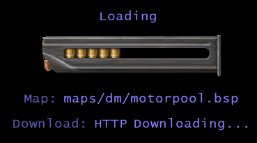
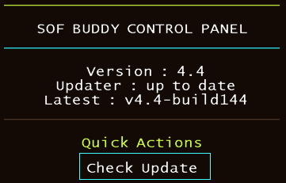

# SoF Buddy 🚀

> **Suggestions, criticisms, and issues are highly encouraged.** Please [open a GitHub issue](https://github.com/d3nd3/sof_buddy/issues), reply on a release, or reach out on [Discord](https://discord.gg/zZjnsRKPEJ) — feedback directly drives what gets fixed and built next.

> **Donations help keep development going.** If SoF Buddy is useful to you, consider [sponsoring on GitHub](https://github.com/sponsors/d3nd3) — contributions go toward monthly [Cursor](https://cursor.com) subscriptions and other tooling that make ongoing fixes and features possible.

<p align="center">
  <a href="LICENSE"></a>
  <a href="https://github.com/d3nd3/sof_buddy/releases"></a>
  <a href="https://discord.gg/zZjnsRKPEJ"></a>
  
  
</p>




> **A modern enhancement suite for Soldier of Fortune 1 — scaling, fixes, and quality-of-life improvements for the best SoF experience.**

---

### ⚠️ **#1 THING YOU NEED TO KNOW**

**Press `F12` in-game** (or bind a key to `sofbuddy_menu sof_buddy`). That opens the SoF Buddy menu — settings, updater, profiles, and everything else. **Do this first.** If you don’t, you’re missing the main way to use SoF Buddy.

---

## ✨ Features

<details open>
<summary><b>Click to expand</b></summary>

- 🔠 **Font Scaling** — Crisp, readable fonts at any resolution: `1x`, `2x`, `3x`, `4x`, etc. Enable **Auto Font Scale** (`_sofbuddy_font_scale_auto 1`) to track resolution (`vid_h / 480`), or turn auto off and set `_sofbuddy_font_scale` manually.
- 🔤 **Font Pack Switcher** — Choose **Default**, **Force SoFPlus**, or **Force Vanilla** fonts from F12 → UI Scale; changing it reloads the renderer without restarting the game.
- 🖥️ **HUD Scaling** — Scale the HUD independently from the font for perfect UI balance. **Auto HUD Scale** (`_sofbuddy_hud_scale_auto 1`) uses the same resolution ratio; disable auto to pick a manual `_sofbuddy_hud_scale`.
- 🎬 **Cinematic Image Scaling** — Credit/fade images (`SP_FLAG_CREDIT`) scale up from 640×480 to your resolution. Toggle with `_sofbuddy_scale_cinematic_pics` (`1` = on, `0` = off) or **Scale Cinematic Images** in F12 → UI Scale.
- 🎯 **Crosshair Scaling** — Scale crosshair textures independently for improved visibility.
- 🎯 **More Crosshairs** — Engine `crosshair` stays 0–4; F12 → Gameplay adds a **theme** list (pack filenames under `sof_buddy/crosshairs/`) with a live preview image.
- 🎯 **Restored `cl_maxfps` in Singleplayer** — Smooth SP caps via **F12 → CPU → Framerate** (legacy ms-budget list, or optional **Exact FPS cap** for integer values like `60`).
- ⚡ **Stable Framerate & CPU Saver** — Uses `QueryPerformanceCounter` for precise timing and energy savings. New cvar: `_sofbuddy_sleep`.
- 🖱️ **Raw Mouse Input** — Direct hardware input bypassing Windows acceleration. All original sensitivity cvars still work!
- 🏷️ **Widescreen Teamicons GlitchFix** — Team icons are always correctly positioned, even in widescreen. Team icons and playernames above players scale with the HUD — toggle with `_sofbuddy_icons_autoscale` or **Icons Autoscale** in F12 → UI Scale.
- 🖼️ **HD Texture Support** — Native support for high-res `.m32` textures. [Learn more](https://www.sof1.org/viewtopic.php?p=45667)
- 👤 **Extended Multiplayer Skins** — Extra player models ship in `sof_buddy/extended_skins.pak` (skins by **Acadie**).
- 🌙 **Lighting Blend Mode Adjustment** — Experience WhiteMagicRaven's lighting tweaks (optional).
- 🖲️ **Console Size Adjustment** — Set how much of the screen the console covers, for any setup.
- 🔄 **VSync Reliability** — `gl_swapinterval` is applied on every `vid_restart` for hassle-free vsync. F12 → CPU shows the measured display refresh, a request picker built from your driver's actual modes, plus a cap check that warns when VSync could deliver more than the framerate cap allows.
- 🛠️ **Sane Defaults on First Run** — Fixes bad config defaults after hardware changes.
- 🛡️ **Console Overflow/Crash Fixes** — No more crashes from large pastes or ultra-wide resolutions.
- 🧾 **Large `config.cfg` Exec Fix** — Avoid `Cbuf_AddText: overflow` when running `exec config.cfg` with very large configs.
- 🧩 **Embedded Loading / Internal Menus** — Serve RMF menu assets from memory (includes loading UI) and open internal pages via `sofbuddy_menu`.
- 🌐 **HTTP Map Download Assist** — Download missing maps over HTTP and resume precache; provider URLs configurable via cvars.
- 🌐 **GameSpy Master Selection** — Choose a known master server for SoFPlus from F12 → Network; the selected `_sp_cl_master_gamespy` value is saved by SoFPlus.
- ⬆️ **In-Game Updater + Startup Prompt** — Check/download release zips in-game, with optional startup check and internal-menu prompt.
- 🧓 **Windows XP Updater Mirror Defaults** — XP builds default updater feed URLs to `sofvault.org` (overrideable via cvars).
- 📚 **Feature Docs** — See `src/features/internal_menus/README.md`, `src/features/http_maps/README.md`, `src/features/master_server_fallback/README.md`, and `src/features/cbuf_limit_increase/README.md`.

</details>

---

## 🚀 Installation

<details>
<summary><b>Click to expand</b></summary>

### Recommended: Windows installer (easiest)

For Windows, the installer is the most effortless way to install SoF Buddy: it installs the
universal DLL, lets you choose features, and writes the runtime selection for you. No manual
extraction or feature-enable scripts are needed.

1. [Download the latest Windows installer](https://github.com/d3nd3/sof_buddy/releases) (`sof_buddy_setup_v<version>.exe`).
2. Run it and select the SoF folder containing `SoF.exe`.
3. Keep **Recommended feature set** or choose **Custom feature selection**, then finish setup.
4. Setup automatically enables SoF Buddy and saves the original as `SoF.exe.bak`.
5. Launch SoF.

### Manual installation (Windows/Linux/Wine)

#### 1. Get SoF Buddy

- **Option A:** [Download a pre-compiled release](https://github.com/d3nd3/sof_buddy/releases)
- **Option B:** Compile from source:
  ```sh
  make               # Release build (optimized)
  make BUILD=xp      # Windows XP-targeted build
  make debug         # Debug build (with logging)
  make BUILD=xp-debug # XP-targeted debug build
  make debug-collect # Debug build with func_parents collection
  ```

### 2. Prepare Your Game Folder

- **Recommended:** Delete your `User/config.cfg` for optimal defaults.
- Extract the release `.zip` directly into your SoF root (where `SoF.exe` lives). It contains:
  - `sof_buddy.dll` (goes in the SoF root)
  - `sof_buddy/` folder (created under the SoF root)
    - `sof_buddy/funcmaps/` (contains JSON function maps)
    - `sof_buddy/*.pak` — `sndrstfindimage.pak` (silences `GL_FindImage` spam after `snd_restart`), `extended_skins.pak` (multiplayer skins; credit Acadie)
    - Windows: `sof_buddy/enable_*.cmd` scripts and `sof_buddy/patch_sof_binary.ps1`
    - Linux/Wine: `sof_buddy/enable_*.sh` scripts and `sof_buddy/patch_sof_binary.sh`
- Use the helper scripts to patch SoF.exe to load different DLLs:
  - `**enable_sofplus_and_buddy.cmd`** → Loads `sof_buddy.dll` (recommended: SoF Buddy + optional SoF Plus)
  - `**enable_sofplus.cmd`** → Loads `spcl.dll` (SoF Plus only, disables SoF Buddy)
  - `**enable_vanilla.cmd`** → Loads `WSOCK32.dll` (vanilla SoF, no mods)
  - `**sof_buddy_update.exe**` → Graphical Windows updater (universal channel / installer only): progress bar and release notes
  - `**update_from_zip.cmd**` → Standard Windows update path (all channels): extract downloaded zip (`sof_buddy/update/*.zip`) into SoF root
- SoF Buddy auto-loads `spcl.dll` if present, so it works *with* SoF Plus.

### Windows installer features

See [WINDOWS_INSTALLER.md](docs/WINDOWS_INSTALLER.md) for the complete packaging,
runtime-selection, and updater behavior.

The Windows installer uses one universal DLL and writes the selected features to
`sof_buddy/features.cfg`; it does not compile a custom DLL for each installation.
GitHub publishes that universal channel separately as
`release_windows_universal.zip`; `release_windows.zip` remains the
compile-time/default channel, and the updater keeps those channels separate.
Its initial selections are generated from `features/FEATURES.txt`. The file can be
edited later (`feature` enables it, `// feature` disables it); restart SoF after changes.
If `features.cfg` is missing, the universal DLL falls back to those same defaults.
The F12 **Features** tab exposes the same choices at runtime as archived
`_sofbuddy_feature_<name>` cvars. Changes are written to `base/sofbuddy.cfg`,
shown as **Unavailable** when the installed non-universal DLL does not contain a
feature, and take effect after restarting SoF. On startup, those saved selections
are read before hooks are registered and synchronized back to
`sof_buddy/features.cfg`; that file remains the early-startup source of truth.
It also offers a **Select Additional Tasks** page with **Optional installation
options**. Both are checked by default:

- **[OPTIONAL] Apply Windows 10+ Application Compatibility fix** — For a
  recognized `SoF.exe`, applies the same PE change GOG uses so the game behaves
  under Windows 10+ application compatibility. The original is saved as
  `SoF.exe.sofbuddy.bak`. Unrecognized executables are not modified.

- **[OPTIONAL] Unlock full violence** — Recommended when you are not using
  SoFPlus's `spcl.dll`. Password, volume serial, and `-cs` key are optional.
  The installer sets SoF parental-control values for the volume that contains
  the chosen game folder, for the current Windows user only. Uninstalling SoF
  Buddy does not remove those per-user settings.

</details>

---

## 🕹️ Usage

<details>
<summary><b>Click to expand</b></summary>

### Enable SoF Buddy (Recommended)

- **Windows:** Run `sof_buddy/enable_sofplus_and_buddy.cmd`
- **Linux/Wine:** Run `sof_buddy/enable_sofplus_and_buddy.sh`
- This enables SoF Buddy and optionally loads SoF Plus (if `spcl.dll` is present)
- To apply a downloaded update zip, run:
  - **Windows universal / installer:** `sof_buddy/sof_buddy_update.exe` (or `update_from_zip.cmd`)
  - **Windows compile-time channel:** `sof_buddy/update_from_zip.cmd` only
  - **Linux/Wine:** `sof_buddy/update_from_zip.sh`

### Enable SoF Plus Only

- **Windows:** Run `sof_buddy/enable_sofplus.cmd`
- **Linux/Wine:** Run `sof_buddy/enable_sofplus.sh`
- This disables SoF Buddy and uses only SoF Plus

### Restore Vanilla SoF

- **Windows:** Run `sof_buddy/enable_vanilla.cmd`
- **Linux/Wine:** Run `sof_buddy/enable_vanilla.sh`
- This removes all mods and restores the original game

### In-Game Commands

- `**F12`** (or `**bind <key> sofbuddy_menu sof_buddy`**) — **Open the SoF Buddy menu. Use this. It’s the main entry point for all settings, updater, and profiles.** Set an additional shortcut from **Settings → Menu → Bonus menu key**; F12 remains available. Under **UI Scale**: **Auto Font Scale** / **Auto HUD Scale** toggle `_sofbuddy_font_scale_auto` / `_sofbuddy_hud_scale_auto`; manual scale lists appear when auto is off. **Auto Round Scale** and **Scale Cinematic Images** are on the same page.
- `sofbuddy_list_features` — Print compiled features (and whether they are on/off).
- `sofbuddy_master_next` — Query the next configured GameSpy master server.
- `sofbuddy_menu <name>` — Open an embedded internal menu page (examples: `loading`, `sof_buddy`).
- `sofbuddy_menu <menu>/<page>` — Open a specific embedded page (e.g. `sofbuddy_menu sof_buddy/cpu`).
- `sofbuddy_apply_profile_comp` — Apply competitive/low-visual profile preset.
- `sofbuddy_apply_profile_visual` — Apply visual/high-fidelity profile preset.
- `sofbuddy_update` — Check latest release from configured update API endpoint and compare with your current version.
- `sofbuddy_update download` — Download latest release zip to `sof_buddy/update/` (apply after closing game; release zips are preferred over debug zips).
- `sofbuddy_update_install` — On **universal** builds with graphical updater enabled (default), queue `sof_buddy_update.exe`; otherwise `update_from_zip.cmd` / in-DLL extract on Wine/Proton, via `winstart`, then quit SoF.
- `sofbuddy_openurl <https_url>` — Open trusted community links in your default browser (used by the Social Links menu page).

</details>

---

## 🧓 Windows XP

<details>
<summary><b>Click to expand</b></summary>

- Use the **XP package** from releases (`release_windows_xp.zip`) or compile with:
  ```sh
  make BUILD=xp
  ```
- XP builds define `SOFBUDDY_XP_BUILD` and default updater endpoints to:
  - `_sofbuddy_update_api_url` = `http://sofvault.org/sof_buddy/releases/latest.json`
  - `_sofbuddy_update_releases_url` = `http://sofvault.org/sof_buddy/releases/latest`
- If you run your own mirror/proxy feed, override in console:
  ```cfg
  set _sofbuddy_update_api_url "http://your-endpoint/latest.json"
  set _sofbuddy_update_releases_url "http://your-endpoint/releases/latest"
  ```
- XP users may hit WinHTTP TLS failures on modern HTTPS endpoints (for example GitHub API). The mirror defaults above avoid that path.
- The sofvault host syncs the XP zip + `latest.json` from GitHub on a cron schedule (`rsrc/sofvault_mirror/sync_from_github.sh`); no SSH publish from CI is required.

</details>

---

## 🍷 Wine/Proton (Linux)

<details>
<summary><b>Click to expand</b></summary>

- **Recommendation:** Use Wine for best fullscreen experience and fewer visual glitches.
- **Launch Example:**
  ```sh
  wine SoF.exe +set console 1 +set cddir CDDIR #%command%
  ```
- **Proton Note:** Proton ≤ 4.11-13 recommended. Otherwise, adjust sound frequency each startup.
- **Raw Mouse Input (`_sofbuddy_rawmouse`):** For true raw mouse input (bypassing system acceleration), you need **Proton ≥ 9.0** or **GloriousEggroll's custom Proton builds**. Standard Wine/wine-staging may still apply system mouse acceleration.
- **Optimal FPS Tweaks:** Add to `base/autoexec.cfg`:
  ```
  cl_quads 0
  ghl_light_method 0
  ghl_shadows 0
  ```
  (Note: `cl_quads 0` disables many effects.)

</details>

---

## ⚙️ Cvars (Configuration Variables)

<details>
<summary><b>Click to expand</b></summary>

Every user-facing cvar is editable from **F12 → Cvars**, which shows the live value, the
default, and a description for each one. Friendly controls also live on the named tabs (**Cpu**,
**UI Scale**, **Graphics**, **Lighting**, **Gameplay**, **Network**, **Version**, **General**, …).
Use `set <name> <value>` in the console to script them.

Internal bookkeeping cvars (layout math, migration guards, runtime status read-outs) use the
`_sb_internal_` prefix and are listed separately at the bottom. Do not edit those by hand.

### User-facing

<table style="width:100%;max-width:838px;table-layout:fixed;border-collapse:collapse">
<colgroup><col style="width:34%"><col style="width:66%"></colgroup>
<thead><tr>
<th style="text-align:left;vertical-align:top;padding:6px 8px;border-bottom:1px solid #30363d">Cvar</th><th style="text-align:left;vertical-align:top;padding:6px 8px;border-bottom:1px solid #30363d">Description</th>
</tr></thead><tbody>
<tr>
<td style="text-align:left;vertical-align:top;padding:6px 8px;border-bottom:1px solid #30363d;word-break:break-word;overflow-wrap:anywhere;width:34%"><code>_sofbuddy_high_priority</code></td>
<td style="text-align:left;vertical-align:top;padding:6px 8px;border-bottom:1px solid #30363d;width:66%"><strong>Default</strong> <code>1</code>. Set process priority to HIGH (<code>0</code> = NORMAL). F12 → CPU.</td>
</tr>
<tr>
<td style="text-align:left;vertical-align:top;padding:6px 8px;border-bottom:1px solid #30363d;word-break:break-word;overflow-wrap:anywhere;width:34%"><code>_sofbuddy_sleep</code></td>
<td style="text-align:left;vertical-align:top;padding:6px 8px;border-bottom:1px solid #30363d;width:66%"><strong>Default</strong> <code>1</code>. CPU-saving sleep between frames. F12 → CPU.</td>
</tr>
<tr>
<td style="text-align:left;vertical-align:top;padding:6px 8px;border-bottom:1px solid #30363d;word-break:break-word;overflow-wrap:anywhere;width:34%"><code>_sofbuddy_sleep_jitter</code></td>
<td style="text-align:left;vertical-align:top;padding:6px 8px;border-bottom:1px solid #30363d;width:66%"><strong>Default</strong> <code>0</code>. Frame time borrowing. Experimental; can worsen pacing, leave <code>0</code> unless needed. F12 → CPU.</td>
</tr>
<tr>
<td style="text-align:left;vertical-align:top;padding:6px 8px;border-bottom:1px solid #30363d;word-break:break-word;overflow-wrap:anywhere;width:34%"><code>_sofbuddy_sleep_busyticks</code></td>
<td style="text-align:left;vertical-align:top;padding:6px 8px;border-bottom:1px solid #30363d;width:66%"><strong>Default</strong> <code>2</code>. 1 ms busyloop ticks per frame. Lower saves CPU, <code>0</code> may stutter. F12 → CPU.</td>
</tr>
<tr>
<td style="text-align:left;vertical-align:top;padding:6px 8px;border-bottom:1px solid #30363d;word-break:break-word;overflow-wrap:anywhere;width:34%"><code>_sofbuddy_cl_maxfps_exact</code></td>
<td style="text-align:left;vertical-align:top;padding:6px 8px;border-bottom:1px solid #30363d;width:66%"><strong>Default</strong> <code>0</code>. <code>1</code> = <code>cl_maxfps</code> is literal integer FPS; <code>0</code> = legacy millisecond-budget list. Requires Singleplayer Max FPS. F12 → CPU.</td>
</tr>
<tr>
<td style="text-align:left;vertical-align:top;padding:6px 8px;border-bottom:1px solid #30363d;word-break:break-word;overflow-wrap:anywhere;width:34%"><code>_sofbuddy_perf_profile</code></td>
<td style="text-align:left;vertical-align:top;padding:6px 8px;border-bottom:1px solid #30363d;width:66%"><strong>Default</strong> <code>0</code>. Perf preset: <code>0</code> Competitive, <code>1</code> High Visual, <code>2</code> Low Visual, <code>3</code> Custom/Current. The **Cpu** tab selects Custom/Current when the adjusted cvars do not match a preset. F12 → Cpu.</td>
</tr>
<tr>
<td style="text-align:left;vertical-align:top;padding:6px 8px;border-bottom:1px solid #30363d;word-break:break-word;overflow-wrap:anywhere;width:34%"><code>_sofbuddy_font_scale</code></td>
<td style="text-align:left;vertical-align:top;padding:6px 8px;border-bottom:1px solid #30363d;width:66%"><strong>Default</strong> <code>1</code>. Manual font scale multiplier (<code>0.25</code> … <code>8</code> in 0.25 steps). Used when auto is <code>0</code>. F12 → UI Scale.</td>
</tr>
<tr>
<td style="text-align:left;vertical-align:top;padding:6px 8px;border-bottom:1px solid #30363d;word-break:break-word;overflow-wrap:anywhere;width:34%"><code>_sofbuddy_font_scale_auto</code></td>
<td style="text-align:left;vertical-align:top;padding:6px 8px;border-bottom:1px solid #30363d;width:66%"><strong>Default</strong> <code>1</code>. Auto font scale from <code>vid_h / 480</code>. <code>1</code> on, <code>0</code> off. Legacy <code>_sofbuddy_font_scale -1</code> migrates to auto on + scale <code>1</code>. F12 → UI Scale.</td>
</tr>
<tr>
<td style="text-align:left;vertical-align:top;padding:6px 8px;border-bottom:1px solid #30363d;word-break:break-word;overflow-wrap:anywhere;width:34%"><code>_sofbuddy_font_pack</code></td>
<td style="text-align:left;vertical-align:top;padding:6px 8px;border-bottom:1px solid #30363d;width:66%"><strong>Default</strong> <code>0</code>. Font mode: <code>0</code> Default, <code>1</code> Force SoFPlus, <code>2</code> Force Vanilla. Changing it reloads the renderer. F12 → UI Scale.</td>
</tr>
<tr>
<td style="text-align:left;vertical-align:top;padding:6px 8px;border-bottom:1px solid #30363d;word-break:break-word;overflow-wrap:anywhere;width:34%"><code>_sofbuddy_hud_scale</code></td>
<td style="text-align:left;vertical-align:top;padding:6px 8px;border-bottom:1px solid #30363d;width:66%"><strong>Default</strong> <code>1</code>. Manual HUD scale multiplier (<code>0.25</code> … <code>8</code> in 0.25 steps). Used when auto is <code>0</code>. F12 → UI Scale.</td>
</tr>
<tr>
<td style="text-align:left;vertical-align:top;padding:6px 8px;border-bottom:1px solid #30363d;word-break:break-word;overflow-wrap:anywhere;width:34%"><code>_sofbuddy_hud_scale_auto</code></td>
<td style="text-align:left;vertical-align:top;padding:6px 8px;border-bottom:1px solid #30363d;width:66%"><strong>Default</strong> <code>1</code>. Auto HUD scale from <code>vid_h / 480</code>. <code>1</code> on, <code>0</code> off. Legacy <code>_sofbuddy_hud_scale -1</code> migrates like font auto. F12 → UI Scale.</td>
</tr>
<tr>
<td style="text-align:left;vertical-align:top;padding:6px 8px;border-bottom:1px solid #30363d;word-break:break-word;overflow-wrap:anywhere;width:34%"><code>_sofbuddy_scale_round_auto</code></td>
<td style="text-align:left;vertical-align:top;padding:6px 8px;border-bottom:1px solid #30363d;width:66%"><strong>Default</strong> <code>0</code>. Snap auto font/HUD scale to round steps instead of a continuous ratio. <code>1</code> on, <code>0</code> off. F12 → UI Scale.</td>
</tr>
<tr>
<td style="text-align:left;vertical-align:top;padding:6px 8px;border-bottom:1px solid #30363d;word-break:break-word;overflow-wrap:anywhere;width:34%"><code>_sofbuddy_scale_round_ratio</code></td>
<td style="text-align:left;vertical-align:top;padding:6px 8px;border-bottom:1px solid #30363d;width:66%"><strong>Default</strong> <code>0.25</code>. Snap increment used when round auto is on (<code>0.05</code>, <code>0.1</code>, <code>0.125</code>, <code>0.25</code>, <code>0.5</code>, <code>1</code>). Also applies to cinematic image scaling. F12 → UI Scale.</td>
</tr>
<tr>
<td style="text-align:left;vertical-align:top;padding:6px 8px;border-bottom:1px solid #30363d;word-break:break-word;overflow-wrap:anywhere;width:34%"><code>_sofbuddy_scale_cinematic_pics</code></td>
<td style="text-align:left;vertical-align:top;padding:6px 8px;border-bottom:1px solid #30363d;width:66%"><strong>Default</strong> <code>1</code>. Scale cinematic credit/fade images (<code>SP_FLAG_CREDIT</code> / <code>SCR_DrawCinemaScope</code>) up from 640×480. <code>1</code> on, <code>0</code> off. F12 → UI Scale.</td>
</tr>
<tr>
<td style="text-align:left;vertical-align:top;padding:6px 8px;border-bottom:1px solid #30363d;word-break:break-word;overflow-wrap:anywhere;width:34%"><code>_sofbuddy_crossh_scale</code></td>
<td style="text-align:left;vertical-align:top;padding:6px 8px;border-bottom:1px solid #30363d;width:66%"><strong>Default</strong> <code>1</code>. Crosshair size multiplier. F12 → UI Scale.</td>
</tr>
<tr>
<td style="text-align:left;vertical-align:top;padding:6px 8px;border-bottom:1px solid #30363d;word-break:break-word;overflow-wrap:anywhere;width:34%"><code>_sofbuddy_icons_autoscale</code></td>
<td style="text-align:left;vertical-align:top;padding:6px 8px;border-bottom:1px solid #30363d;width:66%"><strong>Default</strong> <code>1</code>. Scale team icons and playernames drawn above players with the HUD scale. <code>1</code> on, <code>0</code> off. F12 → UI Scale.</td>
</tr>
<tr>
<td style="text-align:left;vertical-align:top;padding:6px 8px;border-bottom:1px solid #30363d;word-break:break-word;overflow-wrap:anywhere;width:34%"><code>_sofbuddy_console_size</code></td>
<td style="text-align:left;vertical-align:top;padding:6px 8px;border-bottom:1px solid #30363d;width:66%"><strong>Default</strong> <code>0.5</code>. Console height as a fraction of screen height (<code>0</code>–<code>1</code>, <code>1</code> = fullscreen). F12 → UI Scale.</td>
</tr>
<tr>
<td style="text-align:left;vertical-align:top;padding:6px 8px;border-bottom:1px solid #30363d;word-break:break-word;overflow-wrap:anywhere;width:34%"><code>_sofbuddy_minfilter_unmipped</code></td>
<td style="text-align:left;vertical-align:top;padding:6px 8px;border-bottom:1px solid #30363d;width:66%"><strong>Default</strong> <code>GL_LINEAR</code>. Min filter for sky and other unmipped textures. <code>GL_NEAREST</code> or <code>GL_LINEAR</code> (mipmap modes make textures incomplete). F12 → Graphics.</td>
</tr>
<tr>
<td style="text-align:left;vertical-align:top;padding:6px 8px;border-bottom:1px solid #30363d;word-break:break-word;overflow-wrap:anywhere;width:34%"><code>_sofbuddy_magfilter_unmipped</code></td>
<td style="text-align:left;vertical-align:top;padding:6px 8px;border-bottom:1px solid #30363d;width:66%"><strong>Default</strong> <code>GL_LINEAR</code>. Mag filter for sky and other unmipped textures. F12 → Graphics.</td>
</tr>
<tr>
<td style="text-align:left;vertical-align:top;padding:6px 8px;border-bottom:1px solid #30363d;word-break:break-word;overflow-wrap:anywhere;width:34%"><code>_sofbuddy_minfilter_mipped</code></td>
<td style="text-align:left;vertical-align:top;padding:6px 8px;border-bottom:1px solid #30363d;width:66%"><strong>Default</strong> <code>GL_LINEAR_MIPMAP_LINEAR</code>. Min filter for mipmapped textures. F12 → Graphics.</td>
</tr>
<tr>
<td style="text-align:left;vertical-align:top;padding:6px 8px;border-bottom:1px solid #30363d;word-break:break-word;overflow-wrap:anywhere;width:34%"><code>_sofbuddy_magfilter_mipped</code></td>
<td style="text-align:left;vertical-align:top;padding:6px 8px;border-bottom:1px solid #30363d;width:66%"><strong>Default</strong> <code>GL_LINEAR</code>. Mag filter for mipmapped textures. F12 → Graphics.</td>
</tr>
<tr>
<td style="text-align:left;vertical-align:top;padding:6px 8px;border-bottom:1px solid #30363d;word-break:break-word;overflow-wrap:anywhere;width:34%"><code>_sofbuddy_minfilter_ui</code></td>
<td style="text-align:left;vertical-align:top;padding:6px 8px;border-bottom:1px solid #30363d;width:66%"><strong>Default</strong> <code>GL_NEAREST</code>. Min filter for UI textures. Keep <code>GL_NEAREST</code> — LINEAR makes fonts unreadable. F12 → Graphics.</td>
</tr>
<tr>
<td style="text-align:left;vertical-align:top;padding:6px 8px;border-bottom:1px solid #30363d;word-break:break-word;overflow-wrap:anywhere;width:34%"><code>_sofbuddy_magfilter_ui</code></td>
<td style="text-align:left;vertical-align:top;padding:6px 8px;border-bottom:1px solid #30363d;width:66%"><strong>Default</strong> <code>GL_NEAREST</code>. Mag filter for UI textures. Keep <code>GL_NEAREST</code> — LINEAR makes fonts unreadable. F12 → Graphics.</td>
</tr>
<tr>
<td style="text-align:left;vertical-align:top;padding:6px 8px;border-bottom:1px solid #30363d;word-break:break-word;overflow-wrap:anywhere;width:34%"><code>_sofbuddy_lighting_overbright</code></td>
<td style="text-align:left;vertical-align:top;padding:6px 8px;border-bottom:1px solid #30363d;width:66%"><strong>Default</strong> <code>0</code>. Overbright lighting. <code>1</code> on. When on, it overrides the manual blend cvars below. F12 → Lighting.</td>
</tr>
<tr>
<td style="text-align:left;vertical-align:top;padding:6px 8px;border-bottom:1px solid #30363d;word-break:break-word;overflow-wrap:anywhere;width:34%"><code>_sofbuddy_lighting_cutoff</code></td>
<td style="text-align:left;vertical-align:top;padding:6px 8px;border-bottom:1px solid #30363d;width:66%"><strong>Default</strong> <code>64</code>. Dynamic light threshold (DLIGHT_CUTOFF). F12 → Lighting.</td>
</tr>
<tr>
<td style="text-align:left;vertical-align:top;padding:6px 8px;border-bottom:1px solid #30363d;word-break:break-word;overflow-wrap:anywhere;width:34%"><code>_sofbuddy_water_size</code></td>
<td style="text-align:left;vertical-align:top;padding:6px 8px;border-bottom:1px solid #30363d;width:66%"><strong>Default</strong> <code>64</code>. Warp texture chunk size for water, lava, and sky turbulence. Smaller is finer (more work), minimum <code>16</code>. F12 → Graphics.</td>
</tr>
<tr>
<td style="text-align:left;vertical-align:top;padding:6px 8px;border-bottom:1px solid #30363d;word-break:break-word;overflow-wrap:anywhere;width:34%"><code>_sofbuddy_lightblend_src</code></td>
<td style="text-align:left;vertical-align:top;padding:6px 8px;border-bottom:1px solid #30363d;width:66%"><strong>Default</strong> <code>GL_ZERO</code>. Lightmap blend source. Experimental, leave at default. F12 → Lighting.</td>
</tr>
<tr>
<td style="text-align:left;vertical-align:top;padding:6px 8px;border-bottom:1px solid #30363d;word-break:break-word;overflow-wrap:anywhere;width:34%"><code>_sofbuddy_lightblend_dst</code></td>
<td style="text-align:left;vertical-align:top;padding:6px 8px;border-bottom:1px solid #30363d;width:66%"><strong>Default</strong> <code>GL_SRC_COLOR</code>. Lightmap blend destination. Experimental, leave at default. F12 → Lighting.</td>
</tr>
<tr>
<td style="text-align:left;vertical-align:top;padding:6px 8px;border-bottom:1px solid #30363d;word-break:break-word;overflow-wrap:anywhere;width:34%"><code>_sofbuddy_shiny_spherical</code></td>
<td style="text-align:left;vertical-align:top;padding:6px 8px;border-bottom:1px solid #30363d;width:66%"><strong>Default</strong> <code>1</code>. Let shiny <code>gl_detailtexturing</code> change with view angle. <code>1</code> on, <code>0</code> off. F12 → Lighting.</td>
</tr>
<tr>
<td style="text-align:left;vertical-align:top;padding:6px 8px;border-bottom:1px solid #30363d;word-break:break-word;overflow-wrap:anywhere;width:34%"><code>_sofbuddy_rawmouse</code></td>
<td style="text-align:left;vertical-align:top;padding:6px 8px;border-bottom:1px solid #30363d;width:66%"><strong>Default</strong> <code>0</code>. Raw mouse input via the Raw Input API, bypassing Windows pointer acceleration. <code>1</code> on, <code>0</code> off. F12 → Gameplay.</td>
</tr>
<tr>
<td style="text-align:left;vertical-align:top;padding:6px 8px;border-bottom:1px solid #30363d;word-break:break-word;overflow-wrap:anywhere;width:34%"><code>_sp_cl_master_gamespy</code></td>
<td style="text-align:left;vertical-align:top;padding:6px 8px;border-bottom:1px solid #30363d;width:66%"><strong>Default</strong> <code>sof1master.sofvault.org</code>. Selected GameSpy master server; choose a known host from F12 → Network. SoFPlus saves this value across launches.</td>
</tr>
<tr>
<td style="text-align:left;vertical-align:top;padding:6px 8px;border-bottom:1px solid #30363d;word-break:break-word;overflow-wrap:anywhere;width:34%"><code>_sofbuddy_http_maps</code></td>
<td style="text-align:left;vertical-align:top;padding:6px 8px;border-bottom:1px solid #30363d;width:66%"><strong>Default</strong> <code>1</code>. HTTP map assist: <code>0</code> Off, <code>1</code> Primary, <code>2</code> Random provider, <code>3</code> Rotate providers. F12 → Network.</td>
</tr>
<tr>
<td style="text-align:left;vertical-align:top;padding:6px 8px;border-bottom:1px solid #30363d;word-break:break-word;overflow-wrap:anywhere;width:34%"><code>_sofbuddy_http_maps_dl_1</code></td>
<td style="text-align:left;vertical-align:top;padding:6px 8px;border-bottom:1px solid #30363d;width:66%"><strong>Default</strong> <code>https://sofvault.org/sof1maps</code>. Zip download base URL, provider slot 1. F12 → Network (provider block) or Cvars.</td>
</tr>
<tr>
<td style="text-align:left;vertical-align:top;padding:6px 8px;border-bottom:1px solid #30363d;word-break:break-word;overflow-wrap:anywhere;width:34%"><code>_sofbuddy_http_maps_dl_2</code></td>
<td style="text-align:left;vertical-align:top;padding:6px 8px;border-bottom:1px solid #30363d;width:66%"><strong>Default</strong> <code>https://raw.githubusercontent.com/plowsof/sof1maps/main</code>. Zip download base URL, provider slot 2. F12 → Network or Cvars.</td>
</tr>
<tr>
<td style="text-align:left;vertical-align:top;padding:6px 8px;border-bottom:1px solid #30363d;word-break:break-word;overflow-wrap:anywhere;width:34%"><code>_sofbuddy_http_maps_dl_3</code></td>
<td style="text-align:left;vertical-align:top;padding:6px 8px;border-bottom:1px solid #30363d;width:66%"><strong>Default</strong> <em>empty</em>. Zip download base URL, provider slot 3. F12 → Network or Cvars.</td>
</tr>
<tr>
<td style="text-align:left;vertical-align:top;padding:6px 8px;border-bottom:1px solid #30363d;word-break:break-word;overflow-wrap:anywhere;width:34%"><code>_sofbuddy_http_maps_crc_1</code></td>
<td style="text-align:left;vertical-align:top;padding:6px 8px;border-bottom:1px solid #30363d;width:66%"><strong>Default</strong> <code>https://sofvault.org/sof1maps</code>. CRC lookup base URL, slot 1 (HTTP Range fetch of the zip central directory). F12 → Network or Cvars.</td>
</tr>
<tr>
<td style="text-align:left;vertical-align:top;padding:6px 8px;border-bottom:1px solid #30363d;word-break:break-word;overflow-wrap:anywhere;width:34%"><code>_sofbuddy_http_maps_crc_2</code></td>
<td style="text-align:left;vertical-align:top;padding:6px 8px;border-bottom:1px solid #30363d;width:66%"><strong>Default</strong> <code>https://raw.githubusercontent.com/plowsof/sof1maps/main</code>. CRC lookup base URL, slot 2. F12 → Network or Cvars.</td>
</tr>
<tr>
<td style="text-align:left;vertical-align:top;padding:6px 8px;border-bottom:1px solid #30363d;word-break:break-word;overflow-wrap:anywhere;width:34%"><code>_sofbuddy_http_maps_crc_3</code></td>
<td style="text-align:left;vertical-align:top;padding:6px 8px;border-bottom:1px solid #30363d;width:66%"><strong>Default</strong> <em>empty</em>. CRC lookup base URL, slot 3. F12 → Network or Cvars.</td>
</tr>
<tr>
<td style="text-align:left;vertical-align:top;padding:6px 8px;border-bottom:1px solid #30363d;word-break:break-word;overflow-wrap:anywhere;width:34%"><code>_sofbuddy_http_show_providers</code></td>
<td style="text-align:left;vertical-align:top;padding:6px 8px;border-bottom:1px solid #30363d;width:66%"><strong>Default</strong> <code>0</code>. Show the provider + updater URL inputs on the Network tab. <code>1</code> show, <code>0</code> hide. F12 → Cvars (value); URLs on Network when shown.</td>
</tr>
<tr>
<td style="text-align:left;vertical-align:top;padding:6px 8px;border-bottom:1px solid #30363d;word-break:break-word;overflow-wrap:anywhere;width:34%"><code>_sofbuddy_update_check_startup</code></td>
<td style="text-align:left;vertical-align:top;padding:6px 8px;border-bottom:1px solid #30363d;width:66%"><strong>Default</strong> <code>1</code>. Run the updater check at startup and open the internal prompt when a newer release is found. F12 → General.</td>
</tr>
<tr>
<td style="text-align:left;vertical-align:top;padding:6px 8px;border-bottom:1px solid #30363d;word-break:break-word;overflow-wrap:anywhere;width:34%"><code>_sofbuddy_update_use_gui</code></td>
<td style="text-align:left;vertical-align:top;padding:6px 8px;border-bottom:1px solid #30363d;width:66%"><strong>Default</strong> <code>1</code> on <strong>universal</strong> builds (Windows, Wine, and Proton); <code>0</code> on non-universal channels. Use <code>sof_buddy_update.exe</code> when queuing an install (<code>sofbuddy_update_install</code>) unless turned off (then script / in-DLL extract on Wine/Proton). Toggle on <strong>F12 → Version</strong>.</td>
</tr>
<tr>
<td style="text-align:left;vertical-align:top;padding:6px 8px;border-bottom:1px solid #30363d;word-break:break-word;overflow-wrap:anywhere;width:34%"><code>_sofbuddy_update_api_url</code></td>
<td style="text-align:left;vertical-align:top;padding:6px 8px;border-bottom:1px solid #30363d;width:66%"><strong>Default</strong> build-dependent. Updater JSON feed URL. XP builds default to the sofvault mirror, non-XP to the GitHub API. F12 → Network or Cvars.</td>
</tr>
<tr>
<td style="text-align:left;vertical-align:top;padding:6px 8px;border-bottom:1px solid #30363d;word-break:break-word;overflow-wrap:anywhere;width:34%"><code>_sofbuddy_update_releases_url</code></td>
<td style="text-align:left;vertical-align:top;padding:6px 8px;border-bottom:1px solid #30363d;width:66%"><strong>Default</strong> build-dependent. Human release page URL shown in updater status/help. F12 → Network or Cvars.</td>
</tr>
<tr>
<td style="text-align:left;vertical-align:top;padding:6px 8px;border-bottom:1px solid #30363d;word-break:break-word;overflow-wrap:anywhere;width:34%"><code>_sofbuddy_update_target_tag</code></td>
<td style="text-align:left;vertical-align:top;padding:6px 8px;border-bottom:1px solid #30363d;width:66%"><strong>Default</strong> <code>latest</code>. Release tag to install. Run <code>sofbuddy_update releases</code> to refresh the tag list after changing. F12 → Cvars (or console).</td>
</tr>
<tr>
<td style="text-align:left;vertical-align:top;padding:6px 8px;border-bottom:1px solid #30363d;word-break:break-word;overflow-wrap:anywhere;width:34%"><code>_sofbuddy_menu_theme</code></td>
<td style="text-align:left;vertical-align:top;padding:6px 8px;border-bottom:1px solid #30363d;width:66%"><strong>Default</strong> <code>0</code>. Menu color preset (<code>0</code> … <code>37</code>). Reopen the menu to apply. F12 → General.</td>
</tr>
<tr>
<td style="text-align:left;vertical-align:top;padding:6px 8px;border-bottom:1px solid #30363d;word-break:break-word;overflow-wrap:anywhere;width:34%"><code>_sofbuddy_loading_lock_input</code></td>
<td style="text-align:left;vertical-align:top;padding:6px 8px;border-bottom:1px solid #30363d;width:66%"><strong>Default</strong> <code>0</code>. Block opening the console while the loading screen is up (<code>1</code> locked, <code>0</code> unlocked). F12 → General.</td>
</tr>
<tr>
<td style="text-align:left;vertical-align:top;padding:6px 8px;border-bottom:1px solid #30363d;word-break:break-word;overflow-wrap:anywhere;width:34%"><code>_sofbuddy_loading_show_mapname</code></td>
<td style="text-align:left;vertical-align:top;padding:6px 8px;border-bottom:1px solid #30363d;width:66%"><strong>Default</strong> <code>1</code>. Show the current map name on the loading screen header. <code>1</code> on, <code>0</code> off. F12 → General.</td>
</tr>
<tr>
<td style="text-align:left;vertical-align:top;padding:6px 8px;border-bottom:1px solid #30363d;word-break:break-word;overflow-wrap:anywhere;width:34%"><code>_sofbuddy_loading_show_download</code></td>
<td style="text-align:left;vertical-align:top;padding:6px 8px;border-bottom:1px solid #30363d;width:66%"><strong>Default</strong> <code>1</code>. Show HTTP/download status on the loading screen header. <code>1</code> on, <code>0</code> off. F12 → General.</td>
</tr>
<tr>
<td style="text-align:left;vertical-align:top;padding:6px 8px;border-bottom:1px solid #30363d;word-break:break-word;overflow-wrap:anywhere;width:34%"><code>_sofbuddy_entity_edit</code></td>
<td style="text-align:left;vertical-align:top;padding:6px 8px;border-bottom:1px solid #30363d;width:66%"><strong>Default</strong> <code>0</code>. <strong>Map entity / map study tools (off by default):</strong> set <code>1</code> to enable the spawn <strong>cache</strong> during load, <code>sofbuddy_entities_draw</code> / <code>ev_debugbox</code>, and <strong>primary-attack intersect</strong>. Nothing in this feature runs until this is on — see <a href="src/features/entity_visualizer/README.md#map-entity-wireframes-how-it-works">Map entity wireframes</a>. F12 → Cvars (Map Study section).</td>
</tr>
<tr>
<td style="text-align:left;vertical-align:top;padding:6px 8px;border-bottom:1px solid #30363d;word-break:break-word;overflow-wrap:anywhere;width:34%"><code>_sofbuddy_entities_draw_verbose</code></td>
<td style="text-align:left;vertical-align:top;padding:6px 8px;border-bottom:1px solid #30363d;width:66%"><strong>Default</strong> <code>0</code>. Log one line per entity when <code>sofbuddy_entities_draw</code> runs. F12 → Cvars (Map Study).</td>
</tr>
<tr>
<td style="text-align:left;vertical-align:top;padding:6px 8px;border-bottom:1px solid #30363d;word-break:break-word;overflow-wrap:anywhere;width:34%"><code>_sofbuddy_map_debug_map</code></td>
<td style="text-align:left;vertical-align:top;padding:6px 8px;border-bottom:1px solid #30363d;width:66%"><strong>Default</strong> <em>empty</em>. Map stem for Map study load + spawn recording, no path and no <code>.bsp</code> (e.g. <code>moscow</code>). F12 → Cvars (Map Study) or <code>sofbuddy_menu sof_buddy/map_debug</code>.</td>
</tr>
<tr>
<td style="text-align:left;vertical-align:top;padding:6px 8px;border-bottom:1px solid #30363d;word-break:break-word;overflow-wrap:anywhere;width:34%"><code>_sofbuddy_map_study_deathmatch</code></td>
<td style="text-align:left;vertical-align:top;padding:6px 8px;border-bottom:1px solid #30363d;width:66%"><strong>Default</strong> <code>4</code>. <code>deathmatch</code> mode applied before the map loads. <code>4</code> = CTF, which suits most map testing. F12 → Cvars (Map Study) or map_debug page.</td>
</tr>
</tbody></table>


The four `_sofbuddy_entity_edit` / `_sofbuddy_entities_draw_verbose` / `_sofbuddy_map_debug_map` /
`_sofbuddy_map_study_deathmatch` cvars come from the `entity_visualizer` feature, which is
**disabled by default** in `features/FEATURES.txt`. In a default build they are never registered,
so they do not appear in the console and the **Map Study** section is hidden from the Cvars tab
(gated on `_sb_internal_feature_entity_visualizer` via `<cinclude>`). Enable that feature to get
them.

- See [OpenGL glBlendFunc docs](https://www.khronos.org/registry/OpenGL-Refpages/gl4/html/glBlendFunc.xhtml) for blend values.
- Cvars with `CVAR_SOFBUDDY_ARCHIVE` persist to `base/sofbuddy.cfg` and are reapplied on startup.

### Server-visible client info

<table style="width:100%;max-width:838px;table-layout:fixed;border-collapse:collapse">
<colgroup><col style="width:34%"><col style="width:66%"></colgroup>
<thead><tr>
<th style="text-align:left;vertical-align:top;padding:6px 8px;border-bottom:1px solid #30363d">Cvar</th><th style="text-align:left;vertical-align:top;padding:6px 8px;border-bottom:1px solid #30363d">Purpose</th>
</tr></thead><tbody>
<tr>
<td style="text-align:left;vertical-align:top;padding:6px 8px;border-bottom:1px solid #30363d;word-break:break-word;overflow-wrap:anywhere;width:34%"><code>_sp_cl_info_sofbuddy</code></td>
<td style="text-align:left;vertical-align:top;padding:6px 8px;border-bottom:1px solid #30363d;width:66%"><code>windows-<version>-<build></code>, <code>wine-<version>-<build></code>, or <code>universal-<version>-<build></code>, sent with client userinfo so a server can identify the SoF Buddy channel.</td>
</tr>
</tbody></table>


The build number is the GitHub Actions run number; local builds use `local`.
This is informational client metadata, not an anti-cheat signal.

### Internal (`_sb_internal_`)

Written by sof_buddy itself. Values are recomputed each launch, so editing them has no lasting effect.

<table style="width:100%;max-width:838px;table-layout:fixed;border-collapse:collapse">
<colgroup><col style="width:34%"><col style="width:66%"></colgroup>
<thead><tr>
<th style="text-align:left;vertical-align:top;padding:6px 8px;border-bottom:1px solid #30363d">Cvar</th><th style="text-align:left;vertical-align:top;padding:6px 8px;border-bottom:1px solid #30363d">Purpose</th>
</tr></thead><tbody>
<tr>
<td style="text-align:left;vertical-align:top;padding:6px 8px;border-bottom:1px solid #30363d;word-break:break-word;overflow-wrap:anywhere;width:34%"><code>_sb_internal_version</code></td>
<td style="text-align:left;vertical-align:top;padding:6px 8px;border-bottom:1px solid #30363d;width:66%">Build version string, reported on the Version tab.</td>
</tr>
<tr>
<td style="text-align:left;vertical-align:top;padding:6px 8px;border-bottom:1px solid #30363d;word-break:break-word;overflow-wrap:anywhere;width:34%"><code>_sb_internal_build_flavour</code></td>
<td style="text-align:left;vertical-align:top;padding:6px 8px;border-bottom:1px solid #30363d;width:66%">Release channel label (Universal, Windows, Linux / Wine, Windows XP, Debug, …).</td>
</tr>
<tr>
<td style="text-align:left;vertical-align:top;padding:6px 8px;border-bottom:1px solid #30363d;word-break:break-word;overflow-wrap:anywhere;width:34%"><code>_sb_internal_build_number</code></td>
<td style="text-align:left;vertical-align:top;padding:6px 8px;border-bottom:1px solid #30363d;width:66%">CI build number from <code>SOFBUDDY_BUILD_NUMBER</code>.</td>
</tr>
<tr>
<td style="text-align:left;vertical-align:top;padding:6px 8px;border-bottom:1px solid #30363d;word-break:break-word;overflow-wrap:anywhere;width:34%"><code>_sb_internal_tab</code> / <code>_sb_internal_menu_last_page</code></td>
<td style="text-align:left;vertical-align:top;padding:6px 8px;border-bottom:1px solid #30363d;width:66%">Remembered tab index and last opened page.</td>
</tr>
<tr>
<td style="text-align:left;vertical-align:top;padding:6px 8px;border-bottom:1px solid #30363d;word-break:break-word;overflow-wrap:anywhere;width:34%"><code>_sb_internal_menu_vid_w</code> / <code>_sb_internal_menu_vid_h</code></td>
<td style="text-align:left;vertical-align:top;padding:6px 8px;border-bottom:1px solid #30363d;width:66%">Cached engine <code>vid_w</code> / <code>vid_h</code> used to recompute menu layout cvars.</td>
</tr>
<tr>
<td style="text-align:left;vertical-align:top;padding:6px 8px;border-bottom:1px solid #30363d;word-break:break-word;overflow-wrap:anywhere;width:34%"><code>_sb_internal_center_panel_px</code>, <code>_sb_internal_tabs_row1_*</code>, <code>_sb_internal_tabs_row2_*</code></td>
<td style="text-align:left;vertical-align:top;padding:6px 8px;border-bottom:1px solid #30363d;width:66%">Computed tab-bar layout: panel width, prefixes/suffixes, content width and bias. Recomputed on resolution change.</td>
</tr>
<tr>
<td style="text-align:left;vertical-align:top;padding:6px 8px;border-bottom:1px solid #30363d;word-break:break-word;overflow-wrap:anywhere;width:34%"><code>_sb_internal_profile_target_*</code></td>
<td style="text-align:left;vertical-align:top;padding:6px 8px;border-bottom:1px solid #30363d;width:66%">In-use profile values shown on the CPU tab.</td>
</tr>
<tr>
<td style="text-align:left;vertical-align:top;padding:6px 8px;border-bottom:1px solid #30363d;word-break:break-word;overflow-wrap:anywhere;width:34%"><code>_sb_internal_font_scale_rounded</code> / <code>_sb_internal_hud_scale_rounded</code></td>
<td style="text-align:left;vertical-align:top;padding:6px 8px;border-bottom:1px solid #30363d;width:66%">Read-only mirror of the effective scale after ratio and glyph-grid rounding.</td>
</tr>
<tr>
<td style="text-align:left;vertical-align:top;padding:6px 8px;border-bottom:1px solid #30363d;word-break:break-word;overflow-wrap:anywhere;width:34%"><code>_sb_internal_font_scale_auto_migrated</code> / <code>_sb_internal_hud_scale_auto_migrated</code></td>
<td style="text-align:left;vertical-align:top;padding:6px 8px;border-bottom:1px solid #30363d;width:66%">One-shot guards so the legacy <code>-1</code> auto-scale migration runs once.</td>
</tr>
<tr>
<td style="text-align:left;vertical-align:top;padding:6px 8px;border-bottom:1px solid #30363d;word-break:break-word;overflow-wrap:anywhere;width:34%"><code>_sb_internal_loading_progress</code> / <code>_sb_internal_loading_current</code> / <code>_sb_internal_loading_status</code> / <code>_sb_internal_loading_network</code></td>
<td style="text-align:left;vertical-align:top;padding:6px 8px;border-bottom:1px solid #30363d;width:66%">Runtime loading-screen state and status text.</td>
</tr>
<tr>
<td style="text-align:left;vertical-align:top;padding:6px 8px;border-bottom:1px solid #30363d;word-break:break-word;overflow-wrap:anywhere;width:34%"><code>_sb_internal_loading_zip_indicator</code></td>
<td style="text-align:left;vertical-align:top;padding:6px 8px;border-bottom:1px solid #30363d;width:66%">Pic path for the loading-screen download indicator.</td>
</tr>
<tr>
<td style="text-align:left;vertical-align:top;padding:6px 8px;border-bottom:1px solid #30363d;word-break:break-word;overflow-wrap:anywhere;width:34%"><code>_sb_internal_update_status</code> / <code>_sb_internal_update_latest</code> / <code>_sb_internal_update_download_path</code> / <code>_sb_internal_update_downloaded_asset</code> / <code>_sb_internal_update_checked_utc</code></td>
<td style="text-align:left;vertical-align:top;padding:6px 8px;border-bottom:1px solid #30363d;width:66%">Updater progress read-outs (Version tab and startup prompt).</td>
</tr>
<tr>
<td style="text-align:left;vertical-align:top;padding:6px 8px;border-bottom:1px solid #30363d;word-break:break-word;overflow-wrap:anywhere;width:34%"><code>_sb_internal_update_release_list_rmf</code> / <code>_sb_internal_update_release_list_status</code></td>
<td style="text-align:left;vertical-align:top;padding:6px 8px;border-bottom:1px solid #30363d;width:66%">Generated RMF markup for the release list, plus its load status.</td>
</tr>
<tr>
<td style="text-align:left;vertical-align:top;padding:6px 8px;border-bottom:1px solid #30363d;word-break:break-word;overflow-wrap:anywhere;width:34%"><code>_sb_internal_feature_entity_visualizer</code></td>
<td style="text-align:left;vertical-align:top;padding:6px 8px;border-bottom:1px solid #30363d;width:66%">Compile-time build flag (<code>1</code>/<code>0</code>) used by <code>&lt;cinclude&gt;</code> to hide menu sections whose feature is not compiled in.</td>
</tr>
<tr>
<td style="text-align:left;vertical-align:top;padding:6px 8px;border-bottom:1px solid #30363d;word-break:break-word;overflow-wrap:anywhere;width:34%"><code>_sb_internal_feature_master_server_fallback</code></td>
<td style="text-align:left;vertical-align:top;padding:6px 8px;border-bottom:1px solid #30363d;width:66%">Runtime menu gate for the GameSpy master selection control.</td>
</tr>
<tr>
<td style="text-align:left;vertical-align:top;padding:6px 8px;border-bottom:1px solid #30363d;word-break:break-word;overflow-wrap:anywhere;width:34%"><code>_sb_internal_openurl_status</code> / <code>_sb_internal_openurl_last</code></td>
<td style="text-align:left;vertical-align:top;padding:6px 8px;border-bottom:1px solid #30363d;width:66%">Last social-link open result and requested URL.</td>
</tr>
</tbody></table>


</details>

---

## Releasing (maintainers)

See **[RELEASE_INSTRUCTIONS.md](docs/RELEASE_INSTRUCTIONS.md)** for the full manual guide.

SoF Buddy uses two version numbers:

| Part | Where | Example |
|------|--------|---------|
| **Version** (`MAJOR.MINOR`) | `VERSION` file (bump manually) | `8.1` |
| **Build** | GitHub Actions `run_number` (automatic) | `189` |

Published tags look like **`v8.1-build189`**. Pushing to `master` always builds; a **GitHub Release is created only when `VERSION` changes** in that commit.

**Cut a release:**

```sh
./tools/new_release.sh          # bump VERSION, stage hdr/version.h
# update CHANGELOG.md with ## vX.Y
./tools/new_release.sh --check  # verify bump + changelog
./tools/new_release.sh --commit -m "Release vX.Y: summary"
```

`--commit` runs `--check` automatically. Feature fixes on `master` without a `VERSION` bump still CI-build but do not publish a new GitHub release.

---

## 🤝 Credits

- **WhiteMagicRaven** — Lighting blend mode
- **Acadie** — Endless knowledge; `extended_skins.pak`
- **More Crosshairs** — Classic community packs in `sof_buddy/crosshairs/` (original authors retain credit; SoF Buddy repackages them for the theme picker):
  - **FL44** — `fl44.pak`
  - **Jay** — `jay_crosshairs_v4.pak`
  - **Keifer** — `keifer_2009.pak`, `keifer_2010.pak`
  - **MHP** — `mhp.pak`
  - **Reps** — `reps_crosshairs_v1.2.pak`
  - **Sauron** — `sauron_crosshairs.pak`
  - **Yump Skulls** — `yump_skulls.pak`
- **d3nd3** — Project lead
- **Community** — Bug reports, testing, and support

---

## 📄 License

This project is licensed under the MIT License. See [LICENSE](LICENSE) for details.

---

## 💬 Need Help?

- [Open an issue](https://github.com/d3nd3/sof_buddy/issues)
- [SoF1.org Forums](https://www.sof1.org/)
- **Discord Server:** [Join our Discord](https://discord.gg/zZjnsRKPEJ)

---

> *SoF Buddy is not affiliated with Raven Software or Activision. Soldier of Fortune is © their respective owners.* 

