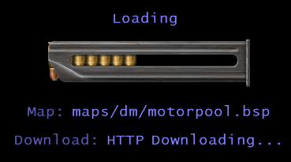
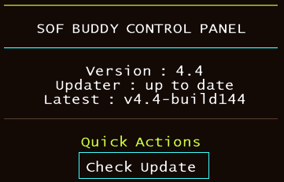

# SoF Buddy 🚀

> **Suggestions, criticisms, and issues are highly encouraged.** Please [open a GitHub issue](https://github.com/d3nd3/sof_buddy/issues), reply on a release, or reach out on [Discord](https://discord.gg/zZjnsRKPEJ) — feedback directly drives what gets fixed and built next.

> **Donations help keep development going.** If SoF Buddy is useful to you, consider [sponsoring on GitHub](https://github.com/sponsors/d3nd3) — contributions go toward monthly [Cursor](https://cursor.com) subscriptions and other tooling that make ongoing fixes and features possible.

<p align="center">
  <a href="LICENSE"></a>
  <a href="https://github.com/d3nd3/sof_buddy/releases"></a>
  <a href="https://discord.gg/zZjnsRKPEJ"></a>
  
  
</p>




> **A modern enhancement suite for Soldier of Fortune 1 and early Soldier of Fortune II: Double Helix multiplayer (sof2bud) — scaling, fixes, and quality-of-life improvements.**

<p align="center">
  <strong>Jump to:</strong>
  <a href="#sof-1--soldier-of-fortune">SoF 1</a>
  ·
  <a href="#chapter-2-sof-2-mp-sof2bud">SoF 2 MP (sof2bud)</a>
</p>

---

## SoF 1 — Soldier of Fortune

### ⚠️ **#1 THING YOU NEED TO KNOW**

**Press `F12` in-game** (or bind a key to `sofbuddy_menu sof_buddy`). That opens the SoF Buddy menu — settings, updater, profiles, and everything else. **Do this first.** If you don’t, you’re missing the main way to use SoF Buddy.

---

## ✨ Features

<details open>
<summary><b>Click to expand</b></summary>

- 🎯 **One menu for everything** — Press **F12** for settings, profiles, updates, links, and diagnostics. No console required.
- ✨ **Crisp at any resolution** — Fonts, HUD, console, intros, cinematics, and the **entire menu system** scale cleanly from 640×480 to 4K and ultrawide, with auto or manual control.
- 🧭 **Menu Scaling, rebuilt** — Stock and F12 menus stay sharp and readable at high resolutions. The redesigned F12 menu has adaptive tabs, a fixed nav bar, a comfortable widescreen reading column, themes, and readable font/tooltip presets.
- 🎯 **Crosshair studio** — Stock and community crosshair packs with live preview, tint, size control, and optional auto-scaling.
- ⚡ **Smoother framerate** — Fine-grained singleplayer FPS caps, including exact integer targets, with improved timing and CPU-friendly pacing.
- 🔎 **Faster cvars & commands** — Hash-map lookups replace the engine's linked-list scans for cvars, commands, and aliases; especially noticeable with script-heavy SoF Plus setups.
- 🖱️ **Raw mouse input** — Direct hardware input without Windows acceleration; your existing sensitivity settings still work.
- 🏷️ **Widescreen fixes** — Team icons and player names stay correctly positioned and scale with your HUD.
- 🖼️ **HD textures & extended skins** — High-resolution texture support plus extra multiplayer player models.
- 🌙 **Better lighting** — Optional WhiteMagicRaven lighting blend tweaks for a sharper, more atmospheric look.
- 🌐 **Multiplayer quality of life** — HTTP map downloads, a GameSpy master selector with known-host fallback, and faster server setup.
- ⬆️ **In-game updater** — Check, download, and install releases without leaving the game; choose the stable master channel or unstable prerelease builds, get an optional startup prompt, and (in the graphical updater) merge new recommended feature defaults while keeping explicit overrides.
- 🎮 **One-click Windows installer** — Installs SoF Buddy and can optionally set up the official SoF Plus client, with automatic CD/GOG detection.
- 🛡️ **Rock-solid compatibility** — Console crash fixes, large-config handling, Windows XP builds, and Wine/Proton support.
- 📚 **Learn more** — Feature guides live under `src/features/`; start with `scaled_menu/`, `internal_menus/`, and `more_crosshairs/`.


</details>

---

## 🚀 Installation

<details>
<summary><b>Click to expand</b></summary>

### Recommended: Windows installer (easiest)

For Windows, the installer is the most effortless way to install SoF Buddy: it installs the
universal DLL, lets you choose features, and writes the runtime selection for you. No manual
extraction or feature-enable scripts are needed.

1. [Download the latest Windows installer](https://github.com/d3nd3/sof_buddy/releases) (`sof_buddy_setup_v<version>.exe`).
2. Run it and select the SoF folder containing `SoF.exe`.
3. Keep **Recommended feature set** or choose **Custom feature selection**, then finish setup. Setup reselects the Recommended feature set on upgrades instead of reusing an older custom/disabled selection.
4. Setup automatically enables SoF Buddy and saves the original as `SoF.exe.bak`.
5. Launch SoF.

### Manual installation (Windows/Linux/Wine)

#### 1. Get SoF Buddy

- **Option A:** [Download a pre-compiled release](https://github.com/d3nd3/sof_buddy/releases)
- **Option B:** Compile from source:
  ```sh
  make               # Release build (optimized)
  make BUILD=xp      # Windows XP-targeted build
  make debug         # Debug build (with logging)
  make BUILD=xp-debug # XP-targeted debug build
  make debug-collect # Debug build with func_parents collection
  ```

### 2. Prepare Your Game Folder

- **Recommended:** Delete your `User/config.cfg` for optimal defaults.
- Extract the release `.zip` directly into your SoF root (where `SoF.exe` lives). It contains:
  - `sof_buddy.dll` (goes in the SoF root)
  - `sof_buddy/` folder (created under the SoF root)
    - `sof_buddy/funcmaps/` (contains JSON function maps)
    - `sof_buddy/*.pak` — `sndrstfindimage.pak` (silences `GL_FindImage` spam after `snd_restart`), `extended_skins.pak` (multiplayer skins; credit Acadie)
    - Windows: `sof_buddy/enable_*.cmd` scripts and `sof_buddy/patch_sof_binary.ps1`
    - Linux/Wine: `sof_buddy/enable_*.sh` scripts and `sof_buddy/patch_sof_binary.sh`
- Use the helper scripts to patch SoF.exe to load different DLLs:
  - `**enable_sofplus_and_buddy.cmd`** → Loads `sof_buddy.dll` (recommended: SoF Buddy + optional SoF Plus)
  - `**enable_sofplus.cmd`** → Loads `spcl.dll` (SoF Plus only, disables SoF Buddy)
  - `**enable_vanilla.cmd`** → Loads `WSOCK32.dll` (vanilla SoF, no mods)
  - `**sof_buddy_update.exe**` → Graphical Windows updater (universal channel / installer only): progress bar and release notes
  - `**update_from_zip.cmd**` → Standard Windows update path (all channels): extract downloaded zip (`sof_buddy/update/*.zip`) into SoF root
- SoF Buddy auto-loads `spcl.dll` if present, so it works *with* SoF Plus.

### Windows installer features

See [WINDOWS_INSTALLER.md](docs/WINDOWS_INSTALLER.md) for the complete packaging,
runtime-selection, and updater behavior.
See [FEATURES_FLOW.md](docs/FEATURES_FLOW.md) for feature-file ownership, startup
load order, reset behavior, and updater handling.

The Windows installer uses one universal DLL and writes the selected features to
`sof_buddy/features.cfg`; it does not compile a custom DLL for each installation.
GitHub publishes that universal channel separately as
`release_windows_universal.zip`; `release_windows.zip` remains the
compile-time/default channel, and the updater keeps those channels separate.
Its initial selections are generated from `features/FEATURES.txt`. The file can be
edited later (`feature` enables it, `// feature` disables it); restart SoF after changes.
If `features.cfg` is missing, the universal DLL falls back to those same defaults.
The F12 **Features** tab exposes the same choices at runtime as archived
`_sofbuddy_feature_<name>` cvars. Changing a setting whose feature is disabled
opens a **Feature Required** prompt with a shortcut to the Features tab instead
of silently doing nothing. Changes are written to `base/sofbuddy_features.cfg`,
shown as **Unavailable** when the installed non-universal DLL does not contain a
feature, and take effect after restarting SoF. On startup, those saved selections
override the installed `sof_buddy/features.cfg`; the installed file is treated as
the default set and is not overwritten by runtime toggles. Deleting
`base/sofbuddy_features.cfg` therefore falls back to the installed defaults (or
the compiled defaults when `features.cfg` is missing or was auto-generated).
The installer and updater offer **Reset feature toggles** separately from the
normal settings reset, for users expecting a newly added feature.
It also offers a **Select Additional Tasks** page with **Optional installation
options**. After you pick the game directory, Setup probes `SoF.exe` and
pre-checks the first two tasks when they still make sense for your retail build;
**Install SoF Plus client** stays off unless you enable it.

- **[OPTIONAL] Apply Windows 10+ Application Compatibility fix** — For a
  recognized `SoF.exe`, applies the same PE change GOG uses so the game behaves
  under Windows 10+ application compatibility. The original is saved as
  `SoF.exe.sofbuddy.bak`. Unrecognized executables are not modified. Skipped
  when the KB4571756 Raven-string fix is already present on the executable.

- **[OPTIONAL] Unlock full violence** — Recommended when you are not using
  SoFPlus's `spcl.dll`. Password, volume serial, and `-cs` key are optional.
  The installer sets SoF parental-control values for the volume that contains
  the chosen game folder, for the current Windows user only. Uninstalling SoF
  Buddy does not remove those per-user settings.

- **[OPTIONAL] Expecting a new feature? Reset feature toggles** — Shown only
  when an existing SoF Buddy install is detected. Clears saved feature toggles
  (`base/sofbuddy_features.cfg` and legacy feature lines) while keeping normal
  SoF Buddy settings, then uses the features selected in the installer.
  The graphical updater and update scripts offer the same reset separately from
  **fresh settings**.

- **[OPTIONAL] Install SoF Plus client (20140531)** — Bundles all four retail
  patch kits (`cd`, `gog`, `cd-kb4571756`, `gog-kb4571756`); Setup selects one
  from your `SoF.exe`, runs `sofplus-patch.exe`, and then enables
  `enable_sofplus_and_buddy` so `sof_buddy.dll` loads `spcl.dll` when present.
  Full detection rules: [WINDOWS_INSTALLER.md](docs/WINDOWS_INSTALLER.md#sof-plus-client-20140531).

</details>

---

## 🕹️ Usage

<details>
<summary><b>Click to expand</b></summary>

### Enable SoF Buddy (Recommended)

- **Windows:** Run `sof_buddy/enable_sofplus_and_buddy.cmd`
- **Linux/Wine:** Run `sof_buddy/enable_sofplus_and_buddy.sh`
- This enables SoF Buddy and optionally loads SoF Plus (if `spcl.dll` is present)
- To apply a downloaded update zip, run:
  - **Windows universal / installer:** `sof_buddy/sof_buddy_update.exe` (or `update_from_zip.cmd`)
  - **Windows compile-time channel:** `sof_buddy/update_from_zip.cmd` only
  - **Linux/Wine:** `sof_buddy/update_from_zip.sh`
  - Put `--reset-features` before the optional zip path to reset only saved
    feature toggles for a newly added feature; use `--fresh-settings` to remove
    `sofbuddy.cfg`. Scripts also accept
    `SOFBUDDY_UPDATER_RESET_FEATURES=1` / `SOFBUDDY_UPDATER_FRESH=1`.

### Enable SoF Plus Only

- **Windows:** Run `sof_buddy/enable_sofplus.cmd`
- **Linux/Wine:** Run `sof_buddy/enable_sofplus.sh`
- This disables SoF Buddy and uses only SoF Plus

### Restore Vanilla SoF

- **Windows:** Run `sof_buddy/enable_vanilla.cmd`
- **Linux/Wine:** Run `sof_buddy/enable_vanilla.sh`
- This removes all mods and restores the original game

### In-Game Commands

- `**F12`** (or `**bind <key> sofbuddy_menu sof_buddy`**) — **Open the SoF Buddy menu. Use this. It’s the main entry point for all settings, updater, and profiles.** Set an additional shortcut from **Settings → Menu → Bonus menu key**; F12 remains available. Under **UI Scale**: each scale has an integer percentage slider (**0%** = 1×, **100%** = the vertical resolution max; scale sliders commit on mouse release, and the menu-scale slider reparses the open page at the new scale) and a **Reset to default (75%)** button. The percentage is saved and reapplied after startup and resolution/video changes. **Scaling Mode** selects **Smooth** (integer-prescaled cached textures for HUD/crosshair/scoreboard images; 0% = 1×, 100% = the vertical max, linear in between, with sub-2× results rounded to the nearest integer; if the vertical max is below 2×, Smooth stays at 1×) or **Integer** (integer slider; floors font/HUD/menu/crosshair scales to 1×, 2×, 3×…). **Cinematic Images Rounding** and **Scale Cinematic Images** are on the same page.
- `sofbuddy_list_features` — Print compiled features (and whether they are on/off).
- `sofbuddy_master_next` — Query the next configured GameSpy master server.
- `sofbuddy_menu <name>` — Open an embedded internal menu page (examples: `loading`, `sof_buddy`).
- `sofbuddy_menu <menu>/<page>` — Open a specific embedded page (e.g. `sofbuddy_menu sof_buddy/cpu`).
- `sofbuddy_apply_profile_comp` — Apply competitive/low-visual profile preset.
- `sofbuddy_apply_profile_visual` — Apply visual/high-fidelity profile preset.
- `sofbuddy_update` — Check the selected channel/tag from the configured update feed and compare with your current version.
- `sofbuddy_update stable` / `sofbuddy_update unstable` — Select the stable master channel or the unstable prerelease channel and open the install prompt.
- `sofbuddy_update download` — Download the selected release zip to `sof_buddy/update/` (apply after closing game; release zips are preferred over debug zips).
- `sofbuddy_update_install` — On **universal** builds with graphical updater enabled (default), queue `sof_buddy_update.exe`; otherwise `update_from_zip.cmd` / in-DLL extract on Wine/Proton, via `winstart`, then quit SoF.
- `sofbuddy_openurl <https_url>` — Open trusted community links in your default browser (used by the Social Links menu page).

</details>

---

## 🧓 Windows XP

<details>
<summary><b>Click to expand</b></summary>

- Use the **XP package** from releases (`release_windows_xp.zip`) or compile with:
  ```sh
  make BUILD=xp
  ```
- XP builds define `SOFBUDDY_XP_BUILD` and default updater endpoints to:
  - `_sofbuddy_update_api_url` = `http://sofvault.org/sof_buddy/releases/latest.json`
  - `_sofbuddy_update_releases_url` = `http://sofvault.org/sof_buddy/releases/latest`
- If you run your own mirror/proxy feed, override in console:
  ```cfg
  set _sofbuddy_update_api_url "http://your-endpoint/latest.json"
  set _sofbuddy_update_releases_url "http://your-endpoint/releases/latest"
  ```
- XP users may hit WinHTTP TLS failures on modern HTTPS endpoints (for example GitHub API). The mirror defaults above avoid that path.
- The sofvault host syncs the XP zip + `latest.json` from GitHub on a cron schedule (`rsrc/sofvault_mirror/sync_from_github.sh`); no SSH publish from CI is required.

</details>

---

## 🍷 Wine/Proton (Linux)

<details>
<summary><b>Click to expand</b></summary>

- **Recommendation:** Use Wine for best fullscreen experience and fewer visual glitches.
- **Launch Example:**
  ```sh
  wine SoF.exe +set console 1 +set cddir CDDIR #%command%
  ```
- **Proton Note:** Proton ≤ 4.11-13 recommended. Otherwise, adjust sound frequency each startup.
- **Raw Mouse Input (`_sofbuddy_rawmouse`):** For true raw mouse input (bypassing system acceleration), you need **Proton ≥ 9.0** or **GloriousEggroll's custom Proton builds**. Standard Wine/wine-staging may still apply system mouse acceleration.
- **Optimal FPS Tweaks:** Add to `base/autoexec.cfg`:
  ```
  cl_quads 0
  ghl_light_method 0
  ghl_shadows 0
  ```
  (Note: `cl_quads 0` disables many effects.)

</details>

---

## ⚙️ Cvars (Configuration Variables)

<details>
<summary><b>Click to expand</b></summary>

Every user-facing cvar is editable from **F12 → Cvars**, which shows the live value, the
default, and a description for each one. Friendly controls also live on the named tabs (**Cpu**,
**UI Scale**, **Graphics**, **Lighting**, **Gameplay**, **Network**, **Version**, **General**, …).
Use `set <name> <value>` in the console to script them.

Internal bookkeeping cvars (layout math, migration guards, runtime status read-outs) use the
`_sb_internal_` prefix and are listed separately at the bottom. Do not edit those by hand.

### User-facing

<table style="width:100%;max-width:838px;table-layout:fixed;border-collapse:collapse">
<colgroup><col style="width:34%"><col style="width:66%"></colgroup>
<thead><tr>
<th style="text-align:left;vertical-align:top;padding:6px 8px;border-bottom:1px solid #30363d">Cvar</th><th style="text-align:left;vertical-align:top;padding:6px 8px;border-bottom:1px solid #30363d">Description</th>
</tr></thead><tbody>
<tr>
<td style="text-align:left;vertical-align:top;padding:6px 8px;border-bottom:1px solid #30363d;word-break:break-word;overflow-wrap:anywhere;width:34%"><code>_sofbuddy_high_priority</code></td>
<td style="text-align:left;vertical-align:top;padding:6px 8px;border-bottom:1px solid #30363d;width:66%"><strong>Default</strong> <code>1</code>. Set process priority to HIGH (<code>0</code> = NORMAL). F12 → CPU.</td>
</tr>
<tr>
<td style="text-align:left;vertical-align:top;padding:6px 8px;border-bottom:1px solid #30363d;word-break:break-word;overflow-wrap:anywhere;width:34%"><code>_sofbuddy_sleep</code></td>
<td style="text-align:left;vertical-align:top;padding:6px 8px;border-bottom:1px solid #30363d;width:66%"><strong>Default</strong> <code>1</code>. CPU-saving sleep between frames. F12 → CPU.</td>
</tr>
<tr>
<td style="text-align:left;vertical-align:top;padding:6px 8px;border-bottom:1px solid #30363d;word-break:break-word;overflow-wrap:anywhere;width:34%"><code>_sofbuddy_sleep_jitter</code></td>
<td style="text-align:left;vertical-align:top;padding:6px 8px;border-bottom:1px solid #30363d;width:66%"><strong>Default</strong> <code>0</code>. Frame time borrowing. Experimental; can worsen pacing, leave <code>0</code> unless needed. F12 → CPU.</td>
</tr>
<tr>
<td style="text-align:left;vertical-align:top;padding:6px 8px;border-bottom:1px solid #30363d;word-break:break-word;overflow-wrap:anywhere;width:34%"><code>_sofbuddy_sleep_busyticks</code></td>
<td style="text-align:left;vertical-align:top;padding:6px 8px;border-bottom:1px solid #30363d;width:66%"><strong>Default</strong> <code>2</code>. 1 ms busyloop ticks per frame. Lower saves CPU, <code>0</code> may stutter. F12 → CPU.</td>
</tr>
<tr>
<td style="text-align:left;vertical-align:top;padding:6px 8px;border-bottom:1px solid #30363d;word-break:break-word;overflow-wrap:anywhere;width:34%"><code>_sofbuddy_hashmap</code></td>
<td style="text-align:left;vertical-align:top;padding:6px 8px;border-bottom:1px solid #30363d;width:66%"><strong>Default</strong> <code>1</code>. Hash-map lookups for cvars, commands, and aliases. Read once at startup; restart SoF after changing it. <code>0</code> keeps the engine's original linked-list scans.</td>
</tr>
<tr>
<td style="text-align:left;vertical-align:top;padding:6px 8px;border-bottom:1px solid #30363d;word-break:break-word;overflow-wrap:anywhere;width:34%"><code>_sofbuddy_cl_maxfps_exact</code></td>
<td style="text-align:left;vertical-align:top;padding:6px 8px;border-bottom:1px solid #30363d;width:66%"><strong>Default</strong> <code>0</code>. <code>1</code> = <code>cl_maxfps</code> is literal integer FPS; <code>0</code> = legacy millisecond-budget list. Requires Singleplayer Max FPS. F12 → CPU.</td>
</tr>
<tr>
<td style="text-align:left;vertical-align:top;padding:6px 8px;border-bottom:1px solid #30363d;word-break:break-word;overflow-wrap:anywhere;width:34%"><code>_sofbuddy_perf_profile</code></td>
<td style="text-align:left;vertical-align:top;padding:6px 8px;border-bottom:1px solid #30363d;width:66%"><strong>Default</strong> <code>0</code>. Perf preset: <code>0</code> Competitive, <code>1</code> High Visual, <code>2</code> Low Visual, <code>3</code> Custom/Current. The **Cpu** tab selects Custom/Current when the adjusted cvars do not match a preset. F12 → Cpu.</td>
</tr>
<tr>
<td style="text-align:left;vertical-align:top;padding:6px 8px;border-bottom:1px solid #30363d;word-break:break-word;overflow-wrap:anywhere;width:34%"><code>_sofbuddy_font_scale</code></td>
<td style="text-align:left;vertical-align:top;padding:6px 8px;border-bottom:1px solid #30363d;width:66%"><strong>Default</strong> <code>1</code>. Computed font scale, driven by <code>_sofbuddy_font_scale_pct</code> (<code>0%</code> = 1×, <code>100%</code> = vertical max). F12 → UI Scale.</td>
</tr>
<tr>
<td style="text-align:left;vertical-align:top;padding:6px 8px;border-bottom:1px solid #30363d;word-break:break-word;overflow-wrap:anywhere;width:34%"><code>_sofbuddy_font_pack</code></td>
<td style="text-align:left;vertical-align:top;padding:6px 8px;border-bottom:1px solid #30363d;width:66%"><strong>Default</strong> <code>0</code>. Font mode: <code>0</code> Default, <code>1</code> Force SoFPlus, <code>2</code> Force Vanilla. Changing it reloads the renderer. F12 → UI Scale.</td>
</tr>
<tr>
<td style="text-align:left;vertical-align:top;padding:6px 8px;border-bottom:1px solid #30363d;word-break:break-word;overflow-wrap:anywhere;width:34%"><code>_sofbuddy_hud_scale</code></td>
<td style="text-align:left;vertical-align:top;padding:6px 8px;border-bottom:1px solid #30363d;width:66%"><strong>Default</strong> <code>1</code>. Computed HUD scale, driven by <code>_sofbuddy_hud_scale_pct</code> (<code>0%</code> = 1×, <code>100%</code> = vertical max). F12 → UI Scale.</td>
</tr>
<tr>
<td style="text-align:left;vertical-align:top;padding:6px 8px;border-bottom:1px solid #30363d;word-break:break-word;overflow-wrap:anywhere;width:34%"><code>_sofbuddy_scale_round_auto</code></td>
<td style="text-align:left;vertical-align:top;padding:6px 8px;border-bottom:1px solid #30363d;width:66%"><strong>Default</strong> <code>0</code>. Snap the effective menu and cinematic image scale to the round step. <code>1</code> on, <code>0</code> off. F12 → UI Scale.</td>
</tr>
<tr>
<td style="text-align:left;vertical-align:top;padding:6px 8px;border-bottom:1px solid #30363d;word-break:break-word;overflow-wrap:anywhere;width:34%"><code>_sofbuddy_scale_round_ratio</code></td>
<td style="text-align:left;vertical-align:top;padding:6px 8px;border-bottom:1px solid #30363d;width:66%"><strong>Default</strong> <code>0.25</code>. Snap increment for direct console font/HUD/menu scale values (<code>0.05</code>, <code>0.1</code>, <code>0.125</code>, <code>0.25</code>, <code>0.5</code>, <code>1</code>). Also applies to cinematic image scaling when rounding is on. F12 → UI Scale.</td>
</tr>
<tr>
<td style="text-align:left;vertical-align:top;padding:6px 8px;border-bottom:1px solid #30363d;word-break:break-word;overflow-wrap:anywhere;width:34%"><code>_sofbuddy_scale_cinematic_pics</code></td>
<td style="text-align:left;vertical-align:top;padding:6px 8px;border-bottom:1px solid #30363d;width:66%"><strong>Default</strong> <code>1</code>. Scale cinematic credit/fade images (<code>SP_FLAG_CREDIT</code> / <code>SCR_DrawCinemaScope</code>) up from 640×480. <code>1</code> on, <code>0</code> off. F12 → UI Scale.</td>
</tr>
<tr>
<td style="text-align:left;vertical-align:top;padding:6px 8px;border-bottom:1px solid #30363d;word-break:break-word;overflow-wrap:anywhere;width:34%"><code>_sofbuddy_crossh_scale</code></td>
<td style="text-align:left;vertical-align:top;padding:6px 8px;border-bottom:1px solid #30363d;width:66%"><strong>Default</strong> <code>1</code>. Crosshair size multiplier. F12 → Gameplay → Crosshair.</td>
</tr>
<tr>
<td style="text-align:left;vertical-align:top;padding:6px 8px;border-bottom:1px solid #30363d;word-break:break-word;overflow-wrap:anywhere;width:34%"><code>_sofbuddy_crossh_scale_auto</code></td>
<td style="text-align:left;vertical-align:top;padding:6px 8px;border-bottom:1px solid #30363d;width:66%"><strong>Default</strong> <code>0</code> (Off). Auto-scale the crosshair from the vertical scale; hides the manual scale control when On. F12 → Gameplay.</td>
</tr>
<tr>
<td style="text-align:left;vertical-align:top;padding:6px 8px;border-bottom:1px solid #30363d;word-break:break-word;overflow-wrap:anywhere;width:34%"><code>_sofbuddy_crosshair_theme</code></td>
<td style="text-align:left;vertical-align:top;padding:6px 8px;border-bottom:1px solid #30363d;width:66%"><strong>Default</strong> <code>0</code>. Crosshair theme index used by the crosshair picker. F12 → Gameplay.</td>
</tr>
<tr>
<td style="text-align:left;vertical-align:top;padding:6px 8px;border-bottom:1px solid #30363d;word-break:break-word;overflow-wrap:anywhere;width:34%"><code>_sofbuddy_icons_autoscale</code></td>
<td style="text-align:left;vertical-align:top;padding:6px 8px;border-bottom:1px solid #30363d;width:66%"><strong>Default</strong> <code>1</code>. Scale team icons and playernames drawn above players with the HUD scale. <code>1</code> on, <code>0</code> off. F12 → UI Scale.</td>
</tr>
<tr>
<td style="text-align:left;vertical-align:top;padding:6px 8px;border-bottom:1px solid #30363d;word-break:break-word;overflow-wrap:anywhere;width:34%"><code>_sofbuddy_console_size</code></td>
<td style="text-align:left;vertical-align:top;padding:6px 8px;border-bottom:1px solid #30363d;width:66%"><strong>Default</strong> <code>0.5</code>. Console height as a fraction of screen height (<code>0</code>–<code>1</code>, <code>1</code> = fullscreen). F12 → UI Scale.</td>
</tr>
<tr>
<td style="text-align:left;vertical-align:top;padding:6px 8px;border-bottom:1px solid #30363d;word-break:break-word;overflow-wrap:anywhere;width:34%"><code>_sofbuddy_minfilter_unmipped</code></td>
<td style="text-align:left;vertical-align:top;padding:6px 8px;border-bottom:1px solid #30363d;width:66%"><strong>Default</strong> <code>GL_LINEAR</code>. Min filter for sky and other unmipped textures. <code>GL_NEAREST</code> or <code>GL_LINEAR</code> (mipmap modes make textures incomplete). F12 → Graphics.</td>
</tr>
<tr>
<td style="text-align:left;vertical-align:top;padding:6px 8px;border-bottom:1px solid #30363d;word-break:break-word;overflow-wrap:anywhere;width:34%"><code>_sofbuddy_magfilter_unmipped</code></td>
<td style="text-align:left;vertical-align:top;padding:6px 8px;border-bottom:1px solid #30363d;width:66%"><strong>Default</strong> <code>GL_LINEAR</code>. Mag filter for sky and other unmipped textures. F12 → Graphics.</td>
</tr>
<tr>
<td style="text-align:left;vertical-align:top;padding:6px 8px;border-bottom:1px solid #30363d;word-break:break-word;overflow-wrap:anywhere;width:34%"><code>_sofbuddy_minfilter_mipped</code></td>
<td style="text-align:left;vertical-align:top;padding:6px 8px;border-bottom:1px solid #30363d;width:66%"><strong>Default</strong> <code>GL_LINEAR_MIPMAP_LINEAR</code>. Min filter for mipmapped textures. F12 → Graphics.</td>
</tr>
<tr>
<td style="text-align:left;vertical-align:top;padding:6px 8px;border-bottom:1px solid #30363d;word-break:break-word;overflow-wrap:anywhere;width:34%"><code>_sofbuddy_magfilter_mipped</code></td>
<td style="text-align:left;vertical-align:top;padding:6px 8px;border-bottom:1px solid #30363d;width:66%"><strong>Default</strong> <code>GL_LINEAR</code>. Mag filter for mipmapped textures. F12 → Graphics.</td>
</tr>
<tr>
<td style="text-align:left;vertical-align:top;padding:6px 8px;border-bottom:1px solid #30363d;word-break:break-word;overflow-wrap:anywhere;width:34%"><code>_sofbuddy_minfilter_ui</code></td>
<td style="text-align:left;vertical-align:top;padding:6px 8px;border-bottom:1px solid #30363d;width:66%"><strong>Default</strong> <code>GL_NEAREST</code>. Min filter for UI textures. Keep <code>GL_NEAREST</code> — LINEAR makes fonts unreadable. F12 → Graphics.</td>
</tr>
<tr>
<td style="text-align:left;vertical-align:top;padding:6px 8px;border-bottom:1px solid #30363d;word-break:break-word;overflow-wrap:anywhere;width:34%"><code>_sofbuddy_magfilter_ui</code></td>
<td style="text-align:left;vertical-align:top;padding:6px 8px;border-bottom:1px solid #30363d;width:66%"><strong>Default</strong> <code>GL_NEAREST</code>. Mag filter for UI textures. Keep <code>GL_NEAREST</code> — LINEAR makes fonts unreadable. F12 → Graphics.</td>
</tr>
<tr>
<td style="text-align:left;vertical-align:top;padding:6px 8px;border-bottom:1px solid #30363d;word-break:break-word;overflow-wrap:anywhere;width:34%"><code>_sofbuddy_lighting_overbright</code></td>
<td style="text-align:left;vertical-align:top;padding:6px 8px;border-bottom:1px solid #30363d;width:66%"><strong>Default</strong> <code>0</code>. Overbright lighting. <code>1</code> on. When on, it overrides the manual blend cvars below. F12 → Lighting.</td>
</tr>
<tr>
<td style="text-align:left;vertical-align:top;padding:6px 8px;border-bottom:1px solid #30363d;word-break:break-word;overflow-wrap:anywhere;width:34%"><code>_sofbuddy_lighting_cutoff</code></td>
<td style="text-align:left;vertical-align:top;padding:6px 8px;border-bottom:1px solid #30363d;width:66%"><strong>Default</strong> <code>64</code>. Dynamic light threshold (DLIGHT_CUTOFF). F12 → Lighting.</td>
</tr>
<tr>
<td style="text-align:left;vertical-align:top;padding:6px 8px;border-bottom:1px solid #30363d;word-break:break-word;overflow-wrap:anywhere;width:34%"><code>_sofbuddy_water_size</code></td>
<td style="text-align:left;vertical-align:top;padding:6px 8px;border-bottom:1px solid #30363d;width:66%"><strong>Default</strong> <code>64</code>. Warp texture chunk size for water, lava, and sky turbulence. Smaller is finer (more work), minimum <code>16</code>. F12 → Graphics.</td>
</tr>
<tr>
<td style="text-align:left;vertical-align:top;padding:6px 8px;border-bottom:1px solid #30363d;word-break:break-word;overflow-wrap:anywhere;width:34%"><code>_sofbuddy_lightblend_src</code></td>
<td style="text-align:left;vertical-align:top;padding:6px 8px;border-bottom:1px solid #30363d;width:66%"><strong>Default</strong> <code>GL_ZERO</code>. Lightmap blend source. Experimental, leave at default. F12 → Lighting.</td>
</tr>
<tr>
<td style="text-align:left;vertical-align:top;padding:6px 8px;border-bottom:1px solid #30363d;word-break:break-word;overflow-wrap:anywhere;width:34%"><code>_sofbuddy_lightblend_dst</code></td>
<td style="text-align:left;vertical-align:top;padding:6px 8px;border-bottom:1px solid #30363d;width:66%"><strong>Default</strong> <code>GL_SRC_COLOR</code>. Lightmap blend destination. Experimental, leave at default. F12 → Lighting.</td>
</tr>
<tr>
<td style="text-align:left;vertical-align:top;padding:6px 8px;border-bottom:1px solid #30363d;word-break:break-word;overflow-wrap:anywhere;width:34%"><code>_sofbuddy_shiny_spherical</code></td>
<td style="text-align:left;vertical-align:top;padding:6px 8px;border-bottom:1px solid #30363d;width:66%"><strong>Default</strong> <code>1</code>. Let shiny <code>gl_detailtexturing</code> change with view angle. <code>1</code> on, <code>0</code> off. F12 → Lighting.</td>
</tr>
<tr>
<td style="text-align:left;vertical-align:top;padding:6px 8px;border-bottom:1px solid #30363d;word-break:break-word;overflow-wrap:anywhere;width:34%"><code>_sofbuddy_rawmouse</code></td>
<td style="text-align:left;vertical-align:top;padding:6px 8px;border-bottom:1px solid #30363d;width:66%"><strong>Default</strong> <code>0</code>. Raw mouse input via the Raw Input API, bypassing Windows pointer acceleration. <code>1</code> on, <code>0</code> off. F12 → Gameplay.</td>
</tr>
<tr>
<td style="text-align:left;vertical-align:top;padding:6px 8px;border-bottom:1px solid #30363d;word-break:break-word;overflow-wrap:anywhere;width:34%"><code>_sp_cl_master_gamespy</code></td>
<td style="text-align:left;vertical-align:top;padding:6px 8px;border-bottom:1px solid #30363d;width:66%"><strong>Default</strong> <code>sof1master.sofvault.org</code>. Selected GameSpy master server; choose a known host from F12 → Network. SoFPlus saves this value across launches.</td>
</tr>
<tr>
<td style="text-align:left;vertical-align:top;padding:6px 8px;border-bottom:1px solid #30363d;word-break:break-word;overflow-wrap:anywhere;width:34%"><code>_sofbuddy_http_maps</code></td>
<td style="text-align:left;vertical-align:top;padding:6px 8px;border-bottom:1px solid #30363d;width:66%"><strong>Default</strong> <code>1</code>. HTTP map assist: <code>0</code> Off, <code>1</code> Primary, <code>2</code> Random provider, <code>3</code> Rotate providers. F12 → Network.</td>
</tr>
<tr>
<td style="text-align:left;vertical-align:top;padding:6px 8px;border-bottom:1px solid #30363d;word-break:break-word;overflow-wrap:anywhere;width:34%"><code>_sofbuddy_http_maps_dl_1</code></td>
<td style="text-align:left;vertical-align:top;padding:6px 8px;border-bottom:1px solid #30363d;width:66%"><strong>Default</strong> <code>https://sofvault.org/sof1maps</code>. Zip download base URL, provider slot 1. F12 → Network (provider block) or Cvars.</td>
</tr>
<tr>
<td style="text-align:left;vertical-align:top;padding:6px 8px;border-bottom:1px solid #30363d;word-break:break-word;overflow-wrap:anywhere;width:34%"><code>_sofbuddy_http_maps_dl_2</code></td>
<td style="text-align:left;vertical-align:top;padding:6px 8px;border-bottom:1px solid #30363d;width:66%"><strong>Default</strong> <code>https://raw.githubusercontent.com/plowsof/sof1maps/main</code>. Zip download base URL, provider slot 2. F12 → Network or Cvars.</td>
</tr>
<tr>
<td style="text-align:left;vertical-align:top;padding:6px 8px;border-bottom:1px solid #30363d;word-break:break-word;overflow-wrap:anywhere;width:34%"><code>_sofbuddy_http_maps_dl_3</code></td>
<td style="text-align:left;vertical-align:top;padding:6px 8px;border-bottom:1px solid #30363d;width:66%"><strong>Default</strong> <em>empty</em>. Zip download base URL, provider slot 3. F12 → Network or Cvars.</td>
</tr>
<tr>
<td style="text-align:left;vertical-align:top;padding:6px 8px;border-bottom:1px solid #30363d;word-break:break-word;overflow-wrap:anywhere;width:34%"><code>_sofbuddy_http_maps_crc_1</code></td>
<td style="text-align:left;vertical-align:top;padding:6px 8px;border-bottom:1px solid #30363d;width:66%"><strong>Default</strong> <code>https://sofvault.org/sof1maps</code>. CRC lookup base URL, slot 1 (HTTP Range fetch of the zip central directory). F12 → Network or Cvars.</td>
</tr>
<tr>
<td style="text-align:left;vertical-align:top;padding:6px 8px;border-bottom:1px solid #30363d;word-break:break-word;overflow-wrap:anywhere;width:34%"><code>_sofbuddy_http_maps_crc_2</code></td>
<td style="text-align:left;vertical-align:top;padding:6px 8px;border-bottom:1px solid #30363d;width:66%"><strong>Default</strong> <code>https://raw.githubusercontent.com/plowsof/sof1maps/main</code>. CRC lookup base URL, slot 2. F12 → Network or Cvars.</td>
</tr>
<tr>
<td style="text-align:left;vertical-align:top;padding:6px 8px;border-bottom:1px solid #30363d;word-break:break-word;overflow-wrap:anywhere;width:34%"><code>_sofbuddy_http_maps_crc_3</code></td>
<td style="text-align:left;vertical-align:top;padding:6px 8px;border-bottom:1px solid #30363d;width:66%"><strong>Default</strong> <em>empty</em>. CRC lookup base URL, slot 3. F12 → Network or Cvars.</td>
</tr>
<tr>
<td style="text-align:left;vertical-align:top;padding:6px 8px;border-bottom:1px solid #30363d;word-break:break-word;overflow-wrap:anywhere;width:34%"><code>_sofbuddy_http_show_providers</code></td>
<td style="text-align:left;vertical-align:top;padding:6px 8px;border-bottom:1px solid #30363d;width:66%"><strong>Default</strong> <code>0</code>. Show the provider + updater URL inputs on the Network tab. <code>1</code> show, <code>0</code> hide. F12 → Cvars (value); URLs on Network when shown.</td>
</tr>
<tr>
<td style="text-align:left;vertical-align:top;padding:6px 8px;border-bottom:1px solid #30363d;word-break:break-word;overflow-wrap:anywhere;width:34%"><code>_sofbuddy_update_check_startup</code></td>
<td style="text-align:left;vertical-align:top;padding:6px 8px;border-bottom:1px solid #30363d;width:66%"><strong>Default</strong> <code>1</code>. Run the updater check at startup and open the internal prompt when a newer release is found. F12 → General.</td>
</tr>
<tr>
<td style="text-align:left;vertical-align:top;padding:6px 8px;border-bottom:1px solid #30363d;word-break:break-word;overflow-wrap:anywhere;width:34%"><code>_sofbuddy_update_show_all_releases</code></td>
<td style="text-align:left;vertical-align:top;padding:6px 8px;border-bottom:1px solid #30363d;width:66%"><strong>Default</strong> <code>0</code>. Show up to 12 recent release tags in F12 after Refresh release list; off shows channels plus the latest stable/unstable tags. F12 → Version.</td>
</tr>
<tr>
<td style="text-align:left;vertical-align:top;padding:6px 8px;border-bottom:1px solid #30363d;word-break:break-word;overflow-wrap:anywhere;width:34%"><code>_sofbuddy_update_startup_stable_only</code></td>
<td style="text-align:left;vertical-align:top;padding:6px 8px;border-bottom:1px solid #30363d;width:66%"><strong>Default</strong> <code>0</code>. Startup prompt only for the stable channel (master); <code>1</code> stable only, <code>0</code> use the selected install target. F12 → General.</td>
</tr>
<tr>
<td style="text-align:left;vertical-align:top;padding:6px 8px;border-bottom:1px solid #30363d;word-break:break-word;overflow-wrap:anywhere;width:34%"><code>_sofbuddy_update_use_gui</code></td>
<td style="text-align:left;vertical-align:top;padding:6px 8px;border-bottom:1px solid #30363d;width:66%"><strong>Default</strong> <code>1</code> on <strong>universal</strong> builds (Windows, Wine, and Proton); <code>0</code> on non-universal channels. Use <code>sof_buddy_update.exe</code> when queuing an install (<code>sofbuddy_update_install</code>) unless turned off (then script / in-DLL extract on Wine/Proton). Toggle on <strong>F12 → Version</strong>.</td>
</tr>
<tr>
<td style="text-align:left;vertical-align:top;padding:6px 8px;border-bottom:1px solid #30363d;word-break:break-word;overflow-wrap:anywhere;width:34%"><code>_sofbuddy_update_replace_features</code></td>
<td style="text-align:left;vertical-align:top;padding:6px 8px;border-bottom:1px solid #30363d;width:66%"><strong>Default</strong> <code>1</code> on <strong>universal</strong> builds; ignored on compile-time channels (they always keep <code>features.cfg</code>). Merge newly recommended feature defaults into saved toggles when updating (Wine/Proton in-DLL extract), preserving explicit overrides. The graphical updater exposes the same choice as a checked-by-default tick box; <code>update_from_zip.cmd</code>/<code>.sh</code> prompt with <strong>Yes</strong> as the default. Choose <strong>Reset feature toggles</strong> to discard both the package file and saved overrides and use compiled defaults. Non-universal builds cannot change features in-game, so their updater never prompts for or replaces <code>features.cfg</code>.</td>
</tr>
<tr>
<td style="text-align:left;vertical-align:top;padding:6px 8px;border-bottom:1px solid #30363d;word-break:break-word;overflow-wrap:anywhere;width:34%"><code>_sofbuddy_update_api_url</code></td>
<td style="text-align:left;vertical-align:top;padding:6px 8px;border-bottom:1px solid #30363d;width:66%"><strong>Default</strong> build-dependent. Updater JSON feed URL. XP builds default to the sofvault mirror, non-XP to the GitHub API. F12 → Network or Cvars.</td>
</tr>
<tr>
<td style="text-align:left;vertical-align:top;padding:6px 8px;border-bottom:1px solid #30363d;word-break:break-word;overflow-wrap:anywhere;width:34%"><code>_sofbuddy_update_releases_url</code></td>
<td style="text-align:left;vertical-align:top;padding:6px 8px;border-bottom:1px solid #30363d;width:66%"><strong>Default</strong> build-dependent. Human release page URL shown in updater status/help. F12 → Network or Cvars.</td>
</tr>
<tr>
<td style="text-align:left;vertical-align:top;padding:6px 8px;border-bottom:1px solid #30363d;word-break:break-word;overflow-wrap:anywhere;width:34%"><code>_sofbuddy_update_target_tag</code></td>
<td style="text-align:left;vertical-align:top;padding:6px 8px;border-bottom:1px solid #30363d;width:66%"><strong>Default</strong> <code>stable</code>. Release target: <code>stable</code> (latest non-prerelease from master), <code>unstable</code> (latest prerelease from the unstable branch), or a tag. Legacy <code>latest</code> is treated as <code>unstable</code>. Run <code>sofbuddy_update releases</code> to refresh the tag list after changing. F12 → Cvars (or console).</td>
</tr>
<tr>
<td style="text-align:left;vertical-align:top;padding:6px 8px;border-bottom:1px solid #30363d;word-break:break-word;overflow-wrap:anywhere;width:34%"><code>_sofbuddy_menu_theme</code></td>
<td style="text-align:left;vertical-align:top;padding:6px 8px;border-bottom:1px solid #30363d;width:66%"><strong>Default</strong> <code>21</code> (Cob2). Menu color preset (<code>0</code> … <code>38</code>). Reopen the menu to apply. F12 → General.</td>
</tr>
<tr>
<td style="text-align:left;vertical-align:top;padding:6px 8px;border-bottom:1px solid #30363d;word-break:break-word;overflow-wrap:anywhere;width:34%"><code>_sofbuddy_menu_hotkey</code></td>
<td style="text-align:left;vertical-align:top;padding:6px 8px;border-bottom:1px solid #30363d;width:66%"><tr>
<td style="text-align:left;vertical-align:top;padding:6px 8px;border-bottom:1px solid #30363d;word-break:break-word;overflow-wrap:anywhere;width:34%"><code>_sofbuddy_menu_scale</code></td>
<td style="text-align:left;vertical-align:top;padding:6px 8px;border-bottom:1px solid #30363d;width:66%"><strong>Default</strong> <code>1</code>. Computed menu scale, driven by <code>_sofbuddy_menu_scale_pct</code> (<code>0%</code> = 1×, <code>100%</code> = vertical max). F12 → UI Scale.</td>
</tr>
<strong>Default</strong> <code>F12</code>. Keyboard key that opens the F12 menu. F12 → General.</td>
</tr>
<tr>
<td style="text-align:left;vertical-align:top;padding:6px 8px;border-bottom:1px solid #30363d;word-break:break-word;overflow-wrap:anywhere;width:34%"><code>_sofbuddy_menu_tip_appear</code></td>
<td style="text-align:left;vertical-align:top;padding:6px 8px;border-bottom:1px solid #30363d;width:66%"><strong>Default</strong> <code>750</code>. Tooltip appearance delay in milliseconds (<code>0</code> immediate). F12 → General.</td>
</tr>
<tr>
<td style="text-align:left;vertical-align:top;padding:6px 8px;border-bottom:1px solid #30363d;word-break:break-word;overflow-wrap:anywhere;width:34%"><code>_sofbuddy_menu_tip_font</code></td>
<td style="text-align:left;vertical-align:top;padding:6px 8px;border-bottom:1px solid #30363d;width:66%"><strong>Default</strong> <code>0</code> (Small). Tooltip font tier: <code>0</code> Small, <code>1</code> Medium, <code>2</code> Title. Reopen F12 to apply. F12 → General.</td>
</tr>
<tr>
<td style="text-align:left;vertical-align:top;padding:6px 8px;border-bottom:1px solid #30363d;word-break:break-word;overflow-wrap:anywhere;width:34%"><code>_sofbuddy_menu_font_size_style</code></td>
<td style="text-align:left;vertical-align:top;padding:6px 8px;border-bottom:1px solid #30363d;width:66%"><strong>Default</strong> <code>0</code> (Small). F12 font-tier preset: <code>0</code> Small, <code>1</code> Normal, <code>2</code> Large, <code>3</code> Extra Large. Reopen F12 to apply. F12 → General.</td>
</tr>
<tr>
<td style="text-align:left;vertical-align:top;padding:6px 8px;border-bottom:1px solid #30363d;word-break:break-word;overflow-wrap:anywhere;width:34%"><code>_sofbuddy_snd_quiet_alt_tab</code></td>
<td style="text-align:left;vertical-align:top;padding:6px 8px;border-bottom:1px solid #30363d;width:66%"><strong>Default</strong> <code>1</code>. Hide DirectSound buffer recreation messages, including after Alt-Tab. <code>1</code> on, <code>0</code> off. F12 → General.</td>
</tr>
<tr>
<td style="text-align:left;vertical-align:top;padding:6px 8px;border-bottom:1px solid #30363d;word-break:break-word;overflow-wrap:anywhere;width:34%"><code>_sofbuddy_loading_lock_input</code></td>
<td style="text-align:left;vertical-align:top;padding:6px 8px;border-bottom:1px solid #30363d;width:66%"><strong>Default</strong> <code>0</code>. Block opening the console while the loading screen is up (<code>1</code> locked, <code>0</code> unlocked). F12 → General.</td>
</tr>
<tr>
<td style="text-align:left;vertical-align:top;padding:6px 8px;border-bottom:1px solid #30363d;word-break:break-word;overflow-wrap:anywhere;width:34%"><code>_sofbuddy_loading_show_mapname</code></td>
<td style="text-align:left;vertical-align:top;padding:6px 8px;border-bottom:1px solid #30363d;width:66%"><strong>Default</strong> <code>1</code>. Show the current map name on the loading screen header. <code>1</code> on, <code>0</code> off. F12 → General.</td>
</tr>
<tr>
<td style="text-align:left;vertical-align:top;padding:6px 8px;border-bottom:1px solid #30363d;word-break:break-word;overflow-wrap:anywhere;width:34%"><code>_sofbuddy_loading_show_download</code></td>
<td style="text-align:left;vertical-align:top;padding:6px 8px;border-bottom:1px solid #30363d;width:66%"><strong>Default</strong> <code>1</code>. Show HTTP/download status on the loading screen header. <code>1</code> on, <code>0</code> off. F12 → General.</td>
</tr>
<tr>
<td style="text-align:left;vertical-align:top;padding:6px 8px;border-bottom:1px solid #30363d;word-break:break-word;overflow-wrap:anywhere;width:34%"><code>_sofbuddy_entity_edit</code></td>
<td style="text-align:left;vertical-align:top;padding:6px 8px;border-bottom:1px solid #30363d;width:66%"><strong>Default</strong> <code>0</code>. <strong>Map entity / map study tools (off by default):</strong> set <code>1</code> to enable the spawn <strong>cache</strong> during load, <code>sofbuddy_entities_draw</code> / <code>ev_debugbox</code>, and <strong>primary-attack intersect</strong>. Nothing in this feature runs until this is on — see <a href="src/features/entity_visualizer/README.md#map-entity-wireframes-how-it-works">Map entity wireframes</a>. F12 → Cvars (Map Study section).</td>
</tr>
<tr>
<td style="text-align:left;vertical-align:top;padding:6px 8px;border-bottom:1px solid #30363d;word-break:break-word;overflow-wrap:anywhere;width:34%"><code>_sofbuddy_entities_draw_verbose</code></td>
<td style="text-align:left;vertical-align:top;padding:6px 8px;border-bottom:1px solid #30363d;width:66%"><strong>Default</strong> <code>0</code>. Log one line per entity when <code>sofbuddy_entities_draw</code> runs. F12 → Cvars (Map Study).</td>
</tr>
<tr>
<td style="text-align:left;vertical-align:top;padding:6px 8px;border-bottom:1px solid #30363d;word-break:break-word;overflow-wrap:anywhere;width:34%"><code>_sofbuddy_map_debug_map</code></td>
<td style="text-align:left;vertical-align:top;padding:6px 8px;border-bottom:1px solid #30363d;width:66%"><strong>Default</strong> <em>empty</em>. Map stem for Map study load + spawn recording, no path and no <code>.bsp</code> (e.g. <code>moscow</code>). F12 → Cvars (Map Study) or <code>sofbuddy_menu sof_buddy/map_debug</code>.</td>
</tr>
<tr>
<td style="text-align:left;vertical-align:top;padding:6px 8px;border-bottom:1px solid #30363d;word-break:break-word;overflow-wrap:anywhere;width:34%"><code>_sofbuddy_map_study_deathmatch</code></td>
<td style="text-align:left;vertical-align:top;padding:6px 8px;border-bottom:1px solid #30363d;width:66%"><strong>Default</strong> <code>4</code>. <code>deathmatch</code> mode applied before the map loads. <code>4</code> = CTF, which suits most map testing. F12 → Cvars (Map Study) or map_debug page.</td>
</tr>
</tbody></table>


The four `_sofbuddy_entity_edit` / `_sofbuddy_entities_draw_verbose` / `_sofbuddy_map_debug_map` /
`_sofbuddy_map_study_deathmatch` cvars come from the `entity_visualizer` feature, which is
**disabled by default** in `features/FEATURES.txt`. In a default build they are never registered,
so they do not appear in the console and the **Map Study** section is hidden from the Cvars tab
(gated on `_sb_internal_feature_entity_visualizer` via `<cinclude>`). Enable that feature to get
them.

- See [OpenGL glBlendFunc docs](https://www.khronos.org/registry/OpenGL-Refpages/gl4/html/glBlendFunc.xhtml) for blend values.
- Cvars with `CVAR_SOFBUDDY_ARCHIVE` persist to `base/sofbuddy.cfg` and are reapplied on startup. `_sofbuddy_feature_*` toggles persist separately in `base/sofbuddy_features.cfg`.

### Server-visible client info

<table style="width:100%;max-width:838px;table-layout:fixed;border-collapse:collapse">
<colgroup><col style="width:34%"><col style="width:66%"></colgroup>
<thead><tr>
<th style="text-align:left;vertical-align:top;padding:6px 8px;border-bottom:1px solid #30363d">Cvar</th><th style="text-align:left;vertical-align:top;padding:6px 8px;border-bottom:1px solid #30363d">Purpose</th>
</tr></thead><tbody>
<tr>
<td style="text-align:left;vertical-align:top;padding:6px 8px;border-bottom:1px solid #30363d;word-break:break-word;overflow-wrap:anywhere;width:34%"><code>_sp_cl_info_sofbuddy</code></td>
<td style="text-align:left;vertical-align:top;padding:6px 8px;border-bottom:1px solid #30363d;width:66%"><code>windows-<version>-<build></code>, <code>wine-<version>-<build></code>, or <code>universal-<version>-<build></code>, sent with client userinfo so a server can identify the SoF Buddy channel.</td>
</tr>
</tbody></table>


The build number is the GitHub Actions run number; local builds use `local`.
This is informational client metadata, not an anti-cheat signal.

### Internal (`_sb_internal_`)

Written by sof_buddy itself. Values are recomputed each launch, so editing them has no lasting effect.

<table style="width:100%;max-width:838px;table-layout:fixed;border-collapse:collapse">
<colgroup><col style="width:34%"><col style="width:66%"></colgroup>
<thead><tr>
<th style="text-align:left;vertical-align:top;padding:6px 8px;border-bottom:1px solid #30363d">Cvar</th><th style="text-align:left;vertical-align:top;padding:6px 8px;border-bottom:1px solid #30363d">Purpose</th>
</tr></thead><tbody>
<tr>
<td style="text-align:left;vertical-align:top;padding:6px 8px;border-bottom:1px solid #30363d;word-break:break-word;overflow-wrap:anywhere;width:34%"><code>_sb_internal_version</code></td>
<td style="text-align:left;vertical-align:top;padding:6px 8px;border-bottom:1px solid #30363d;width:66%">Build version string, reported on the Version tab.</td>
</tr>
<tr>
<td style="text-align:left;vertical-align:top;padding:6px 8px;border-bottom:1px solid #30363d;word-break:break-word;overflow-wrap:anywhere;width:34%"><code>_sb_internal_build_flavour</code></td>
<td style="text-align:left;vertical-align:top;padding:6px 8px;border-bottom:1px solid #30363d;width:66%">Release channel label (Universal, Windows, Linux / Wine, Windows XP, Debug, …).</td>
</tr>
<tr>
<td style="text-align:left;vertical-align:top;padding:6px 8px;border-bottom:1px solid #30363d;word-break:break-word;overflow-wrap:anywhere;width:34%"><code>_sb_internal_build_number</code></td>
<td style="text-align:left;vertical-align:top;padding:6px 8px;border-bottom:1px solid #30363d;width:66%">CI build number from <code>SOFBUDDY_BUILD_NUMBER</code>.</td>
</tr>
<tr>
<td style="text-align:left;vertical-align:top;padding:6px 8px;border-bottom:1px solid #30363d;word-break:break-word;overflow-wrap:anywhere;width:34%"><code>_sb_internal_tab</code> / <code>_sb_internal_menu_last_page</code></td>
<td style="text-align:left;vertical-align:top;padding:6px 8px;border-bottom:1px solid #30363d;width:66%">Remembered tab index and last opened page.</td>
</tr>
<tr>
<td style="text-align:left;vertical-align:top;padding:6px 8px;border-bottom:1px solid #30363d;word-break:break-word;overflow-wrap:anywhere;width:34%"><code>_sb_internal_menu_vid_w</code> / <code>_sb_internal_menu_vid_h</code></td>
<td style="text-align:left;vertical-align:top;padding:6px 8px;border-bottom:1px solid #30363d;width:66%">Cached engine <code>vid_w</code> / <code>vid_h</code> used to recompute menu layout cvars.</td>
</tr>
<tr>
<td style="text-align:left;vertical-align:top;padding:6px 8px;border-bottom:1px solid #30363d;word-break:break-word;overflow-wrap:anywhere;width:34%"><code>_sb_internal_center_panel_px</code>, <code>_sb_internal_tabs_row1_*</code>, <code>_sb_internal_tabs_row2_*</code></td>
<td style="text-align:left;vertical-align:top;padding:6px 8px;border-bottom:1px solid #30363d;width:66%">Computed tab-bar layout: panel width and the per-resolution centred tab prefix (28 px at 640×480). Recomputed on resolution change.</td>
</tr>
<tr>
<td style="text-align:left;vertical-align:top;padding:6px 8px;border-bottom:1px solid #30363d;word-break:break-word;overflow-wrap:anywhere;width:34%"><code>_sb_internal_profile_target_*</code></td>
<td style="text-align:left;vertical-align:top;padding:6px 8px;border-bottom:1px solid #30363d;width:66%">In-use profile values shown on the CPU tab.</td>
</tr>
<tr>
<td style="text-align:left;vertical-align:top;padding:6px 8px;border-bottom:1px solid #30363d;word-break:break-word;overflow-wrap:anywhere;width:34%"><code>_sb_internal_font_scale_rounded</code> / <code>_sb_internal_hud_scale_rounded</code></td>
<td style="text-align:left;vertical-align:top;padding:6px 8px;border-bottom:1px solid #30363d;width:66%">Read-only mirror of the effective scale after ratio and glyph-grid rounding.</td>
</tr>
<tr>
<td style="text-align:left;vertical-align:top;padding:6px 8px;border-bottom:1px solid #30363d;word-break:break-word;overflow-wrap:anywhere;width:34%"><code>_sb_internal_font_scale_auto_migrated</code> / <code>_sb_internal_hud_scale_auto_migrated</code></td>
<td style="text-align:left;vertical-align:top;padding:6px 8px;border-bottom:1px solid #30363d;width:66%">One-shot guards so the legacy <code>-1</code> auto-scale migration runs once.</td>
</tr>
<tr>
<td style="text-align:left;vertical-align:top;padding:6px 8px;border-bottom:1px solid #30363d;word-break:break-word;overflow-wrap:anywhere;width:34%"><code>_sb_internal_loading_progress</code> / <code>_sb_internal_loading_current</code> / <code>_sb_internal_loading_status</code> / <code>_sb_internal_loading_network</code></td>
<td style="text-align:left;vertical-align:top;padding:6px 8px;border-bottom:1px solid #30363d;width:66%">Runtime loading-screen state and status text.</td>
</tr>
<tr>
<td style="text-align:left;vertical-align:top;padding:6px 8px;border-bottom:1px solid #30363d;word-break:break-word;overflow-wrap:anywhere;width:34%"><code>_sb_internal_loading_zip_indicator</code></td>
<td style="text-align:left;vertical-align:top;padding:6px 8px;border-bottom:1px solid #30363d;width:66%">Pic path for the loading-screen download indicator.</td>
</tr>
<tr>
<td style="text-align:left;vertical-align:top;padding:6px 8px;border-bottom:1px solid #30363d;word-break:break-word;overflow-wrap:anywhere;width:34%"><code>_sb_internal_update_status</code> / <code>_sb_internal_update_latest</code> / <code>_sb_internal_update_stable_tag</code> / <code>_sb_internal_update_unstable_tag</code> / <code>_sb_internal_update_download_path</code> / <code>_sb_internal_update_downloaded_asset</code> / <code>_sb_internal_update_checked_utc</code></td>
<td style="text-align:left;vertical-align:top;padding:6px 8px;border-bottom:1px solid #30363d;width:66%">Updater progress read-outs (Version tab and startup prompt).</td>
</tr>
<tr>
<td style="text-align:left;vertical-align:top;padding:6px 8px;border-bottom:1px solid #30363d;word-break:break-word;overflow-wrap:anywhere;width:34%"><code>_sb_internal_update_release_list_rmf</code> / <code>_sb_internal_update_release_list_status</code></td>
<td style="text-align:left;vertical-align:top;padding:6px 8px;border-bottom:1px solid #30363d;width:66%">Generated RMF markup for the release list, plus its load status.</td>
</tr>
<tr>
<td style="text-align:left;vertical-align:top;padding:6px 8px;border-bottom:1px solid #30363d;word-break:break-word;overflow-wrap:anywhere;width:34%"><code>_sb_internal_feature_entity_visualizer</code></td>
<td style="text-align:left;vertical-align:top;padding:6px 8px;border-bottom:1px solid #30363d;width:66%">Compile-time build flag (<code>1</code>/<code>0</code>) used by <code>&lt;cinclude&gt;</code> to hide menu sections whose feature is not compiled in.</td>
</tr>
<tr>
<td style="text-align:left;vertical-align:top;padding:6px 8px;border-bottom:1px solid #30363d;word-break:break-word;overflow-wrap:anywhere;width:34%"><code>_sb_internal_feature_master_server_fallback</code></td>
<td style="text-align:left;vertical-align:top;padding:6px 8px;border-bottom:1px solid #30363d;width:66%">Runtime menu gate for the GameSpy master selection control.</td>
</tr>
<tr>
<td style="text-align:left;vertical-align:top;padding:6px 8px;border-bottom:1px solid #30363d;word-break:break-word;overflow-wrap:anywhere;width:34%"><code>_sb_internal_openurl_status</code> / <code>_sb_internal_openurl_last</code></td>
<td style="text-align:left;vertical-align:top;padding:6px 8px;border-bottom:1px solid #30363d;width:66%">Last social-link open result and requested URL.</td>
</tr>
</tbody></table>


</details>

---

## Releasing (maintainers)

<details>
<summary><b>Click to expand</b></summary>

See **[RELEASE_INSTRUCTIONS.md](docs/RELEASE_INSTRUCTIONS.md)** for the full manual guide.

SoF Buddy uses two version numbers:

| Part | Where | Example |
|------|--------|---------|
| **Version** (`MAJOR.MINOR`) | `VERSION` file (bump manually) | `8.1` |
| **Build** | GitHub Actions `run_number` (automatic) | `189` |

Published stable tags look like **`v8.1-build189`**; unstable builds use **`v8.1-build190-unstable`** and are GitHub prereleases. Develop on `unstable`, then merge to `master` when the build is ready for stable.

**Unstable build:** push to `unstable`. CI builds and publishes a prerelease automatically; its release notes come from `## Unreleased` in `CHANGELOG.md`.

**Cut a stable release:** merge `unstable` into `master`, then bump `VERSION` and add the matching `## vX.Y` changelog section on `master`:

```sh
./tools/new_release.sh X.Y      # bump VERSION, stage hdr/version.h
# update CHANGELOG.md with ## vX.Y
./tools/new_release.sh --check  # verify bump + changelog
./tools/new_release.sh --commit -m "Release vX.Y: summary"
```

`--commit` runs `--check` automatically. Pushing to `master` without a `VERSION` change only runs the gate; it does not publish a new stable release.

</details>

---

## Chapter 2: SoF 2 MP (sof2bud)

<details>
<summary><b>Click to expand</b></summary>

Experimental **Soldier of Fortune II: Double Helix** multiplayer companion, developed in this repo under [`sof2/`](sof2/). It is **not** the same DLL as SoF 1’s `sof_buddy.dll` — it injects **`sof2bud.dll`** into **`SoF2MP.exe`** (MP **1.03 Gold** target today).

### What works today

- **F12 in-game menu** — same *idea* as SoF Buddy (native **Menusx86** RMF under `menus/sof_buddy/`): **Version**, **Graphics**, **General** tabs.
- **Graphics** — extended `r_mode` list (common desktop resolutions), **fullscreen**, **Vid Restart**.
- **Baseline fixes** — small engine patches (e.g. `r_mode` bounds, master server string) aligned with the SoF2 MP binary.
- **Wine/Linux** — run with the game folder as working directory (see below).

SoF 1 features (font/HUD scaling, updater, HTTP maps, crosshair packs, installer wizard, etc.) are **not** ported yet; the SoF2 menu and feature set will grow over time.

### Quick start (Wine / manual)

1. Build or download **`sof2bud.dll`** ([`sof2` releases](https://github.com/d3nd3/sof_buddy/releases) — tags `sof2-v*`, artifact `sof2_release_windows.zip`).
2. Point at your **SoF2 MP install root** (folder with `SoF2MP.exe`, `Menusx86.dll`, `base/`):

   ```sh
   cd sof2
   ./deploy_to_sof2.sh "/path/to/Soldier of Fortune II - Double Helix"
   ```

   This copies `sof2bud.dll`, patch helpers under `sof2_buddy/`, and **`menus/sof_buddy/*.rmf`** into the game tree, then patches **`SoF2MP.exe`** to load the DLL (same import-hijack idea as SoF 1).

3. Launch **from the game directory** (required for assets and menus):

   ```sh
   ./sof2/run_sof2mp_wine.sh
   ```

4. In-game: press **`F12`** (bound at startup) or console:

   ```text
   sof2buddy_menu sof_buddy/main
   sof2buddy_menu sof_buddy/texture
   ```

### Build from source

```sh
make -C sof2              # → sof2/bin/sof2bud.dll
make -C sof2 clean
```

Feature list: [`sof2/FEATURES.txt`](sof2/FEATURES.txt). Changelog: [`sof2/CHANGELOG.md`](sof2/CHANGELOG.md). Maintainer releases: [`sof2/RELEASE.md`](sof2/RELEASE.md).


</details>

---

## 🤝 Credits

- **WhiteMagicRaven** — Lighting blend mode
- **Acadie** — Endless knowledge; `extended_skins.pak`
- **More Crosshairs** — Classic community packs in `sof_buddy/crosshairs/` (original authors retain credit; SoF Buddy repackages them for the theme picker):
  - **FL44** — `fl44.pak`
  - **Jay** — `jay_crosshairs_v4.pak`
  - **Keifer** — `keifer_2009.pak`, `keifer_2010.pak`
  - **MHP** — `mhp.pak`
  - **Reps** — `reps_crosshairs_v1.2.pak`
  - **Sauron** — `sauron_crosshairs.pak`
  - **Yump Skulls** — `yump_skulls.pak`
- **d3nd3** — Project lead
- **Community** — Bug reports, testing, and support

---

## 📄 License

This project is licensed under the MIT License. See [LICENSE](LICENSE) for details.

---

## 💬 Need Help?

- [Open an issue](https://github.com/d3nd3/sof_buddy/issues)
- [SoF1.org Forums](https://www.sof1.org/)
- **Discord Server:** [Join our Discord](https://discord.gg/zZjnsRKPEJ)

---

> *SoF Buddy / sof2bud are not affiliated with Raven Software or Activision. Soldier of Fortune and Soldier of Fortune II are © their respective owners.*

